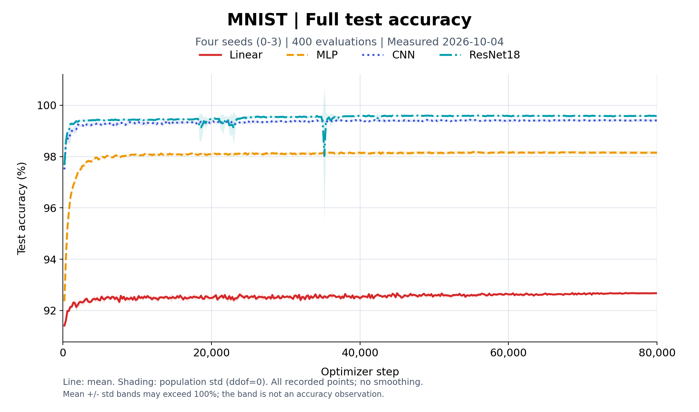
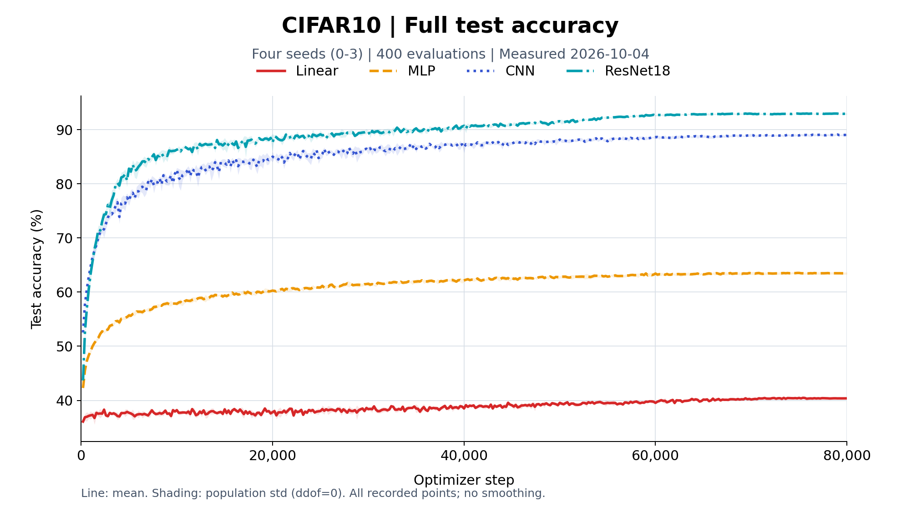

# RPipe

RPipe（Research Pipeline）是研究项目的代码架构与执行模板，本仓库的参考实现使用 Python 包名 `rpipe`。用 YAML 声明实验因素与 seed，展开并运行实验，再将配置、结果、日志、checkpoint 和跨 seed 汇总保存到同一 Study 中。

当前模板版本为 **0.3.0（阶段版）**，提供项目入口参考、原生 PyTorch / Hugging Face Trainer 通路、checkpoint/resume、运行日志与跨 seed 聚合。上个版本以来的完整改动、迁移和验证边界见 [v0.3.0 发布报告](docs/releases/v0.3.0.md)。

其他项目接入从[在其他项目中使用 RPipe](#在其他项目中使用-rpipe)开始：将固定版本的源码复制到项目的 `src/rpipe/`，按 structure / flow 两柱组织自己的代码，在自己的仓库声明和运行 Study。

2026-10-13发布准备阶段完成恢复、设备调度及持久化 / 数值比较边界修复，详情见[开发记录](docs/development/record.md)。严格研究对照须两侧显式相同计算精度，不依赖Torch默认TF32；短探针和容量校准不替代新基线的完整长实验。

## 本机实测（2026-10-04）

### MNIST / CIFAR10 训练曲线

MNIST / CIFAR10 × linear / mlp / cnn / resnet18 × seeds 0–3：**32 条连续 80000-step 训练与 32 条自身 best 独立评测全部成功**。每条训练每 200 个 optimizer steps 完整评测 10000 张 test，共 400 个点。下图保留为实例 Study 的实测验证，不是所有下游项目的验收结果。图为本机实际训练曲线，横轴是 optimizer step，实线为四 seed mean，阴影为 **population std（ddof=0）**，保留全部点和瞬时波动。





两图使用训练中的完整 test history，独立 eval 的 best 没有替代曲线终点。实验使用 Study 专用配方与固定环境；完整配置、数值、环境和验收范围见 [实测报告](https://github.com/DreamSoul-AI/RPipe/blob/18cd76c/studies/main_historical/docs/STUDY_REPORT.md)（2026-10-04，原 Study `main_historical`）。该 Study 已改名为 [main_exp](studies/main_exp/README.md)。

2026-10-13 的异机分支复验固定 v0.3.0 / `804b3823`，已报告 main_probe 八格 60-step 终验和 main_exp 的 32 train / 32 own-best eval、固定曲线门全部通过，见 [probe 报告](studies/main_probe/docs/STUDY_REPORT.md) / [长实验报告](studies/main_exp/docs/STUDY_REPORT.md)。两条长训练中断后以新身份从 step0 重跑，不能称一次连续 launch；报告与正式 JSON / 图已同步，原始 Run、checkpoint 和临时日志不随 Git 提供。上方两图仍保留为 2026-10-04 的实例，未替换成新一轮结果。新发现的报告来源缺陷 [B-030](docs/development/bugs.md) 仍未修复，本轮通过额外身份核对避免混入旧聚合。

## 核心模型

```text
Study
  └─ Experiment（axes 的一个取值组合，不含 seed）
       └─ Run（Experiment × seed 的一次实测）

src/rpipe/
  ├─ structure/   # control、data、model、algorithm、system、artifact、make
  └─ flow/        # prepare → execute → collect → summarize → write → process
```

- **structure** 定义一次 Run 如何组成，并由 `make` 将 Study 声明展开成 config、index 和调度计划。其中 `structure/artifact/` 管理 Study / Run 的磁盘契约，readout 将 index、result、日志和 `process.json` 读成表；artifact 不是与两柱并列的一层。
- **flow** 是跑 Study 的入口：对每个 Run 执行固定阶段链，最后按 Experiment 跨 seed 聚合。`status` / `logs` / `report` 从 cli 进来，转给 readout。

Flow 的默认阶段是实际执行代码，不是空骨架：普通阶段实现在 `flow/<phase>/run.py`，process 按 Run / Study 聚合拆成独立模块；`__init__.py` 只做导出。Study 的同名目录仅承载可选扩展，没有扩展时仍执行库默认链。展开到文件的目录见 [layout.md](docs/code/layout.md)、[flow.md](docs/code/flow.md)。

## 文档顺序

Agent 的文档导航与通用工作约定见 [AGENTS.md](AGENTS.md)。

设计与代码冲突时，先更新文档，再更新实现。权威阅读顺序是：

1. [concept.md](docs/code/concept.md)：概念、职责与边界
2. [layout.md](docs/code/layout.md)：仓库和 Study 的目录契约
3. [code.md](docs/code/code.md)：模块边界与依赖方向
4. [structure.md](docs/code/structure.md) / [flow.md](docs/code/flow.md)：两柱的详细契约
5. [Study 使用指南](#study-使用指南)：如何设计和运行一轮 Study；[Study 导航](studies/README.md)列出现有研究的计划、报告和代码
6. [testing.md](docs/development/testing.md)：测试策略、标签和结果持久化

已知缺陷见 [bugs.md](docs/development/bugs.md)，开发记录见 [record.md](docs/development/record.md)，Flow/Study 重构交接见 [handover.md](docs/development/handover.md)，阶段性想法见 [brainstorm.md](docs/development/brainstorm.md)。

## 在其他项目中使用 RPipe

下游项目采用**源码复制与架构复用**：把 RPipe 源码放进自己的 `src/`，以 structure / flow 组织项目实现，而不是把 RPipe 作为 pip / Git URL 外部依赖。通用展开、调度、阶段链与产物直接复用这份代码，项目保留自己的科学算法或运行时；例如量化、解码、内存卸载的内部执行不必强改为研究六阶段。

### 1. 将固定版本源码复制到 src

当前 v0.3.0 对应 main 提交 `804b3823ab6d2af46cbda1a65688ca8b76c60b22`。先取得该版本的 checkout，以下命令在下游仓库根执行；已有该版本 checkout 时可直接使用，不必重新 clone：

```bash
git clone --branch v0.3.0 https://github.com/DreamSoul-AI/RPipe.git .tmp/rpipe-v0.3.0
git -C .tmp/rpipe-v0.3.0 rev-parse HEAD
```

确认 HEAD 为上述提交后，复制完整 `src/rpipe/` 包和许可证。Windows PowerShell 示例：

```powershell
if (Test-Path -LiteralPath src/rpipe) { throw 'src/rpipe already exists; compare before updating' }
New-Item -ItemType Directory -Force src | Out-Null
Copy-Item -LiteralPath .tmp/rpipe-v0.3.0/src/rpipe -Destination src -Recurse
Copy-Item -LiteralPath .tmp/rpipe-v0.3.0/LICENSE.md -Destination src/rpipe/LICENSE.md
```

不要覆盖已有副本：升级时先比较上游差异和本地修改，再迁移及回归。只复制受 Git 管理的源码，不带 `__pycache__`、本地缓存或运行产物。保持包名 `rpipe` 与内部导入；记录 `src/rpipe/ORIGIN`，至少包含上游仓库、确切 commit、release 和本地差异，不能只记 `main` 或包版本号。

运行环境要求 Python 3.10 或更高版本，第三方依赖按 [pyproject.toml](pyproject.toml) 核对；复制源码不会自动准备 PyTorch / torchvision、数据或设备环境。这里不以包安装作为项目接入步骤。

`src/rpipe/` 始终保留为项目内的基础模板，不能用研究包替换、删除或改名。项目可以 import、继承、组合或按需要重构对应实现，改动先明确与模板的接口和数值差异；已有通用能力优先复用，不零散搭第二套入口。无需复制 RPipe 的历史实验、数据或 `.github/workflows/`。

### 2. 在自己的仓库跑通最小 Study

先让 Python 找到项目自己的 `src/`。PowerShell 示例（bash 使用 `export PYTHONPATH="$PWD/src"`）：

```powershell
$env:PYTHONPATH = (Resolve-Path src).Path
python -c "import rpipe; print(rpipe.__version__, rpipe.__file__)"
```

导入路径必须落在当前下游仓库的 `src/rpipe/`，不能实际使用另一个 checkout 或已安装的旧包。已有打包/开发环境同样须核对这一点。

在下游仓库创建 `studies/smoke/`，先在 `studies/smoke/docs/PLAN.md` 说明这只是源码接入与产物合同验证。以下两个文件即可跑离线 CPU Toy/Stub，不下载数据或使用 GPU。

`studies/smoke/study.yaml`：

```yaml
study: downstream_smoke
seeds: [0, 1]
axes:
  algorithm.mode: [train, eval]
freeze: true
```

`studies/smoke/experiment_config.yaml`：

```yaml
version: downstream-smoke-v1
data:
  name: Toy
  source: stub
model:
  name: linear
algorithm:
  source: custom_torch
  mode: train
  num_steps: 2
  progress_unit: step
system:
  device: cpu
  deterministic: true
  cudnn_benchmark: false
```

下面先用复制后的 `rpipe` 参考入口验证模板，路径指向临时 smoke Study；这不规定研究项目以后的入口名称。项目建立自己的入口后，应使用该入口验证同样的流程：

```bash
python -m rpipe make studies/smoke --num-gpus 0
python -m rpipe launch studies/smoke --num-gpus 0
python -m rpipe status studies/smoke
python -m rpipe logs studies/smoke
python -m rpipe report studies/smoke
```

预期生成两个 Experiment、四个成功 Run，以及 Study 根的 `process.json` 和 `docs/NUMBERS.md`。`launch` 完成后会执行 Study 聚合；只重建聚合可用 `python -m rpipe process studies/smoke`。Toy/Stub 只证明源码接入与流程合同，不证明模型数值、GPU 性能或研究质量。正式研究再参考 [Study 模板](studies/_template/) 和下方[使用指南](#study-使用指南)，替换真实数据、模型、算法和验收计划，不沿用 smoke 的预算或结论。

### 3. 接入项目自己的代码

目录保留 structure / flow 及同名子目录，Study 也保持相同结构；各阶段是否添加实现按实际职责确定，图中不展开代码文件：

```text
my_project/
  docs/research/                     # 宏观研究方向与方案
  src/
    rpipe/                          # 始终保留的基础模板
      structure/
      flow/
    my_project/                     # 项目研究代码
      structure/
        api/
        control/
        data/
        model/
        algorithm/
        system/
        artifact/
        make/
      flow/
        prepare/
        execute/
        collect/
        summarize/
        write/
        process/
  studies/my_study/
    study.yaml
    experiment_config.yaml
    structure/                      # 导入 src 项目实现
      api/
      control/
      data/
      model/
      algorithm/
      system/
      artifact/
      make/
    flow/                           # 与 src 的同名阶段对齐
      prepare/
      execute/
      collect/
      summarize/
      write/
      process/
    docs/
      PLAN.md
      STUDY_REPORT.md
```

三处代码使用同一套目录与职责：`src/rpipe/` 是基础模板，`src/<项目名>/` 是研究实现，`studies/<name>/` 是研究声明和薄组装。研究实现优先放 src 的项目包，Study 通过同名 structure 适配与 flow 扩展 import 它们，不把项目算法另写一遍。structure 定义配置、对象和领域能力，flow 组合这些能力并协调执行；项目按对应层的职责组织实现，不在 `__init__.py` 堆业务逻辑。

| **职责层级** | **src/rpipe 与 src/项目包** | **Study 中的对应位置** |
| --- | --- | --- |
| 建构与结构 | `structure/api`、`control`、`data`、`model`、`algorithm`、`system`、`artifact`、`make` | `structure/` 下保持相同层名，导入 src 实现并做本 Study 的组装 |
| 执行阶段 | `flow/prepare`、`execute`、`collect`、`summarize`、`write`、`process` | `flow/` 下保持相同阶段名，入口调用 src 项目包的对应实现 |
| 入口与实现 | 包入口只导出，实现放职责模块 | Study 导入项目实现，目录示意只展示同名层级和阶段 |

“同结构”指相同的分层、目录语义和实现落点，不是为每层复制一份无修改代码或填写空函数。只建立实际需要的模块，无项目差异时可以直接复用 RPipe；需要重构时在相同职责位置实施并验证。分层与依赖方向见 [代码结构](docs/code/code.md)。

| **需要接入的内容** | **做法** |
| --- | --- |
| 新数据或模型 | 通过 `DataRegistry.register(name, source, builder)` / `ModelRegistry.register(name, source, builder)` 注册，YAML 中点名相同的 name/source |
| 专用计算，如量化、解码、卸载测量 | 实现 `Algorithm` 的 `run(data, model, system, tracker)`，通过 `AlgorithmRegistry.register(mode, source, impl)` 注册；复用已有计算，不重写通用执行链 |
| 额外来源、指标或质量门 | 按真实职责添加 Study 阶段扩展；没有额外职责时使用库默认阶段 |
| 项目自己的 Engine 或其他运行时 | 由专用 Algorithm / 薄适配组合使用；领域核心不必依赖 RPipe，也不替换库的调度与运行状态 |

v0.3.0 提供上述 Data/Model/Algorithm Registry，没有 `SystemRegistry`；设置 `system.source` 不会自动切换 SystemFactory 的实现。专项运行时由项目适配组合使用，库的原生 System 继续负责设备、日志和 checkpoint，不通过虚构配置键接入新后端。

项目自己的入口、注册和建构由 `src/<项目名>/` 的对应层负责，Study 的同名 structure/flow 导入这些实现。模板提供的现有扩展接口及函数签名见[结构合同](docs/code/structure.md)和[阶段合同](docs/code/flow.md#14-study-扩展recipe来源清单run-对比)，不把某一个入口文件作为所有项目必须照搬的目录项。

添加阶段时在 `study.yaml` 显式设置 `flow: {study_phases: true}`。实现放 `flow/<phase>/run.py`，同目录 `__init__.py` 仅 `from .run import run`；旧 Study 根目录阶段包须迁移。prepare.before 在构造前，write 扩展在库成功定稿前，其余扩展在对应库阶段后；质量门在 summarize 或 write 扩展中完成，须早于库的成功定稿，不靠成功后的 process 追改 result。process 必须区分 `ctx.scope == 'run'` / `'study'`，不完整矩阵不能报告整轮通过。完整时序见[阶段扩展合同](docs/code/flow.md#14-study-扩展recipe来源清单run-对比)。

默认 make 会准备共享数据；需要隔离准备或特殊来源时才设置 `flow.prepare_shared: false`，由项目显式准备入口或 Study prepare/Data builder 承担。该开关不是吞掉未知 source 或跳过来源检查的方法。

### 4. 冻结来源、验证和交付

本模板的 make 记录实际使用的源码、声明、注册适配、Study 两柱源码及生成计划；`freeze: true` 在执行和聚合前拒绝来源变化。**项目包 `src/my_project/` 不自动纳入**，需要在 make 前生成 Study 内的项目源码清单，将其加入 `provenance.include`，并在构造前及终验核对实际包的新增、删除和修改；只冻结清单文件不能证明外部包未变。模型、tokenizer、数据及专项输入同样由项目明确核验。环境记录不参与 freeze 比较，不等于异机数值保证。

每次独立复跑或上游源码迁移使用新 `version` / Run ID；重新 make 不会清除旧成功结果，不能用重签来源把旧结果算成新验收。先做小规模真实数值与失败边界验证，再按已授权计划扩大。单个 Run 成功、Study 聚合完成与专项质量通过分别记录；`report` 生成数字表，不代写研究结论。

并行复用 make/launch 的 wait 组，先按目标设备和配方校准显存、主存、线程及 I/O；不照搬示例并发数或显存预算，不让多个进程写同一个 Run。库的 train/eval 依赖保护不是通用 DAG，专项多步依赖需由项目明确处理。性能对照期间不并行运行竞争资源的任务。自定义采样器或专项 Algorithm 的精确恢复须单独验证，不能由库的 resume 能力直接推定。

正式计划、报告、图和复跑代码放自己的 Study。将本 README 的 [Study 忽略项](#study-中什么进-git)落实到下游 `.gitignore`，临时输出放 `.tmp/`；复制 src 不会复制忽略规则或 GitHub 设置。新建项目可参考模板，但模板会复制 workflow 文件，不继承本仓库的开关和分支规则，详见[模板接入说明](docs/development/cicd.md#模板派生仓库)。继续运行 RPipe 自身的历史对照应 clone 原仓库，不能用只有新历史的模板替代。

### 5. 给 Agent 的重构指令

在目标研究项目中使用下面的 prompt，将 `<RPipe 参考路径或仓库链接>` 替换为可读取的 RPipe checkout 或 `https://github.com/DreamSoul-AI/RPipe`。按需指定模板版本与当次授权；不填写时先核对可用基线，记录确切提交，只重构和做小规模验证，不自动推送或启动大规模实验。本段是任务指令，不替代上面的接入与阶段合同。

```text
请实际将当前研究项目按 RPipe 的架构重构，不只给建议。
参考：<RPipe 参考路径或仓库链接>。

1. 先查看工作区状态和项目 AGENTS.md，保留已有修改。阅读本项目 README、相关设计、docs/research、Study 计划与报告；再读 RPipe README，重点遵循“在其他项目中使用 RPipe”“Study 使用指南”“开发与 CI”及其链接的 concept、layout、code、structure、flow 和测试文档。确认文档与代码差异，不把现状直接当成设计。参考资料无法取得时如实说明，不凭记忆编造接口。

2. 按 README 采用源码模板，不以 pip / Git URL 外部依赖接入。将选定基线的完整源码放入本项目 src/rpipe/ 并长期保留，记录上游 commit、版本与本地差异；已有副本先比较，不覆盖或删除。src/<项目包名>/ 放本项目实现，研究包名从现有代码确认，优先复用原算法和 RPipe 的已有能力。

3. 项目包和 studies/<name>/ 都按 RPipe 同名职责目录组织：structure 下为 api、control、data、model、algorithm、system、artifact、make；flow 下为 prepare、execute、collect、summarize、write、process。artifact 不独立于两柱。保持目录语义与依赖方向，不机械复制通用代码、不写无用空函数，业务实现不堆在 __init__.py。Study 只声明、导入和薄组装 src 中的实现，不再维护另一套算法、训练循环、调度或产物系统。

4. 先写明旧代码到新职责的映射、复用点、接口与配置迁移、阶段输入输出、调用时机和成功条件，再修改实现。保留研究算法、数值口径、原始证据与必要兼容；确需改变行为时记录原因并做对照，不能只搬目录或靠 hook 存在宣布完成。项目可以按对应职责重构模板实现，但必须记录差异并回归验证。

5. 从 docs/research 的宏观问题提取可独立验收的具体 Study，先写 PLAN：对照、变量、固定条件、来源、精度、seed、预算、指标、成功门与停止规则；宏观资料缺失时明确问题后补充，不编造来源。按 README 接通阶段、来源核验和 provenance，确认项目源码新增、删除、修改都能检出；独立复跑用新 version，不把旧成功结果算作新验收。

6. 使用项目真实入口，不强制叫 python -m rpipe；先确认它复用或接通了哪些模板命令，不能照抄不存在的参数。先做源码导入、模板 smoke、真实项目最小 Study、关键失败边界与受影响回归。分别报告执行完成和研究质量通过，不把 Toy/Stub 通过当成真实数值验收。

7. 并行运行先校准设备、显存、主存、线程和 I/O，显存系数可调整，不规定固定比例。复用已有调度，避免多个进程写同一 Run；并行 pytest 使用不同 basetemp，性能对照不混入竞争任务。大规模实验只在小验证通过且已有明确授权时执行。

8. 同步项目 README、设计、Study 计划/报告、测试与 .gitignore。临时文件放 .tmp，正式实验材料放对应 Study。参考 RPipe CI/CD 使用 main/dev，工作分支从 dev 建立，经 PR 进入 dev，发布再由 dev 经 PR 进入 main；已有不同分支体系先明确迁移，不擅改远端规则。GitHub Actions 可选，关闭时仍要本地验证，未执行不能记为通过。

在当前授权范围内持续完成文档、重构和验证，不停在方案阶段。提交、推送、合并、发布、清理旧证据及大规模实验遵循当次明确授权。最终简要交付结构映射、真实运行命令、验证结果、剩余风险和未执行事项。
```

## 快速开始

下游项目先将固定源码复制到 `src/rpipe/`，核对实际导入路径，再跑[四个 CPU smoke Run](#2-在自己的仓库跑通最小-study)。正式研究按下方 Study 指南准备声明、src 实现和计划，通过小规模验证后再按授权扩大。

## Study 使用指南

以下 §1–§9 从声明、目录、排班到结果说明如何在项目内做 Study。开始前先完成[源码复制与项目架构](#在其他项目中使用-rpipe)；正式 Study 导入 `src/<项目名>/` 的实现，不在 Study 另搭一套研究执行框架。现有研究入口与历史记录见 [Study 导航](studies/README.md)。

- [§1 概念](#1-三个词决定你写什么)、[§2 文件与目录](#2-你要准备的文件)
- [§3 并行排班](#3-高效率实验设计)、[§4 执行命令](#4-一条命令怎么跑)
- [§5 基底配置](#5-写-experiment_configyaml)、[§6 Study 声明](#6-写-studyyaml)
- [§7 结果与报告](#7-跑完看什么)、[§8 操作清单](#8-新-study-最小步骤)、[§9 扩展边界](#9-现成能力-vs-要改库)

### 1. 三个词（决定你写什么）

| **比较项** | **Study** | **Experiment** | **Run** |
|--|-----------|----------------|---------|
| 是什么 | 这一轮研究的壳 + 磁盘根 | 研究因素的一个取值点 | 该点 × 一个 seed 的一次实测 |
| 含 seed？ | 声明 `seeds` | **不含** | **至少**一个 |
| 例子 | `mnist_train_size`（声明在 `tests/_data/studies/`） | `train_size=500` | `train_size=500, seed=0` |
| 磁盘 | `studies/<name>/` | **无文件夹** | `runs/<id>/` |
| 这一级看什么 | 声明、shared、index、process 信封、报告 | 跨 seed 的 **mean / std / min / max** | 这一次的 config / result / `run.log` |

展开：`study.yaml` 的 **`axes`** → 多个 Experiment；每个 × **`seeds`** → 多次 Run。

`experiment_config.yaml` 是 Study 的**基底默认**（怎么训、用什么数据/模型），不是「一个 Experiment 实例」。

---

### 2. 你要准备的文件

最少两份声明 + 一份计划（建议）：

正式研究或可复用的验收案例放 `studies/`。一次性环境排错（例如文件占用、杀毒软件开关复测）放 `.tmp/diagnostics/`，把条件、结论及必要数字合并进关联 Study 报告；原始日志、缓存和临时配置保留本地，不为每次排错增加一个正式 Study。

研究项目从 `docs/research/` 的宏观方案提取一个具体问题，再写本 Study 的对照、变量、预算和验收；拆分步骤见 [Studies 入口](studies/README.md#从宏观研究提取具体-study)。Study 不等于整个宏观方向，也不以已有脚本代替研究设计。

```text
studies/<name>/
  study.yaml
  experiment_config.yaml
  structure/                       # 同名层级，导入 src 项目代码
    api/
    control/
    data/
    model/
    algorithm/
    system/
    artifact/
    make/
  flow/                            # 同名阶段，不展开阶段文件
    prepare/
    execute/
    collect/
    summarize/
    write/
    process/
  docs/
    PLAN.md
    STUDY_REPORT.md
    figures/
```

`docs/NUMBERS.md` 不在这份清单里：`report` 从 `process.json` 生成，可以入库，但它不是结论。

跑完后会补上，默认不入库：

```text
  index.json                 # 按 Experiment 列 Run；每条含 log → 该 Run 的 run.log
  process.json               # Study 信封；experiments[] 里是跨 seed 的 mean / std / min / max
  shared/{data,model}/       # Study 级 asset：make/launch 先准备共享数据，再 spawn
  runs/<id>/
    config.yaml              # 这一次 Run 的完整 config
    result.json              # Flow write：摘要（status / metrics / paths）
    assets/
      tracker/               # AlgorithmTracker 数字曲线
      logs/run.log           # 这一次 Run 的 Logger 文本（无 Study 级总 log）
      checkpoints/           # latest.pt + latest/（分件）；save_best 时另有 best
```

#### 模版目录（`studies/_template/`）

```text
studies/_template/
  study.yaml
  experiment_config.yaml
  structure/                       # 同名层级，导入 src 项目代码
    api/
    control/
    data/
    model/
    algorithm/
    system/
    artifact/
    make/
  flow/                            # 同名阶段，不展开阶段文件
    prepare/
    execute/
    collect/
    summarize/
    write/
    process/
  docs/
    PLAN.md
    STUDY_REPORT.md
    figures/
```

PLAN 里写清：比什么、固定什么、几个 seed、同类怎么一组、失败后如何恢复及其支持边界。复制后把 `my_study` 改成新目录名。Study 与 src 的研究包都保持 RPipe 的 structure/flow 职责映射；模型、算法和领域流程在 src 实现，Study 导入并声明本轮因素与验收。

新 Study 复制 `_template/`，改 yaml 与 `docs/`；格子与脚本由 **structure.make** 生成，入口由项目自己的 src 实现确定；本仓库实例使用 `rpipe`，下游可使用自己的模块或脚本。

---

### 3. 高效率实验设计

追求的是**这一轮 Study 的实验效率**：在质量和资源边界内提高总吞吐、缩短墙钟，不规定必须占满显存或使用固定资源系数。并行是排班手段，写进 `docs/PLAN.md`，和「比什么、几个 seed」一起定。

| **先分清** | **是什么** | **不是什么** |
|--------|--------|----------|
| `axes` | 研究因素，决定有几个 Experiment | 并发数 |
| `seeds` | 每个点要复测几次 | 同时开几个进程 |
| 并行 / `--round` | 同一时刻叠几个 `run-one` | seed 个数、模型个数 |

保留模板分组调度时，一组并发叫一个 **wait 组**。组内按项目校准的预算并行执行，组末 **`wait`**：本组进程全部退出、资源释放后再启动下一组。不能去掉等待后直接叠加下一批，否则可能超出本轮资源预算。

一组 `wait` 的墙钟由组内最慢任务决定。模板 make 的 conservative 墙钟只供排班参考，不是实测；任务混合会影响竞争和等待，实际分组以整体吞吐测量为依据，不仅按模型名称或单条耗时判断最优。

**标准（按优先级）：**

1. **正确性先于速度。** 默认整轮 launch：有依赖就分波，全部 train `wait` 完再 eval。也可以 `--mode eval` 单独重跑评测。已 `succeeded` 的默认跳过；中断恢复须符合对应 Algorithm / Study 的合同，不能自动推定自定义循环可精确续跑。一次 `FlowRunner` 只跑一个 Run。
2. **先校准再提高并发。** 同类、相近耗时的格子按目标设备与工作负载的实测容量安排并发，估算系数、显存预算和并发上限可随校准调整，不规定统一比例，并测量整体吞吐、allocated / reserved、进程开销、主存、线程和 I/O。不能直接照搬其他设备预算或用“无 OOM”证明并行有效；性能校准时不同时运行竞争资源的验证。
3. **error 不阻断无关任务。** 某条 `run-one` 失败：记下 `run_id` 和退出码（日志在该 Run 的 `assets/logs/`），同组其余进程继续。本波结束后库对失败格子重试一次，恢复行为仍受专项合同约束；拒绝恢复的 Study 须保留失败并按计划换新 version。依赖该 train 的 eval 只有在它成功后才运行，不把局部故障扩散到其他 seed。
4. **按本轮格子排班。** 轻的同类型可以叠很多；重的 resnet 可能一组 1～2 个。不要用一个全局 `--round` 把轻重砍齐。默认 `auto` 按类型装箱；`--round N` 是均匀切块。
5. **PLAN 里写清排班。** 几个 seed、哪类一组、error 后怎么续。报告里复述实际怎么跑的。

显存估算系数是可调整的项目参数，不是模板规定的固定比例。参考容量函数已有 `safety` 参数，项目可在对应 structure/make 实现中接入校准值；当前 rpipe CLI 未提供独立的 safety 开关，不能把示意配置写成已支持的命令。无论采用哪个入口，都记录实际预算、系数与验证结果。

`system.device` 决定资源队列：`cpu` Run 不绑定 GPU、不设置 `CUDA_VISIBLE_DEVICES`，按 CPU 并发上限分组；`cuda` Run 才探测 GPU 并按显存装箱。混合 Study 中两类 Run 分组执行。默认整轮仍是 train 全部完成后再进入 eval；`--mode` 可以只发其中一波。

机制（进程并行 / `wait`、脚本入口）见下一节。

---

### 4. 一条命令怎么跑

`<project_entry>` 是项目实际入口的占位符，例如 `my_project`，不是可直接照抄的命令。本仓库实例使用 `rpipe`；下游项目可以在 src 的 flow 层复用或重构入口。下列流程仅适用于保留相应模板命令合同的项目，参数和脚本名以项目实现为准，不要求入口始终叫 rpipe。

```bash
# 只写出格子：config + index
python -m <project_entry> run studies/<name> --skip-launch

# 写出格子并按顺序跑每个 Run
python -m <project_entry> run studies/<name>

# 写出格子与调度脚本，再按 §3 同类装箱并行
# pack 只出现在 make；launch 复用 scripts/jobs.json
python -m <project_entry> data studies/<name>
python -m <project_entry> make studies/<name> --num-gpus 1 --init-gpu 0
python -m <project_entry> launch studies/<name> --num-gpus 1 --init-gpu 0
# launch 结束会跑 Study process；也可单独再跑：
python -m <project_entry> process studies/<name>
# 默认 --round auto（装箱）。手写均匀切块：--round 4
# 也可在独立终端跑：
#   studies/<name>/scripts/launch.ps1
#   bash studies/<name>/scripts/launch.sh
```

`data` 先给每个数据集写一份概况：`studies/<name>/shared/data/<数据集>/stats.yaml`（张数、形状、类别数量、像素范围，以及 train 的 mean / std）。Normalize 优先读这份文件。

排班标准见 §3。保持与 git `main` 一致的组内进程并行 / 组末 wait；生成脚本复用同一调度器，以免裸 `run-one` 绕过失败重试和依赖检查。

进程级并行。保留模板 `auto` 策略时按同类分组，资源预算及估算系数由项目校准，不把模板初值当作固定要求。每组末尾的 `wait` 挡住下一组，避免还在占显存时下一波挤进来。某条失败打印 `error <id>`，在本波结束后对失败格子 `resume` 重跑一次；train 的重试必须在 eval 波之前完成。手写 `--round N` 仍是均匀切块。

有 `algorithm.mode: eval` 时，**默认**一次 `launch` 拆成两波：全部 train `wait` 完再启动 eval。Study 可以按这个写 PLAN。要单独重跑 eval（或只发 train）：`python -m <project_entry> launch studies/<name> --mode eval`。已成功的格子默认 skip，加上 `--include-done`。单条仍可用 `run-one`。eval 找不到 sibling `best` 照样失败。

**失败恢复验收约定：** `launch` 按当前 index 的同因素（仅替换 mode）与同 seed 识别 sibling train；它最终未成功时，不启动依赖它的 eval，并将该 eval 记为非成功，其他独立任务仍可继续。开始重跑 train 前，已成功的相关 sibling eval 必须失效，防止 `--mode train` 后聚合旧评估。后续 launch 还会将父 train 未成功、或 train result 修改时间晚于 eval result 的旧成功 eval 视为待重评；不因此重写 jobs 清单，清单漏掉的 Run 仍需 `--remake`。`resume: false`、明确的外部权重或 eval 自己的 checkpoint 不应被误当作 sibling 依赖。

这是本地 `launch` 的依赖保护，不是通用 DAG 或文件来源追踪系统。手动修改/复制权重、回拨文件时间，或绕过调度器直接 `run-one`，不在自动失效承诺内；研究结论仍需核对实际 checkpoint 来源。`--include-done` 只是重执行，不清 checkpoint；需要独立无中断对照时换新 `version`。

以本仓库 `tests/_data/studies/mnist_train_size/` 复制成 `studies/mnist_train_size/` 为例：18 次 Run，分别是9 train和9 eval；实际 wait 组数由设备及资源估计决定，不保证只需两组。下游项目不必复制这套测试输入，按自己的计划声明因素。该例入口：

```bash
python -m rpipe launch studies/mnist_train_size --num-gpus 1 --console shared
# 或使用 make 生成的脚本
bash studies/mnist_train_size/scripts/launch.sh
```

`launch.sh` 用 Python heredoc 调用同一 `launch_jobs`，保留 make 生成的 wait 组及 GPU 分配；`--split-round` 仍按 wait 组切脚本，按顺序执行各片段，最后一个片段执行 Study process。每组子进程全部退出后下一组才启动。旧版已生成的裸 `run-one` 脚本不会自动变更，需要重新 make 后使用新脚本。

训练 Logger 每一行是 `时间 级别 Run id [事件] 内容`，写入该 Run 的 `run.log`（与终端同一套）。时间是本地 RFC 3339（毫秒和时区）。`--console shared` 时终端会混，靠 Run id 这一格分辨；文件仍是每 Run 一份。`[time]` 里的 `elapsed` / `eta` 是这一轮的进度时钟。Windows 上 `python -m <project_entry> launch` 默认 **每个 run-one 一个新控制台窗口**。`launch.ps1` 只转调 `launch`（有 `jobs.json` 就不再 make）。多卡时仍设 `CUDA_VISIBLE_DEVICES`。`scripts/` 默认 gitignore。

Windows / Conda 若报 `OMP: Error #15`，说明环境里加载了多份 OpenMP runtime。先用 `where.exe libiomp5md.dll` 检查来源，并在同一个包管理器中重装 PyTorch / NumPy，或改用干净虚拟环境。`KMP_DUPLICATE_LIB_OK=TRUE` 只能由使用者临时显式设置用于诊断；RPipe 不默认注入它。

1. **make** 读 `study.yaml`，按 `axes` × `seeds` 展开
2. 每个补丁 ⊕ `experiment_config.yaml` → `runs/<id>/config.yaml`
3. 写 `index.json`（每条 Run 带 `log`）
4. 按 `data.name` + `source` 各准备一次共享数据到 `shared/data/`（忽略 `train_size`；只有成功后的 `.ready` 才跳过；半截压缩包会重下；下载不刷 tqdm）。数据地址和模型 hub 都看 Study 的 `origin`。
5. **launch** 读 `scripts/jobs.json` 跑未完成 Run（缺清单或 `--remake` 才再 make）；每个 Run：prepare → execute → collect → summarize → **write** → process

常用参数：

| **开关** | **作用** |
|------|------|
| `--skip-launch` | 只写出 config 与 index（不下载共享数据、不 spawn） |
| `--phases prepare,execute,...` | 只跑列出的阶段；相对顺序不变 |
| `make` | 写出 config、index、`scripts/jobs.json`，并把共享数据落到 `shared/data/`；这里打印 `pack N waits` |
| `launch` | 已有 `scripts/jobs.json` 且 GPU/`round` 一致则直接跑未完成 Run，**不**再 make、**不**重印 `pack`；缺清单、参数变了或 `--remake` 才 make。Windows 默认每条 Run 新窗口；全部 wait 完再跑 Study `process` |
| `--mode` | 仅 `launch`：只发该 `algorithm.mode`（可重复，如 `eval`）。**不**改写 `jobs.json`。已成功的默认 skip，重跑加 `--include-done` |
| `--remake` | 仅 `launch`：忽略已有 `jobs.json`，重新 make 再跑 |
| `--console` | `auto`（Windows=`new` 窗口 / 其它=`shared`）；`new`；`shared` |
| `process` | 只跑 Study 级聚合（信封 + Experiment 的 mean/std/min/max + 图） |
| `status` | 只读，实现在 `structure/artifact/readout/`。把 `index.json` 和各条 `result.json` 列成表。`pending` / `failed` 才填 `note`（见 §7）。`--mode` 可滤。不写文件 |
| `logs` | 同一份 readout。各 Run 的事件行按时间打到终端。不写 Study 级总 log |
| `report` | 同一份 readout。从 `process.json` 写 `docs/NUMBERS.md`。不改 `STUDY_REPORT.md` |
| `--round` / `--num-gpus` / `--init-gpu` | `auto` = §3 按 `system.device` 分流，CUDA 按显存装箱、CPU 按进程上限分组；`N` = 均匀切块；GPU 卡号轮转 |
| `--include-done` | 把 `jobs.json` 里已经 succeeded 的也排进去（仍复用清单；清单里没有的格子才要 `--remake --include-done`） |

直接保留模板 CLI 时，`study run` 是 `run` 的旧别名；项目重构入口后，以该项目实际支持的命令为准。

---

### 5. 写 `experiment_config.yaml`

基底字段对应 structure 四层。native 真训通路：有 `model.module` 且 `Data.iter_batches`（不再要求 `data.name: MNIST`）。`algorithm.source` 默认 `custom_torch`；`transformers_trainer` 用同一套 `optimizer` / `scheduler` / `resume` 键映射到 `TrainingArguments`。

```yaml
experiment: mnist_linear          # 给人看的名字，不是磁盘路径
description: MNIST linear classifier
data:
  name: MNIST
  source: torch                   # torch：真下 MNIST 到 shared/data；stub/Toy：不下载
  config:
    train_size: 1000              # 可被 study.yaml 的 axes 覆盖
    batch_size: 64
    # pin_memory: true            # DataLoader；缺省 false
    # num_workers: 0
model:
  name: linear                    # 默认 MNIST 784→10；CIFAR/SVHN 由 Data.meta.data_size 对齐
algorithm:
  source: custom_torch            # 或 transformers_trainer（同一套键 → TrainingArguments）
  mode: train
  num_epochs: 20              # 有 epoch 概念时：推导并覆盖 num_steps
  progress_unit: epoch        # 本例按 epoch 评 test / 存 latest；默认 step（LLM 只写 num_steps）
  eval_period: 1              # 每 N 个进度单位评 test；0 = 只在训完评一次
  # eval_num_steps: -1        # 正整数限test batch数；缺省 / <0 = 完整test；0报错
  checkpoint: latest          # latest = 覆盖 latest 这一份（.pt 整包 + 目录分件）；percent = 再按总预算百分比留快照
  checkpoint_period: 1        # 每 N 个单位更新 latest；0 = 只在训完写一次
  save_best: true             # 默认：test Accuracy 最好时另写 best；可用 best_metric / best_mode 改口径
  metric:                     # 可选；默认 train/test 都是 Loss + Accuracy（structure.md §6.9）
    train: [Loss, Accuracy]   # 还认 MSE（batch）；RMSE / GLUE 是 full，在 save() 时收口
    test: [Loss, Accuracy]
  # 不要在会覆盖 eval 的基底里写 resume。缺省：train=latest（没有则从头），eval=best（sibling train）
  optimizer: SGD              # 名字；momentum / nesterov / weight_decay 等同层 extras，按构造函数 signature 过滤
  max_grad_norm: 0            # 缺省 / 0 = 不裁。HF Trainer 自带 1.0，必须映射此键
  lr: 0.1
  scheduler: cosine            # 算法层接口；无 / constant = 固定 lr；HF 映射 lr_scheduler_type
  eta_min: 0.0
system:
  device: cpu
  deterministic: false          # prepare 最先落地；true 则 cudnn.deterministic + use_deterministic_algorithms
  cudnn_benchmark: true         # 跟旧 main；deterministic 开时默认关
```

合并规则：`study.yaml` 的 `fixed` 与 `axes` 补丁 **覆盖** 基底同名字段（深层 dict 合并，list 整段替换）。

---

### 6. 写 `study.yaml`

#### 扫研究因素（一个因素一个 Experiment）

```yaml
study: mnist_train_size
origin: foreign                 # Study 级。domestic 时数据走国内镜像，模型 hub 为 hf-mirror.com
description: MNIST train_size sweep → test accuracy

experiment:
  name: mnist_linear

fixed:
  data:
    name: MNIST
    source: torch
    config:
      batch_size: 64
  model:
    name: linear
  algorithm:
    source: custom_torch
    num_epochs: 20
    progress_unit: epoch      # 每个 epoch 评一次 / 更新 latest；不写则默认 step（eval_period: 1 会每步评 test）
    eval_period: 1
    checkpoint: latest
    checkpoint_period: 1
    save_best: true
    optimizer: SGD
    max_grad_norm: 0
    lr: 0.1
    scheduler: cosine
    eta_min: 0.0
  system:
    device: cpu
    deterministic: false
    cudnn_benchmark: true

axes:
  data.config.train_size: [500, 2000, 8000]
  algorithm.mode: [train, eval]

seeds: [0, 1, 2]

tags:
  - when:
      data.config.train_size: 500
      algorithm.mode: train
    tags: [baseline]

run_description: "train_size={train_size} mode={mode} seed={seed}"
```

这会得到 **6 个 Experiment**（size × mode），每个下面 **3 个 Run**。同一 `train_size` 先 train 再 eval；eval 默认 resume `best`，从 sibling train Run 读 `best`。`process.paired` 把 train/eval 拼成报告表。九次训练共用 `shared/data` 里的 MNIST。

#### 只扫 seed（一个 Experiment，多次 Run）

`axes: {}`，因素全部放进 `fixed`，再写 `seeds: [0, 1]`。index 里会是 **一组** `factors: {}`，下面两条 Run（只差 seed）。不需要单独再开一个 Study 目录。

#### 字段约定

| **字段** | **含义** |
|------|------|
| `fixed` | 每次 Run 都带上的补丁（不要把研究因素只写在这里却期望它变成多个 Experiment） |
| `axes` | 研究因素；每个取值组合 = 一个 Experiment。**不要把 seed 放这里** |
| `seeds` | 每个 Experiment 下的随机复测 |
| `tags` | `when` 匹配当前格子（可含 seed）则打标签；`baseline` 只是 tag |
| `run_description` | 写入 config 的说明；**不进** `id` hash。占位符可用轴的末段名（如 `{train_size}`）以及 `{seed}`、`{experiment}` |
| `flow.study_phases` | 显式启用阶段包；`flow/<phase>/run.py` 实现 hook，`__init__.py` 仅导出。prepare.before 在构造前，write 在库定稿前，其余 hook 在库阶段后。旧根目录阶段包需迁移 |
| `flow.prepare_shared` | 默认 `true`；每条 Run 内准备隔离数据或注册专用 source 时设为 `false`，make 不提前构造 Data |
| `freeze` | 复用模板时，make 后已记录的源码、声明、注册适配或计划变化会被拒绝；项目重构后须验证实际冻结范围 |
| `provenance.include` | 额外纳入来源清单的 Study 内文件（glob 列表），例如固定的参考数据或清单 |

#### Study 声明与扩展逻辑

调度、阶段链、来源记录与通用 Run 对比由库提供。Study 在声明之外通过 注册适配、同名 structure/flow 薄适配导入 src 项目包，完成专用计算、数据准备和研究终验：

| **需要** | **用库里的** |
|------|----------|
| 注册 Study 特有的数据、模型或算法 | 导入 src 项目包的注册与建构实现，优先复用模板接口 |
| 记录源码、计划和环境，防止中途改代码 | make 写的 `provenance.json`，加 `freeze: true` |
| 两条 Run 的指标、曲线、checkpoint 是否一致 | `python -m <project_entry> compare <run_a> <run_b> [--atol --rtol --checkpoint NAME --out FILE]` |
| 聚合、数字表、曲线图 | `process` / `report` |

构造前先完成项目的注册与来源核验；Study `prepare.before` 负责隔离准备，`prepare.run` 检查构造结果。collect / summarize 收口数值与判定，write 写证据并在库结果定稿前验收，process 生成派生内容。与外部实现对比时，将已有观测投影为 Run artifact 后复用 `compare`，研究特有的输入、RNG、样本计数和自身 best 等门继续保留。成对计算可通过注册的 Algorithm 执行，每条 Run 只负责自己的组合。

`id` hash **包含** 实验变量、seed、tags，以及可选 `version`；**不含** `id`、`description`。Run 是最底层的一次实测。同内容、同 `version` 再跑仍落到同一 `runs/<id>/`，用于 skip / resume；需要避免相同实验参数与 seed 的不同实测发生 ID 冲突时，换一个 `version` 生成新 Run。timestamp 只是可选内容之一。

version 可写在 `experiment_config.yaml` 顶层，或在 `study.yaml` 的 `fixed` 下覆盖，例如：

```yaml
fixed:
  version: "baseline-repeat-2"
```

这段合并到已有 fixed，不替换其余配置。不要写成 Study 顶层的 `version`，它不会被展开。省略字段保持原有 ID；改变它后重新 make，旧 Run 文件保留，新 index 只列本轮。launch 会复用 jobs，`--include-done` 不清 checkpoint，不代表从头训练。需要保留一次独立实测时使用新 version，不靠删除旧日志或权重实现。

---

### 7. 跑完看什么

**index**（按 Experiment 分组，不是扁平 run 列表）：

```json
{
  "study": "mnist_train_size",
  "experiments": [
    {
      "factors": { "data.config.train_size": 500 },
      "runs": [
        { "id": "…", "seed": 0, "tags": ["baseline"], "config": "runs/…/config.yaml", "log": "runs/…/assets/logs/run.log" },
        { "id": "…", "seed": 1, "tags": ["baseline"] },
        { "id": "…", "seed": 2, "tags": ["baseline"] }
      ]
    }
  ]
}
```

**result**（`runs/<id>/result.json`）：`status`、`metrics`（如 `train_loss` / `accuracy`）、`control`、`paths`。成功则 `status: succeeded`。

**`status`** 把上面两份拼成一张表，只读，不写文件、不跑训练。实现在 `structure/artifact/readout/`，`flow/cli.py` 只转发：

```bash
python -m <project_entry> status studies/<name>
python -m <project_entry> status studies/<name> --mode eval
```

先打一行计数：`planned` / `succeeded` / `failed` / `pending`。然后每条 Run 一行（tab）：`status`、`mode`、`seed`、`id`、因素、一个 metric、失败时的 `error`、`note`、`log`。顺序跟 index。没有 `result.json` 的格子是 `pending`。metric 只在 `succeeded` 时出现，优先 `accuracy`，否则 `best_accuracy` 或 `train_loss`。`pending` 的 `note` 读该 Run 的 `run.log`：最后一条 `[epoch]` 或 `[error]` 摘要，跳过 `Traceback` / `File ` 续行；都没有就用最后一条 `[flow]`。没有日志是 `-`。`failed` 的 `error` 仍是 result 里的消息，`note` 是日志里最后一条 `[error]` 摘要。`succeeded` 的 `note` 是 `-`。`--mode` 只滤显示。缺 `index.json` 则退出码 2。

`launch` 每一组开始前打 `launch: wait i/n mode=train`（失败再试是 `launch: retry`）。结束时再打一行和 `status` 相同的 `planned` / `succeeded` / `failed` / `pending`。不改 `jobs.json`。

`python -m <project_entry> logs studies/<name>` 把各 Run 的事件行按时间打到终端，不写 Study 级总 log。`python -m <project_entry> report studies/<name>` 从 `process.json` 写 `docs/NUMBERS.md`（Experiment 的 mean / std / min / max，以及 Run 表）。不改 `STUDY_REPORT.md` 里的结论。

`make` 进行中会立刻打出阶段（flush），并写 study 根上的 `activity.json`（不进 Git）：`make: origin <foreign|domestic> model <hub>`、`make: expand`、`make: shared <name> download <origin> <url>` / `ready` / `cached`、`make: pack`。另开一个终端跑上面的 `status`，有这份文件时第一行就是当前阶段；index 还没写出时只打这一行也退出 0。make 成功结束后删掉它。下载仍不刷 tqdm。`origin` 写在 `study.yaml` 顶层，不写在 `data` 下。`foreign` 用 torchvision 官方地址和 `https://huggingface.co`；`domestic` 用国内数据镜像和 `https://hf-mirror.com`。缺省 `foreign`，且不改本机已有的 `HF_ENDPOINT`。只有 `.ready` 才跳过；半截包会删掉再下。

`metrics.train_loss` 应是 AlgorithmTracker **最后一段 train mean**，不是最后一个 batch 的 CE。完整曲线在 `runs/<id>/assets/tracker/`；终端同款文本**必写** `assets/logs/run.log`（`时间 级别 Run id [事件] 内容`）。

`process` 分三层含义，对应 concept §2.1：每条 Run 写 `runs/<id>/process.json`。整轮结束后 `process` 写根 `process.json`（Study **信封**）。信封里每个 Experiment 才是跨 seed 的 metrics / history **mean / std / min / max**。图在 `docs/figures/learning_curves.png`。**不**改 `STUDY_REPORT.md`。

Study process 只聚合当前 index 列出的 Run，不扫描旧 version 目录。index 缺失或不可读取时会失败并提示 make，已有 process、图与 result 保留。重建前先确认当前 YAML 就是要分析的那一轮，再执行 make 和 process。

`docs/STUDY_REPORT.md` **必须有图**，并且图和各次 `run.log` **可点开**（Markdown 预览，或源码里 Ctrl+点击）。报告中的图链接用 `figures/learning_curves.png`；log 按 index 的 Study 相对路径转换为报告相对路径 `../runs/<id>/assets/logs/run.log`。数字读 `process.json`。按 Experiment 写结论，不要把 18 行 Run 表当主结论。

---

### 8. 新 Study 最小步骤

1. 复制 `studies/_template/` 为 `studies/<name>/`，对照本指南 §1–§3。
2. 在 src 的研究包实现需要的同名 structure/flow 模块；Study 的建构与阶段入口导入这些实现。改 `experiment_config.yaml` 的基底；改 `study.yaml` 的 `axes` / `seeds` / `tags`。
3. 在 `docs/PLAN.md` 写清：比什么、什么固定、成功标准，以及 **§3 高效率排班**（同类一组、按校准配置并行、error 后在本波重试，成功后才放行依赖 eval）。`make` 之后、`launch` 之前，把每条 Run 的预估秒数写进 **时长预估** 表。同一 `wait` 的墙钟是组内最慢的一条，整轮是各组相加。不含显存。
4. `python -m <project_entry> run studies/<name> --skip-launch`，核对 index。
5. `python -m <project_entry> make studies/<name>`，看打印的 `pack N waits`，再 `python -m <project_entry> launch studies/<name>`（launch 不应再印 pack）。
6. `python -m <project_entry> status studies/<name>` 看谁 `succeeded` / `failed` / `pending`。`python -m <project_entry> report studies/<name>` 把数字表写到 `docs/NUMBERS.md`。读 `process.json` + `docs/figures/learning_curves.png`，按 Experiment 写 `docs/STUDY_REPORT.md`：图做成可点链接，Run 表带各 `run.log` 链接。结论仍由人写。

检查清单：

- [ ] 目录最终有 `docs/`、`shared/`、`runs/`
- [ ] `axes` 与 `seeds` 分开
- [ ] 每个 Run 的 config 含 `seed`
- [ ] 结论按 Experiment 聚合，而不是按扁平 run 列表
- [ ] `PLAN.md` / `STUDY_REPORT.md` 写清本轮怎么并行（同类一组、error 后续跑）
- [ ] `STUDY_REPORT.md` 的「怎么跑的」写整轮预估和实际；Runs 表每行有 `est` 和 `actual`。不另开时长记录，不含显存
- [ ] `STUDY_REPORT.md` 有可点开的 learning curve，以及各 Run 的 `run.log` 链接

---

### 9. 现成能力 vs 要改库

Study 可在 `study.yaml` 写 `flow: {study_phases: true}`。库加载 `flow/` 下的 `prepare/`、`execute/`、`collect/`、`summarize/`、`write/`、`process/` 包；每包在 `run.py` 定义 `run(ctx)`，`__init__.py` 仅通过 `from .run import run` 导出，不能承载函数或业务实现。空目录或没有包入口的手动工具目录不加载，但库默认阶段仍执行，不需要在 Study 复制默认链或填入空 hook。专用建构代码放在 `structure/`。prepare 的 `run.py` 可定义 `before(ctx)`，由包入口一并导出，在库初始化后、recipe / Factory 构造前准备；`run(ctx)` 检查已构造对象。write 先跑 Study 再由库定稿，其他阶段先跑库再跑 Study；未启用时不会自动加载目录。建构前注册通过项目适配接入，现有模板合同见技术分册。两柱全部 Python 源码自动进入来源清单，无须再写重复的 `provenance.include`；固定参考文件等额外输入仍需声明。

`ctx.scope == 'run'` 时是单条 Run 上下文；整轮聚合后还会调用一次 `process.run(ctx)`，此时 `ctx.scope == 'study'`，使用 `ctx.study_dir` 和 `ctx.state['process']`，没有单条 Run 的 layout。只在 Study scope 做终验，避免每条 Run 重复执行矩阵或跨 seed 统计。make 前的下载、数据预检使用显式手动入口（`main_exp` 为 `flow/prepare_data.py`），不接入阶段链。加载、失败和 freeze 的完整合同见 [flow.md §14.0](docs/code/flow.md#140-study-阶段目录)。

| **你想做的** | **怎么做** |
|----------|--------|
| 扫已有字段（样本量、lr、seed…） | 只改 Study 的 yaml |
| 换 MNIST 子集大小 / epoch | yaml 即可 |
| 新数据集、新模型、新训练循环 | 在 src 项目包的相应 structure 层实现，Study 导入并经项目建构接入，再在 YAML 中点名 |
| 换 HF Trainer / Accelerate | 改 `algorithm.source`；`optimizer` / `scheduler` / `resume` 键不变（structure.md §6.11） |
| 独立评测（加载 best） | 另一次 Run：`algorithm.mode: eval`，`resume: best`；不是 Flow 多一个阶段。整波重跑：`<project_entry> launch --mode eval`（已成功加 `--include-done`） |
| 断点续训 | 在已验证的恢复合同内使用 train 的 `resume: latest`；自定义 Algorithm / 采样器不自动获得精确恢复 |
| 调整项目执行链 | 直接复用模板时保持合同；需要重构时先更新设计，再验证调用方、状态和失败边界 |
| 自动出报告 / 跨 Run 对比表 | 人写 `STUDY_REPORT.md`（必须嵌图）。库 Study process 出 mean/std/min/max 和 `docs/figures/learning_curves.png`。`report` 把同一份数字写成 `docs/NUMBERS.md` |
| 训练曲线 | process 优先读 JSONL 的有效训练轨迹：显式 optimizer_step（优先）或 epoch；旧记录 / state history 回退仍用 observation。跨 seed 按坐标并集统计，缺失点不插值，逐点 n 见 process / 图；不同单位分开。原始日志保留回滚分支，恢复规则见 structure §6.9.2。不做 TensorBoard |
| 终端 + 硬盘日志 | **Logger** 必写 `runs/<id>/assets/logs/run.log`（`时间 级别 Run id [事件]`）；失败时 traceback 每一行都是 `[error]`。`index.json` 的 `log` 指向它。没有 Study 级总 log |
| 并行时日志挤在一起 | 文件按 Run 分开；终端每行带 Run `id`。Windows：`launch` 默认 `--console new`；`--console shared` 只混终端 |
| 看这轮谁好了谁挂了 | `python -m <project_entry> status studies/<name>`（只读；`--mode eval` 可滤） |
| 下一组挤进还在跑的实验、显存爆 | 组末必须 `wait`（make 脚本 / `launch` 都这样）；不要手改脚本去掉 `wait` |

脚本里若要编程调用：`from rpipe.flow.cli import run_study`。读写路径用 `rpipe.structure.artifact`；造格子用 `rpipe.structure.make`。

## Study 中什么进 Git

| **内容** | **是否入库** | **原因** |
|------|----------|------|
| `study.yaml`、`experiment_config.yaml`、项目适配、阶段源码 | 是 | 可复现实验声明与 Study 自己的注册配方 |
| `docs/PLAN.md`、`docs/STUDY_REPORT.md`、报告图片 | 是 | 人写的研究计划与结论 |
| `docs/NUMBERS.md` | 可以 | `rpipe report` 从 `process.json` 生成的数字表，不是结论 |
| `runs/`、`shared/`、`scripts/` | 否 | 可重新生成或体积较大的运行产物 |
| `index.json`、`process.json`、`activity.json`、`provenance.json` | 否 | make / process 重建；`activity.json` 只在 make 进行中存在 |
| `.tmp/` | 否 | 本地测试、缓存和临时验证 |
| `docs/*.tmp`、`docs/*.claim` | 否 | 本地事务暂存和执行占用标记；正式恢复/失败快照单独保留 |

数据、运行产物、计划、报告和复跑代码都保存在各自 Study 目录中，不放到 `docs/` 或仓库根目录。

`studies/` 保留正式研究与模板，通用测试声明放在 `tests/_data/studies/`。一次性的文件占用、环境开关等排错放 `.tmp/diagnostics/`，结论合并到相关 Study 报告；本地证据链接不会随 Git clone 提供。

## 开发与 CI

下游模板项目参照 [CI/CD 执行约定](docs/development/cicd.md#下游项目的分支与可选-ci)，保留以下分支关系：

| **分支** | **用途与流转** |
| --- | --- |
| `main` | 正式可发布状态，接收 dev 的发布 PR |
| `dev` | 日常集成基线，接收工作分支的 PR |
| `codex/*` / `feature/*` / `fix/*` / `refactor/*` | 从 dev 建立，完成必要验证后通过 PR 合回 dev |

GitHub Actions **可选**：可以启用适合项目的远端检查，也可以只运行本地验证，不因复制源码而强制接入。没有 Actions 仍需记录真实测试与数值门，不称为“CI 已通过”；核对新仓库是否保留了无法上报的必需检查，规则变更须由该仓库授权。分支保护、评审和发布按实际维护配置核对，不把模板文件当作已配置的 GitHub 规则。

以下是 **RPipe 本仓库**的测试与已启用 Actions，不是下游必须复制的流水线：

```bash
# 快速门：unit + p1 + c1，不跑 slow / external / gpu
python tests/run.py --fast

# 当前 PR 门：unit 的 c1 与 c2，不跑 slow / external / gpu
python tests/run.py --core

# 本地执行链：符合 c1/c2 的 integration/e2e，不跑 slow / external / gpu
python tests/run.py --all --cost-class c1 --cost-class c2 -- -m "(integration or e2e) and not external and not gpu and not slow"

# 显式运行所有已收集测试
python tests/run.py --all
```

pytest 的 base temp、cache 和测试结果都写入 `.tmp/`。测试入口与标记约定见 [tests/README.md](tests/README.md)。

GitHub Actions 配置包括：

- `Unit Tests`：Ubuntu/Windows × Python 3.10/3.13，安装 `.[dev]` 后执行 core 和本地 CPU 流程门；
- `Package Check`：在 Ubuntu/Windows 构建 wheel / sdist，在源码目录之外的全新虚拟环境中安装两种分发包，验证模块入口、console script 与离线 Toy/Stub Study 的 make / launch / process / readout。

各提交的检查状态见 [GitHub Actions](https://github.com/DreamSoul-AI/RPipe/actions)。CPU 安装与流程验收不覆盖所有 GPU 或可选 HF 场景。分支顺序、必需检查和自行合并见 [cicd.md](docs/development/cicd.md)。

## 当前实现范围

- 数据：stub，以及 torchvision 的 MNIST、FashionMNIST、CIFAR10、CIFAR100、SVHN；
- 模型：`custom_torch` 的 linear、MLP、CNN、ResNet、WideResNet；
- 算法：原生 PyTorch train/eval，以及 `transformers_trainer`；
- 运行：顺序执行、按 GPU/wait 组并行、checkpoint/resume、Run 日志与 Study 聚合。

原生精确续训支持单进程、`num_workers=0` 的标准采样器和相同训练预算 / 配置；新 checkpoint 保存 RNG 与数据位置。旧 checkpoint、HF 或未实现恢复协议的数据只保证部分状态加载，并明确警告，不保证等价于连续训练。具体条件见 [resume 合同](docs/code/structure.md#6113-resumetrain-与-eval-的特殊接口)，历史 Study 的续训拒绝门保持不变。

文档中列出的其他下游生态是扩展边界，不代表已经实现；以 Registry 和 [bugs.md](docs/development/bugs.md) 为准。

上述清单表示已有实现，不代表全部模型与数据组合已完成真实运行验收。六个指定组合的 30-step 验收见 [数据报告](https://github.com/DreamSoul-AI/RPipe/blob/71143ab/studies/support_data_smoke/docs/STUDY_REPORT.md) 与 [模型报告](https://github.com/DreamSoul-AI/RPipe/blob/71143ab/studies/support_model_smoke/docs/STUDY_REPORT.md)，模型报告保留 ResNet10 的 Accuracy 复算差异；未解决缺陷见 [bugs.md](docs/development/bugs.md)。
