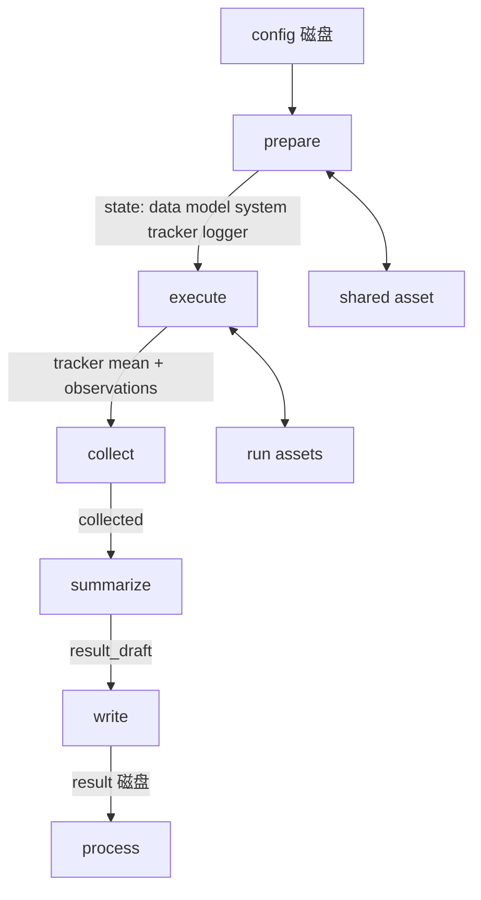

# Code structure · Flow

前置：[concept.md](concept.md) §7、[layout.md](layout.md)、[code.md](code.md)。

并列：[structure.md](structure.md)（含 artifact、make）。

Flow 服务 Study。同一套执行，用参数选择阶段子集、是否先 make、顺序或按 `round` 并行。cli 在 `flow/cli.py`。

make 写出 config、index 与调度脚本，见 `structure.make`。每个 Run 的阶段链：

**prepare → execute → collect → summarize → write → process**

flow 可 import `structure`。阶段保持 config 不变。四层业务在 structure。

**write** 写该 Run 的 result。**index** 由 make 写在 Study 根。

---

## 1. 目录与入口

```
flow/
  __init__.py                # 包入口：只导出，不写流程实现
  cli.py
  context.py
  runner.py
  study.py                   # 可选 Study hook 加载
  prepare/
    __init__.py              # from .run import run
    run.py                   # 读 config，构造对象
  execute/
    __init__.py
    run.py                   # 调用 Algorithm
  collect/
    __init__.py
    run.py                   # 收集指标
  summarize/
    __init__.py
    run.py                   # 生成可序列化草稿
  write/
    __init__.py
    run.py                   # 成功结果定稿
  process/
    __init__.py              # 只导出以下模块的入口
    individual.py            # 本 Run 派生结果
    study.py                 # 整轮 Study 聚合
    aggregate.py             # 结果 / 曲线聚合
    curves.py                # 绘图与显式 JSONL→TensorBoard 展示导出
```

每阶段一个包，约定 `run(ctx: FlowContext) -> None`。实现放 `run.py` 或阶段内按职责命名的模块；所有 Flow `__init__.py` 只保留说明、导入和公开导出，不定义阶段函数或承载业务实现。`FlowRunner` 按 `PHASES` 动态 import 阶段包并调用其导出的 `run`，已有包级调用接口不变。cli 解析参数后：`make` 调 `structure.make`；`launch` 优先读 `scripts/jobs.json`，没有或 `--remake` 才再 make，再对选定 Run 调 `FlowRunner`。

| **符号** | **位置** | **职责** |
|------|------|------|
| `FlowContext` | `context.py` | 贯穿各阶段的上下文 |
| `FlowRunner` / `PHASES` | `runner.py` | 对一个 Run 按序执行阶段；可裁剪阶段；失败时写 failed result |
| cli | `cli.py` | argv → 同一套 Flow；`make` / `launch`（复用 `jobs.json`）/ `--remake` / `--mode`、阶段子集、`round`、GPU、`--console`。`process` 不走单条 Run 的阶段链。`status` / `logs` / `report` / `compare` 转给 `structure.artifact.readout`。`launch` 先过来源清单核对（§14.2） |

`PHASES = ('prepare', 'execute', 'collect', 'summarize', 'write', 'process')`。允许传入子集（例如只跑 prepare 做干检查），但不得打乱相对顺序。

---

## 2. `FlowContext`

| **字段** | **含义** |
|------|------|
| `study_dir` | Study 根（`docs/`、`shared/`、`runs/`、index） |
| `layout` | 本 Run 的 `ArtifactLayout`（`runs/<id>/`） |
| `config` | 本 Run 的 config mapping；prepare 从磁盘读入后覆盖内存副本 |
| `control` | prepare 之后才有；由 config 构造 |
| `state` | 本 Run 内存黑板；**不**直接当 result 落盘 |

`layout` 提供：`config_path`、`result_path`、`assets_dir`、`shared_data_dir`、`shared_model_dir`。data / model 文件走 **asset**（见 structure.md §9.6）。

### 2.1 `state` 约定（谁写、谁读）

| **键** | **写入阶段** | **读取阶段** | **内容** |
|----|----------|----------|------|
| `algorithm` | prepare | execute | 注册的 Algorithm 实例 |
| `runtime` / `recipe` | prepare | summarize / Study hook | 运行时配置记录 / 是否应用 recipe |
| `seed` | prepare | execute 等 | 已落地的 seed |
| `data` / `model` / `system` | prepare | execute、summarize | 运行时对象（可含 Loader / Module） |
| `tracker` | prepare 构造 AlgorithmTracker；execute 每个 batch 更新 | execute、collect、Logger.report | 数字；**不**整棵进 result |
| `logger` | prepare 经 **System** 构造 | execute | 文本；`report(tracker, split, extra)` 打终端并写 `assets/logs/` |
| `observations` | prepare 初始化；execute 可追加短备注 | collect | 非 AlgorithmTracker 的零星观测 |
| `execute` | execute | collect（可选） | 本阶段返回值 |
| `collected` | collect | summarize | `{metrics, observations}` |
| `result_draft` | summarize | write；失败回写 | 可序列化草稿 |
| `result` | write（或 Runner 失败路径） | process | 已定稿 mapping |

规则：runtime handle 只活在 `state`；进 `result_draft` / `result` 必须先投影（structure.md §9.4）。

---

## 3. Runner 与失败

```mermaid
flowchart TD
  start[FlowRunner.run] --> loop{下一阶段}
  loop -->|有| call[module.run ctx]
  call -->|成功| loop
  call -->|异常| fail[尽量 write failed result]
  fail --> rethrow[再抛出原异常]
  loop -->|无| done[返回 result 路径]
```

- 成功：跑完 write 后 `status: succeeded`，再 process。
- 失败：`_write_failed_result` 尽最大努力写入 `status: failed` + `error`（类型名 + 消息），补齐已知 `paths`；**不得吞掉原异常**。落盘自己再失败则静默，优先保证异常向上。
- 失败时 **traceback 进该 Run 的 `run.log`**（与 stdout 同一套；每一行都是 `[error]`，并带时间和 Run `id`）。execute 失败由 execute 写；prepare 等阶段由 Runner 写。prepare 尚未挂 System 时 Runner 先打开同一路径的 Logger。
- 失败时若已有 `control` / `collected.metrics`，写入 result，便于对照哪次 Run 挂了。
- Logger 初始化或首条 start 日志失败同样进入 Runner 失败回写；异常报告所需 Logger 再初始化失败只能放弃日志，不能替换原异常或阻断 failed result。坏日志对象与 peer 保留，result 自身不可写时仍只尽力回写；旧成功保全条件不扩大。
- Runner 的初始冻结拒绝 / process 旧成功保全条件由 runner.py 的私有判断统一表达，范围不变；普通执行失败仍按原合同写 failed。
- process 发生异常时，Runner 保留已有 `status: succeeded` 的 result，记录日志并重新抛出异常。影响本 Run 成功判定的门限须在 write 定稿之前执行；process 的派生失败另行报告。
- Issue #36：Runner 尚未开始任何阶段且来源冻结检查抛出 `ProvenanceChangedError` 时，保留已有成功 result 的原始字节，仍记录失败日志并抛出异常；无旧成功结果仍写 failed。阶段内的实际执行失败沿用原写回规则。

---

## 4. 读写总表

| **阶段** | **config** | **asset** | **result** |
|------|--------|-------|--------|
| prepare | **只读**磁盘 config | 读写 `shared/` + 本 Run `assets/` | — |
| execute | — | 读写（checkpoint、日志、生成物） | — |
| collect | — | **不**动文件 | 内存 |
| summarize | — | **不**动文件 | 内存草稿 |
| write | — | Study 写证据，库列举/登记路径 | **定稿写入** |
| process | **不改** | 可选读；可写派生文件（非 config） | 只读定稿；派生内容另写文件 |

---

## 5. prepare

**目的：** 让这次 Run 在内存里「站起来」：config → control → 四层实例；需要的文件在 artifact 里就位。

**做：**

1. Runner 在进入阶段链前核对 freeze；prepare 读 `config.yaml`，构造并校验 control。
2. 创建本 Run 的 assets，应用 Python / NumPy / Torch seed 与确定性配置。
3. 经 system_api 构造 System，记录 runtime 元数据。
4. prepare 再核对 freeze，调用可选 Study `prepare.before(ctx)` 完成隔离准备，再调用可选 recipe 的 `register(ctx)`。必须在 Data / Model 构造前完成注册和必要的隔离准备。
5. 经 data_api 构造 Data，将 seed 传给 train DataLoader 的 shuffle generator。普通 source 使用 `shared/data/`，专用 source 可使用自己的隔离缓存。
6. 经 model_api 构造 Model，将 Data meta 传给模型，并将 module 放到 System 的设备。
7. 经 algorithm_api 构造 Algorithm 与 AlgorithmTracker，保存 data/model/system/algorithm/tracker/logger 到 state，初始化 observations。

真实数据使用已注册 source。stub 不下载。Logger 写本 Run 的 `assets/logs/run.log`，Tracker 写 `assets/tracker/`。

**不做：** 改 config；跑训练循环；写 result。

**失败点：** 缺 config、契约失败、数据不可达、设备不可用。此时还没有 metrics，failed result 至少要有 `error` 和路径。

---

## 6. execute

**目的：** 按本 Run 的 algorithm **做计算**。原生算法支持 train / eval。专用 Algorithm 可在同一 Run 内封装成对计算与评测，但不得隐式重复执行整轮 Study。原生算法的 `run()` 开头走算法层 **resume**（structure.md §6.11.3）。周期 test / early stop 是 train 的 **AlgorithmHook**（§6.10），不是再跑一个 Flow mode。独立评测是另一次 `mode=eval` 的 Run。

**做：**

1. 要求 `ctx.control` 已在（否则视为未 prepare）。
2. 经 `algorithm_api` 调用实现，传入 data / model / system 与 **`state['tracker']`**。Logger 在 `system` 上。算法内部：`resume` →（train 则）`make_optimizer` / `make_scheduler` → 循环。checkpoint **文件**经 system 读写；**策略**在 algorithm。
3. **每个 batch**：`tracker.evaluate` + `append(split, n=batch_size)`。
4. **按 report 间隔**：`system.logger.report(tracker, …, extra=…)`（stdout + `run.log` **立即 flush**；`[epoch]` `[split]` `[metric]` `[time]`）。`extra` 含本进程 **`elapsed` / `eta`**（algorithm 进度时钟）。AlgorithmTracker 往 jsonl 追加并 flush；写出 `tracker_state.json` 并 flush。
5. **epoch 末**：`tracker.save()` + `reset()`，再 flush state。预算主口径是 `num_steps`（`step_period>1` 时按 optimizer step 计）；若配置 `num_epochs` 且可推导 steps/epoch，会先换算成步数。周期 test / checkpoint 按 `progress_unit`（默认 step）。checkpoint 经 `on_checkpoint` → system 写 `assets/checkpoints/`（默认覆盖 `latest`）。
6. **execute 结束**：再 flush 一遍。正常体完成后的最终 tracker 写失败必须传播，阻止后续成功定稿；已有执行/日志异常或终止时尽力 flush，保持原异常与原日志规则。每条路径只调用一次该收尾 flush，不改算法内部周期 flush。
7. 短备注可进 `state['observations']`。不要把 Module / Tensor / AlgorithmTracker / Logger 整棵丢进 result。

**不做：** 读改 config；跨 Run 聚合；写 `result.json`。

---

## 7. collect

**目的：** 收出口径稳定的最终 **metrics 摘要**，仍只在内存。逐步曲线已在 execute 写入 tracker asset；终端文本由 Logger 写出。

**做：**

1. 若有 `state['tracker']`（AlgorithmTracker）：从 `mean` 抽出 `train_loss` 等；若本 Run 实际跑过 test/eval，再抽对应键（如 `accuracy` = 最后一段 test）。`state['execute'].best_accuracy` 有则写入 `metrics.best_accuracy`（过往最好 test，与 last-segment 不是同一个数）。
2. 复制 `state['observations']`，保留零星观测；不将观测自动展开为 metrics。
3. 写入 `state['collected'] = {metrics, observations}`。`paths.tracker` / `paths.logs` 留给 summarize/write 登记。

**不做：** 改 tracker/log 文件；把 `history` 整棵拷进 metrics；读其他 Run。

没有观测且 tracker 为空时 `metrics` 为空 dict，不要假装成功指标。

---

## 8. summarize

**目的：** 拼出 **可序列化** 的 `result_draft`，作为 write 的唯一输入。

**建议草稿键：**

| **键** | **来源** |
|----|------|
| `status` | 成功路径先标 `succeeded`（write 前若 Runner 失败会改） |
| `control` | `control.to_dict()` 或等价投影 |
| `structure` | data / model / system 的 **快照**，不是 runtime |
| `metrics` | `collected.metrics` |
| `paths` | run 根、config、assets、tracker、logs、checkpoints；result 路径可留给 write 补 |
| `study` | `study_dir` |

**必守：** 丢弃 `train_loader`、`module`、`optimizer`、Tensor 等。实现可集中 `_safe_snapshot` 或调用各层 `to_result_snapshot()`（structure.md §9.4）。无法投影的值写成类型占位，或直接省略，禁止塞进草稿等 write 时崩。

**不做：** 落盘；改 config；二次训练。

---

## 9. write

**目的：** result **定稿落盘**。这是「这次 Run 算不算跑完」的磁盘事实。

**做：**

1. Study write 先从 `result_draft` 与已收集观测写入证据、投影并验收，异常阻止成功定稿。库再取 `result_draft`；若为空应失败或写成明确的 failed（不要写半截）。
2. 列举本 Run asset 文件名，把 `paths.result` / `paths.assets` / `paths.shared` / `paths.asset_files` 写进草稿。
3. `write_result(layout.result_path, draft)`（原子写）。
4. `state['result'] = draft`。

**不做：** 改 config；重复计算；跨 Run 汇总。Study 可投影本 Run 已捕获的两侧观测并对比，完整矩阵验收由 process 负责。

与 **index** 的区别：index 由 **make** 写在 Study 根；write 在 Run **后**写 `runs/<id>/` 下的 result。

---

## 10. process

**目的：** 在 **已经 write 的 result** 上做派生。可空。分两层，都在 `flow/process/`：

| **比较项** | **Run process（阶段链最后一步）** | **Study process（单独进程）** |
|--|-----------------------------------|------------------------------|
| 入口 | `FlowRunner` 的 `process`；每条 `run-one` | `python -m rpipe process <study>`；`launch` / `run` 全部 wait 完再调一次 |
| 写哪里 | `runs/<id>/process.json`，`scope: run` | Study 根 `process.json`，`scope: study`（**信封**） |
| 读什么 | 本 Run 的 result + 本 Run tracker `history` | 当前 index 列出的 result + 各 Run history |
| 统计 | 这一次的 metrics / history（**Run 级**） | 正文 `experiments[]` 才是 **Experiment 级**：跨 seed 的 mean / std / min / max；Δ baseline。图 `docs/figures/learning_curves.png` 是 Study 级可视化 |

**不做：** 改 config；重跑 execute；覆盖 write 已成功的 `status: succeeded` 正文；**不**改写 `STUDY_REPORT.md`；Run process **不**写 Study 根（避免并行抢文件）。

Study process 必须读取当前 `index.json`，不回退扫描 `runs/`。index 缺失、不能读取/解析，或不是含 `experiments` 列表的对象时，明确失败并提示重新 make；不改已有 process、图或 Run result。当前 index 之外的旧 version Run 不参加统计。Run process 仍只依赖自身，不要求 Study index。

可选tracker_state读取沿既有_state_history统一降级：文件缺失、打开/读取IO及JSON/Unicode解码失败返回空旧history，不阻断有效JSONL主轨迹、peer或Run/Study派生；程序RuntimeError仍传播。该降级只供process/曲线，不应用到严格checkpoint/RNG恢复，也不改写损坏输入。

学习曲线与 history 聚合共用 `scalars.jsonl` 的有效轨迹（start / checkpoint 日志位置规则见 structure §6.9.2）；无对应有效记录时回退到 `tracker_state.json` 的 history。只聚合当前 index 中 succeeded 的 Run。真实记录优先以 `optimizer_step` 为坐标，仅有显式 epoch 时用 epoch；旧记录仍为 observation，不猜 batch 计数。不同单位分开统计与绘图，不混合平均。同一有效轨迹的同坐标重复观测取最后一条，不按数值相同去重。

新坐标曲线取各 Run 坐标的并集，仅对该坐标上实际存在的观测计算 mean / std / min / max，记录 `x`、`unit` 与逐点 `n_at_point`；缺失点不插值，不截短其他 Run。n=1 的 std=0 仅是描述。旧 observation 保留按序号、最短长度对齐的口径。混合单位的 metric 以 `by_unit` 分组；Run history 保留数值列表，另写对应 `history_coordinates`。图例注明 n，逐点 n 不同则在点旁标注。原始 JSONL 保留完整诊断记录，学习曲线只画有效轨迹。

Accuracy 仍用当前百分制（0–100），纵轴标注 `Accuracy (%)`；Loss 保持原值，单点显示 marker。历史 0–1 数据不自动转换。process 不改变训练、result、指标收口或原始 tracker；不自动重绘历史 Study。

Run process 仍排在该 Run 的 write 之后。Study process 排在整轮 launch 之后，由 CLI 在当前进程调用；也可通过独立的 `rpipe process` 命令执行。

---

## 11. 阶段串起来（数据流）



生命周期：cli → `structure.make` → 对每个 Run 调 `FlowRunner` → 按 Experiment 读 result。

---

## 12. 测试

| **意图** | **做法** |
|------|------|
| 全链 | stub data，跑满 PHASES，磁盘上有可加载 result |
| 失败落盘 | execute 抛错 → result `failed` + `error`，异常仍抛出 |
| 快照 | result 无 Loader / Module / AlgorithmTracker / Logger 对象 |
| 不改 config | prepare 前后 config 字节一致 |
| write vs index | index 在 Study 根；result 在 `runs/<id>/` |
| process | Run 派生文件与 Study 聚合分别落盘；派生失败保留成功 result |
| AlgorithmTracker + Logger | 短训：`assets/tracker/` 有 train mean；终端与 `run.log` 有 Run `id` 和 `[metric] Loss=`；result 的 `train_loss` 为段均值而非 last-batch |

测试树：`tests/rpipe/flow/` 镜像各阶段包。

---

## 13. cli：`make` / `launch` 与 `wait`

`python -m rpipe make` 先按 `system.device` 分流：CPU Run 不绑定 GPU，CUDA Run 才按显存装箱；随后按 `round` 把未完成 Run 切成 **wait 组** 并写入 `scripts/jobs.json`（同时打印 pack / 墙钟）。`python -m rpipe launch` 复用这份清单跑组内并行、组末 **wait**；缺清单或 `--remake` 才再 make。不 wait 则后一批会挤进还在跑的实验，显存叠加，容易 OOM。默认一次 launch 有独立 eval 时先全部 train wait 完再开 eval。`--mode eval` 只发 eval 波，不改写 `jobs.json`；已成功的加 `--include-done`。

conservative 墙钟只在 **make** 打印。本进程实测时间在 Logger 行的 `elapsed`。

`--console`：Windows 默认 `new`（每条 `run-one` 一个控制台，并行 printout 分开）；`shared` 混在当前终端。不改变 wait 语义。

`python -m rpipe status <study>` **不是** Flow 阶段。它只读 `index.json`、各 `runs/<id>/result.json` 及必要的 Run config，打 planned / succeeded / failed / pending 和一张表。没有 result 的格子是 `pending`。mode 优先读取生成的 Run config 并核对 index / result 的 mode、id 和 seed；冲突或不可读时显示 unknown，在原 error 列给类型与路径诊断，不改 Run 执行状态或文件。仅 config 缺失时兼容历史轴值 / result 模式；两者也未知则 unknown，不猜 train。可读配置省略 mode / None 仍按默认 train；非法类型、空字符串或不支持的模式不可用。`note` 只填 `pending` 和 `failed`：`pending` 是 `run.log` 最后一条 `[epoch]` 或 `[error]`（没有就用最后一条 `[flow]`，跳过 `Traceback` / `File ` 续行）；`failed` 只取最后一条 `[error]`，`error` 列保留 result 错误，并可附加模式读取诊断。`succeeded` 的 `note` 是 `-`。`--mode` 只滤行。若存在 `activity.json`（make 进行中写入，成功后删除），第一行是当前阶段，例如 `make: shared CIFAR10 download`；这时还没有 index 也退出 0。缺 index 且没有 activity 则退出 2。读表在 `structure/artifact/readout/`。make 的活动行写入在 `structure/artifact/activity.py`。

`activity.json` 仅为可选提示：不可读、存在性查询失败、UTF-8解码失败或JSON无效时忽略提示，继续按index/result展示权威状态，不删除或重写该文件。忽略提示不会把缺少index改成成功；缺index且无有效提示仍退出2。非预期编程异常不归为可选IO失败。提示的最低字段合同为非空白字符串phase、可缺省/null/字符串detail；非法字段同样不可用，不能凭坏提示把缺index改成成功。自定义非空阶段名和Unicode/空detail兼容保留，reader返回原mapping，不归一化、改写或删除文件，不增加阶段枚举或ownership/TTL协议。

日志引用在既有`log_path`统一约束并由status/logs/report复用：index.log须为当前Run目录内的字符串路径（可绝对或Study相对），不含行控制字符，解析后的物理路径须属于本Run及Study，Windows命名空间等有效别名以同文件/同share的比较键核对，不按不同锚点误拒；原生Path保留用于文件IO，比较/URI去除常见盘符与UNC扩展拼法，不跨server/share合并；坏引用为不可用，status的note/log单格为`-`、logs跳过该Run、report对应链接格为`-`，不影响peer、状态或计数。缺省/null/空字符串仍回到本Run默认run.log；合法内部别名、Unicode/空格路径与尚未生成的默认日志链接兼容，report按相对文件URI编码特殊字符。先以原生stat区分已有普通文件、尚未生成文件和不可用对象：缺文件允许既有未来链接，目录/循环链接/其他OSError为不可用，再解析物理归属；不笼统捕获RuntimeError，非预期程序异常仍传播。这里只验证引用，不扫描其他Run/硬链接所有权或迁移/删除文件；不改变日志追加协议、正文、JSON结构或目录。

`python -m rpipe logs <study>` 只读，把各 Run 的事件行按行首时间打到终端，不写 Study 级总 log。缺 index 退出 2。

`python -m rpipe report <study>` 读 `process.json`，写 `docs/NUMBERS.md`（Experiment 的 mean / std / min / max，以及 Run 表）。导出前必须读取可用的当前 index，核对 Study 名以及所有计划 Run 的 ID、seed 与因素归属；包含未成功 Run 的合法部分聚合仍可导出，不要求 complete=true。不新增格式字段，旧 process 同样按其已有清单核对；Run / Experiment 的排列次序不影响身份。缺失、损坏的 index / process、重复或缺少 Run 以及身份不匹配时退出 2，提示检查并重新 process；保留旧 process、现有 NUMBERS、图和 Run 证据。数字表在校验成功后原子替换，不改 `STUDY_REPORT.md`。该校验只绑定当前计划，不证明同一 Run 重跑后的指标新鲜度或研究质量。

`launch` 每一组开始前打 `launch: wait i/n mode=`，默认失败再试打 `launch: retry`。`launch --no-retry` 将现有 API 的 `retry_failed=False` 传给调度器，每条选中 Run 在本次 launch 中最多执行一次；不改变 train→eval 屏障、原失败定稿或 `jobs.json`。该选项不持久化到生成脚本，不禁止后续显式再次 launch，也不提供恢复能力。全部 wait 完再打一行和 status 相同的计数。

失败重试属于本波：先结束 train 的初次执行与重试，再放行 eval。按 index 匹配的 sibling train 最终未成功时，其 eval 不启动且不算成功；重跑 train 前失效旧的 sibling eval 结果。后续 launch 对父结果较新的旧 eval 重新执行。具体匹配、独立 eval 的例外与手动改文件的边界见 [Study 指南 §4](../../README.md#4-一条命令怎么跑)。

---

## 14. Study 扩展：recipe、来源清单、Run 对比

### 阶段职责重构（2026-10-10）

阶段扩展必须承载对应工作的输入、产出和失败条件。prepare 分为初始化与对象构造：库先读取并校验 config、应用运行时并构造 System，然后调用可选 `prepare.before(ctx)`，再调用 recipe 注册与 Factory 构造，最后调用 `prepare.run(ctx)` 检查已构造对象。before 接收已初始化的 control/system，可准备隔离数据、统计与归档；recipe 只注册适配器和校验构造条件。直接调用库 prepare 也执行相同准备入口。

execute 只执行 Algorithm 并保存原始观测；collect 从这些观测计算研究指标、逐段对比与判定；summarize 收口可序列化结论并执行数值成功门。write 先调用 Study `run(ctx)` 写入证据、投影已有观测并校验产物，再由库原子写入最终 result，登记完整 asset 清单。Study write 失败须产生 failed result，不能留下本次成功定稿。已有 write 扩展须从读取定稿结果迁移到读取 `result_draft`。process 仍在成功定稿之后生成派生结果，失败不覆盖该成功结果。

main_probe 对应迁移为：prepare 负责 CPU 隔离准备；execute 保存两侧训练、独立评测和 RNG/输入观测；collect 负责数值比较；summarize 拒绝失败数值；write 负责两侧 artifact 投影、库 compare 与最终证据；Study process 负责八组合齐全及同来源终验。训练顺序、预算、checkpoint 选择与固定门限保持原计划。

Study 保存声明、专用配方、阶段扩展、研究证据与结论报告。库提供调度、阶段链、来源记录和通用 Run 对比。研究特有的数值门与外部实现适配放在 Study 阶段或注册的 Algorithm 内，复用库 artifact/compare；完整矩阵由统一 CLI 调度。

### 14.0 Study 阶段目录

Study 在 `study.yaml` 显式声明 `flow: {study_phases: true}` 后，可在 `flow/` 下添加与库同名的阶段包：`prepare/`、`execute/`、`collect/`、`summarize/`、`write/`、`process/`。缺省或 `false` 不加载这些目录；已存在的普通辅助目录不会自动执行。`flow` 必须是 mapping，`study_phases` 必须是 boolean。2026-10-12 起不加载旧的根目录阶段包；启用扩展且仍存在旧阶段 `__init__.py` 时明确报错，须将包搬到 `flow/<phase>/` 并调整相对导入，不能通过 fallback 混用两套路径。

阶段目录中的 `__init__.py` 标识扩展包，只导出 `run.py` 定义的 `run(ctx) -> None` 和可选 `before(ctx)`，不能把实现写在包入口。没有该文件的空目录或手动工具目录不加载，但源码仍进入 provenance；这仅跳过 Study 扩展，不跳过库默认阶段。对选中的阶段，prepare 在库初始化后、recipe / Factory 构造前调用可选 `before(ctx)`，构造后调用 Study `run(ctx)`。write 先调用 Study `run(ctx)`，再由库定稿；其余阶段先调用库 `run(ctx)`，再调用 Study `run(ctx)`。未选中的阶段不执行。阶段不能改变顺序。包以独立的 `<study>.flow.<phase>` 命名空间加载，`run.py` 支持 `from .helper`、`from ..helper` 和 `from ...recipe` / `from ...structure...`，调用后清理该命名空间，避免不同 Study 的同名 helper 串用；`flow/__init__.py` 可选，存在时也只做包导出。阶段路径及其源码必须留在 Study 根目录内。

最小扩展的职责分开写：

```python
# flow/prepare/run.py
def run(ctx):
    if ctx.state['data'].source != 'torch':
        raise ValueError('this Study requires the torch data source')
```

```python
# flow/prepare/__init__.py
from .run import run

__all__ = ['run']
```

没有研究特有检查时不添加这个 hook，直接复用库阶段。helper、投影与对比逻辑放阶段内独立模块，不塞回 `__init__.py`。此次搬迁保留包级导入和加载方式，不改变准备时机、write 定稿顺序或失败边界；新增 `run.py` 自动进入 provenance，已有冻结来源需按 §14.2 更新。

单条 Run 的 ctx 是 `FlowContext`，`scope == 'run'`。Study process 在库完成当前 index 的聚合后调用同一个 `process.run(ctx)` 一次，此时 ctx 是 `StudyProcessContext`，`scope == 'study'`、`study_dir` 是根路径，`state['process']` 是聚合正文；没有单条 Run 的 layout/control。终验必须判断 scope，只在 Study 聚合后执行，派生文件写入 Study 的 docs，不能修改已定稿 Run result。Study 阶段抛错时保留原异常和失败日志；write 后的成功 result 不因派生失败被覆盖。Study process 抛错时保留已完成的通用聚合，不报告终验成功。

来源清单自动包含 Study 的 `flow/**/*.py` 和 `structure/**/*.py`，包括包入口、helper、手动工具与建构实现，不依赖 `provenance.include` 或阶段启用开关；新增、修改或删除源码都能被 freeze 检出，生成的 `runs/`、`shared/` 和缓存不纳入。Runner 在执行任何阶段前、Study process 在聚合前核对 freeze。阶段代码不进入 Run ID，迁移后旧来源清单会失效，须重新 make 接受；独立实测仍使用新 version，旧结果不能替代新链验收。

recipe 继续负责 **Data/Model 建构前** 的注册、runtime 设置与必须提前拒绝的运行条件；Study `prepare.before` 承担构造前隔离准备，`prepare.run` 检查已构造对象；注册仍由 recipe 负责。数据下载、原代码导出和显式前缀预检等 make 前操作使用显式手动入口，不因加载阶段包自动启动。原训练循环、RNG 与数值门限不随目录拆分改变。

### 14.1 recipe

`study.yaml` 可写 `recipe: recipe.py`。路径相对 Study 根，必须落在 Study 目录内。模块必须定义：

```python
def register(ctx) -> None: ...
```

`ctx` 是 `RecipeContext`，只读：

| **字段** | **含义** |
|------|------|
| `study_dir` | Study 根 |
| `run_id` | 本 Run id |
| `seed` | 本 Run seed |
| `config` | 本 Run config 的副本 |
| `shared_data_dir` / `shared_model_dir` | `shared/data`、`shared/model` |
| `assets_dir` | 本 Run `assets/` |

prepare 在 `apply_runtime` 之后、建构 Data / Model 之前调用 `register`（§5）。每个进程、每条 Run 都会调用一次，所以 `run-one`、`launch` 的子进程和顺序 `run` 行为一致。`register` 用来向 `DataRegistry` / `ModelRegistry` / `AlgorithmRegistry` 注册 Study 自己的 `source`，也可校验构造条件；隔离数据、归档与 CPU 对照准备优先由 Study `prepare.before` 承担。最终运行时对象仍由库 prepare 经 Factory 构造。recipe 不执行正式训练，不写 result，不改 config。配方及同目录 helper 在按物理 Study 根隔离的私有包内加载；普通 `import` / `from`、包相对导入和注册对象稍后的本地导入仍引用自己的 Study，不占用外部模块裸名 cache。标准库、RPipe 自身及已经加载的 site-packages 运行时保留普通 Python cache 优先级；显式包相对导入仍选择本地代码，未使用的同名文件不接管运行时。每 Study 复用固定私有模块键，配方每次重新执行，不按 Run 累积新包。加载和注册期间定义模块身份有效，标准 dataclass 延迟注解可解析；失败替换保留此前模块。Python importlib.import_module 动态入口在私有 recipe/helper 内通过所属 Study 的局部 importlib 视图绑定；不修改全局 importlib，原生子模块及非本地/相对动态入口继续委托。helper 仍遵循 Python 模块缓存语义，本合同不提供任意运行中源码热重载。

`recipe` 只写在 `study.yaml`，不进 Run config，所以不改变 Run id。配方文件进入来源清单（§14.2），内容改了能被发现。make 检查文件存在且定义了 `register`，不存在则失败。

### 14.2 来源清单

make 在 Study 根写 `provenance.json`（与 `index.json` 同级，不进 Git）：

| **键** | **内容** |
|----|------|
| `files` | 库源码 `rpipe/**/*.py`、`study.yaml`、`experiment_config.yaml`、recipe 文件、Study 两柱 `flow/**/*.py` / `structure/**/*.py`，以及 `provenance.include` 列出的额外 Study 内文件，各自 SHA-256 |
| `plan` | 当前 `index.json` 与其中各 Run `config.yaml` 的 SHA-256 |
| `environment` | Python、平台、torch / torchvision / numpy 版本、CUDA、GPU 名称 |
| `git` | 仓库 HEAD 与工作区是否有未提交改动；只有两次查询均成功才记录，不在 Git 仓库内、查询失败或超时则为空 |
| `created_at` | UTC 时间 |
| `digest` | 仅对 `files` 与 `plan` 合并内容计算 SHA-256，取前 16 个十六进制字符 |

文件键用相对路径：库源码相对 `rpipe` 包根，加前缀 `rpipe/`；Study 文件相对 Study 根。 rpipe/是库来源保留键域；Study输入使用该前缀时，必须能核验为对应库路径的同一物理文件（包括硬链接），否则以既有ProvenanceChangedError拒绝采集/冻结。即使当前库尚无同名文件或副本字节相同，也不能占用该键域，避免后续库新增/删除被掩盖。身份查询OSError保留cause并转为冻结拒绝；初始拒绝沿用旧成功结果保全。旧歧义清单不自动改写，须恢复对应库身份或将Study输入移到无冲突路径（如rpipe_inputs/），保留旧证据并按计划使用新version/fresh make。

`provenance` 声明缺省/null按空mapping处理，其余必须为mapping；其中`include`缺省/null按空列表处理，其余必须为list，不能将false/0/字符串/映射当空配置或逐元素模式。此检查统一在既有`source_files`，被写入与freeze比较复用；非法声明以ValueError拒绝，`write_provenance`在发布之前失败，保留已有provenance及peer字节，缺目标时不新建。合法列表的模式展开、Path转字符串、未匹配/越界拒绝及来源键域不变。这里只约束来源写入入口，不将make前面已完成的config/index写入扩成多文件事务，不改变旧成功结果保全决策、错误转换或磁盘结构。

来源`plan_files`复用权威`load_index`的容器与Run路径校验，并要求每个计划条目有可用Run id；不自行宽松解析另一套index。index及被哈希的Run config物理路径须留在当前Study内，拒绝`..`/绝对Run路径及指向Study外的链接，先拒绝再哈希。Study内config链接仍以声明的`runs/<id>/config.yaml`逻辑键记清单，不因解析物理路径改键。坏index类型在本入口转ValueError保留原cause，供已有freeze拒绝边界使用；非预期RuntimeError原样上抛。缺index仍为空plan、合法历史空/partial结构及缺失config仍保留既有语义；不改schema/目录、hash或旧成功保全决策。

`plan` 是执行清单与 Run 配置，不是人写的项目研究计划（各 Study 协议统一在项目 docs/research 内）。根目录额外 helper、参考 JSON、依赖清单或计划等需要冻结时显式加入 `provenance.include`；模式未匹配任何路径会报错，解析后的文件必须留在 Study 内。原始数据、历史报告和 Run 产物不自动进入来源清单。库源码覆盖当前导入的整个 `rpipe` 包，非本 Study 使用的 Python 模块变化也会影响 freeze。

来源采集允许声明与自动发现路径重叠，结果按相对路径键记录；每个输入仍须通过 Study 内路径边界验证。每次冻结检查重新发现并读取文件，检测新增、修改、删除，不复用前次清单或 hash。不承诺单次采集的读取次数；先前 B-065 的次数去重优化已按只做正确性的要求暂缓。

来源JSON根必须是mapping，已有files/plan若非null须为mapping；缺省/null映射沿用旧空清单语义。格式不合法时load_provenance抛ValueError，不把磁盘结构错误留给调用方的AttributeError。

freeze开启时，证据读取失败（含include匹配文件消失、权限拒绝）或来源JSON解析失败均以现有ProvenanceChangedError拒绝，原始异常保留在cause与日志中；初始冻结拒绝保留旧成功结果。make仍报告原输入/解析错误，freeze关闭不执行该检查，不将任意编程错误归为来源变更。

`launch` 开始前核对一次。`study.yaml` 写 `freeze: true` 时，`files` 或 `plan` 有任何差异，或来源清单缺失，就退出 2，不启动 Run；prepare 也做同样核对（§5 第 4.1 步），防止直接 `run-one` 绕过。Runner 与 Study process 的检查时机见 §14.0。未启用 freeze 时，launch 对已有清单的变化打印 `provenance: N changed`，照常运行；没有清单则不作该提示。`environment`、`git` 和 `created_at` 只记录，不参与 freeze 比较，不能用 freeze 证明异机环境一致。

重新 make 会覆盖当前 `provenance.json`，接受当前来源；它不是不可变源码快照，也不自动创建新 version 或清理旧 Run。独立实测须先使用新 `version` / Run ID，按 Study 计划保存旧证据并重新准备、make 和执行适用的前置门，不能仅重写清单后把旧成功结果当成新基线。

每条 Run 的 result 写入 `environment`（summarize 时重新采集的执行环境）和 `provenance`（make 写入清单的 `digest`），便于事后核对来源与实际环境；两次环境采集不保证相同。实际计算精度开关另看 System 快照与 Study 的运行条件检查。

### 14.3 Run 对比

`python -m rpipe compare <run_a> <run_b>` 只读，参数是两个 Run 目录（可跨 Study）。比较：

| **项** | **规则** |
|----|------|
| `metrics` | 两边 result 都有的数值键，按 `atol` / `rtol` 判定 |
| `history` | tracker 的 `history`，同一 split / metric 的长度与逐点数值 |
| `checkpoint` | 同名 checkpoint（默认 `latest`，可重复 `--checkpoint best`）的 `model`、`optimizer`、`scheduler`：键集合一致，张量形状一致，最大绝对差在容差内；非张量值要求相等 |

缺失项记为 `missing`，不算通过。`--atol` 默认 `0`，`--rtol` 默认 `0`，即逐位一致。`--out <file>` 把完整结果写成 JSON；终端只打每项的通过与最大差。全部通过退出 0，任一不通过退出 1，参数或文件错误退出 2。

严格比较不得通过 float64 转换吞掉大整数的差异；零容差整数 / bool tensor 精确核对，整数标量保留原值算差。复数 tensor 的实部和虚部均参加数值差，不隐式转成实数。一般浮点容差与共用数值 metric 键的规则不变。

compare 对 result/tracker 的根和所用容器先作对象/历史列表校验；缺省或 null 的可选 metrics/splits/split 保持历史空容器语义，非法容器或目录冒充文件按文件错误退出2。checkpoint 仅在 torch.load 解析边界将 EOF/反序列化/归档解析错误转成带原 cause 的文件错误，其他位置的 RuntimeError 仍上抛。非有限容差是参数错误；整数用配置浮点容差的精确有理数值判定，不将大整数转float，普通浮点/NaN原有比较逻辑保持。--out 发布失败也进入同一CLI错误边界，在成功发布前不打印成功摘要，保留旧输出。

compare 不重跑计算，不改任何 Run 文件。和外部实现（例如旧 `main` 代码）对比时，先让 Study 的适配逻辑把外部观测投影为同样的 Run 目录格式，再用 compare。

### 14.4 Study 专用数据准备

`flow.prepare_shared: false` 关闭 make/launch 的通用共享数据预构建（默认 true）。用于每个 Run 需先生成隔离数据、统计或注册专用 source 的 Study；此时 Study prepare / Data builder 负责准备并报告缺失原始数据。该字段必须是布尔值，不能因为未知 source 自动吞掉构造错误。main_probe 使用此选项，make 不加载探针，launch 的每个 Run 才准备一个组合。


launch对非零run-one退出的既有成功结果纠正须先于辅助错误行输出；stdout拒绝仍按原方式向上传播，但不能因此保留本次非零退出的成功结果。既有failed/无结果策略、codes、retry、spawn与依赖屏障不扩大。见B105/Issue138。


Study曲线PNG单文件发布使用同目录短随机.tmp，xb排他取得所有权后以既有PNG/dpi写入，关闭句柄再复用atomic_replace；失败保留旧图或缺目标、peer staging及输入字节。目标原mode与新文件umask保持；finally只清自有独立临时文件并关闭本次figure，OS清理拒绝留诊断、不覆盖原保存/发布错误。绘制数据、坐标、标签、格式和docs/figures/learning_curves.png路径不变；不承诺PNG与process.json多文件事务，也不改变checkpoint诊断保留。见B106/Issue140。


PNG临时流在保存已有错误/取消时尽力关闭，仅关闭OSError不得替换首错；成功保存后的close仍严格传播，关闭成功之前不发布。不吞新的终止或关闭中的非IO程序错误，figure和临时所有权规则保持。


### 14.5 可选结果与严格命令的读取失败边界

Study process读取indexed sibling result时，缺失、IO、坏语法、非object或JSON递归解析失败均沿已有不可用结果行处理；有效peer仍可汇总，计划分母保留，不改变n/n_planned/complete或数值公式。公共load_result仍严格拒绝坏输入。CLI status/logs/report/compare将已知JSON递归解析失败归入既有诊断并返回2；可选launch计数按既有best-effort不输出。任意RuntimeError不归入文件损坏；不改解析限额、schema、checkpoint恢复或科学审计。见B111/#150与B112/#151、[开发验收](../development/record.md)。


Run process无有效内存result时，磁盘自身result同样沿原可选回读规则处理stat/IO、domain与JSON递归解析失败；继续生成自身history且不改result字节。有效内存mapping仍优先，不要求Study index。Runner的普通失败及旧成功保全规则、metrics转换与history读取不变，见B113/#153。


状态/日志字段边界补充（B125–B127，2026-10-17本机）：activity仅在announce/status两个显示点共用单行投影，reader仍返回原mapping、不改JSON，正常行空格与缺index行为保持；native日志在已知Run目录身份后定位真实event，再用原选择集合，未知legacy回退保持。Traceback噪声只认标准头或quoted File数字line形态，普通File/Traceback首词错误保留；完全同形非结构化文本无法辨别，旧日志不重写。未改变模式/路径/数值门或产物布局，当前完整工程结果与待CI状态见[record§213](../development/record.md)。


失败证据与共享元数据边界（B129/#176、B130/#177）：Runner失败回写保留已有paths.shared；缺键且解析不可用时省略此可选元数据，继续原failed/error及已知Run路径，不猜默认根。正常write的实际共享路径仍严格。launcher失败/失效化在原_run_result组件验证后直接写既有Run result路径，不为失败证据建立完整共享布局；旧Result body与真实发布错误保持，五个调用点/重试/依赖屏障/console/env不变。CLI原上下文前拒绝与冻结/process保全政策不扩大；不可写存储仍按原best-effort/严格writer合同。见record§219。
