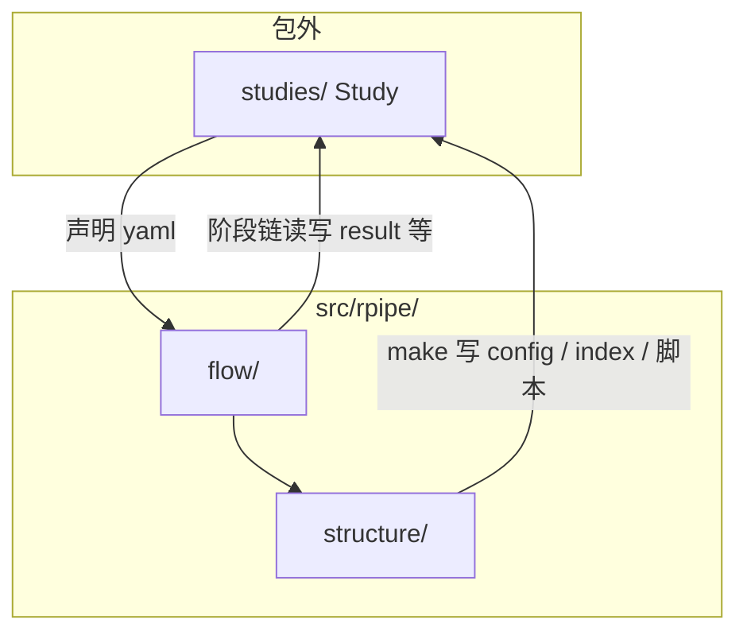

# Layout

本文定义 **RPipe** 仓库目录约定；Flow 展开到可执行入口文件，避免只见目录、不见实现。前置阅读 [concept.md](concept.md)。模块细则见 [code.md](code.md)。

参考包名 **`rpipe`**，源码根 `src/rpipe/`。下游以源码模板接入并保留该包，不以 pip 安装作为接入方式；本仓库的包构建用于验证分发合同。目录只映射 concept。

---

## 1. 导读

库内两柱：`structure/`、`flow/`。artifact 在 `structure/artifact/`，make 在 `structure/make/`。cli 在 `flow/cli.py`。Study 在包外 `studies/`。

### 项目顶层目录合同（v0.4.0）

`<project>` 是项目仓库根；`<study>` 是 Study 名，`<run_id>` 是配置内容导出的身份。以下表格规定位置、内容和写入责任，不只是目录示例。**以后改默认路径必须先改本文合同，再改实现与路径回归**；同一 PR 明确兼容与迁移方案，不因本机旧缓存外观改变约定。默认运行不得另建根级 data / model / output / res / tmp 保存研究产物。

| **固定位置** | **内容与边界** | **写入方** |
| --- | --- | --- |
| `<project>/.git/` | Git 元数据；worktree 可为 .git 文件，源码归档可没有它；不存研究产物 | Git |
| `<project>/.github/` | workflows 与仓库协作配置 | 维护者；Actions 执行配置而不将 Run 写入此处 |
| `<project>/.tmp/` | 隔离环境、缓存、临时脚本、测试报告与诊断；不随 clone 提供 | Agent、测试入口、开发工具 |
| `<project>/asset/` | README 使用的已登记静态实例图；不作为新 Study 图目录 | 维护者按已有来源维护 |
| `<project>/docs/` | code 设计、development 记录、releases 发布材料、research 唯一项目研究计划（含所有 Study 章节）/原样规范与译本、issue 独立探索；具体 Study 数字和结论不放这里 | 维护者 / Agent |
| `<project>/shared/` | **供 studies 下各 Study 共用的不可变输入**；不得存训练中的模型对象或 Run 可变状态 | 受锁保护的 data / model 准备入口、显式迁移命令 |
| `<project>/shared/data/` | 原始数据、按格式和版本区分的可复用派生输入；不共享可变 Dataset / sampler | DataFactory / 注册 data builder、prepare_shared_data、显式迁移 |
| `<project>/shared/model/` | 固定 revision 的预训练权重 / tokenizer 输入；不放训练 checkpoint | ModelFactory / 注册 model builder、显式迁移 |
| `<project>/src/` | 基础包 src/rpipe 与下游自己的项目包源码；运行不在此写资产 | 维护者 / Agent，源码模板复制 |
| `<project>/studies/` | 每个 Study 的声明、专用源码、正式报告和独立运行产物；_template 是声明模板 | Study 作者；库只在对应 Study 范围写产物 |
| `<project>/tests/` | 源码镜像测试、tests/_data 公共输入与包验收入口；不依赖正式 Run | 维护者 / Agent；测试运行输出到 .tmp 或独立临时工作区 |
| `<project>/build/` | 构建工具临时中间产物，忽略，不作实验数据根 | setuptools / build |
| `<project>/dist/` | 构建默认 wheel / sdist 输出，忽略；本地验证优先用 .tmp 下显式 outdir | build；本任务不上传发布 |

`src/rpipe.egg-info/` 等安装元数据由打包工具生成并忽略；.venv、编辑器缓存和 __pycache__ 不是新项目业务目录，应保持隔离/忽略。根级 README.md、AGENTS.md、LICENSE.md、pyproject.toml、.gitignore 是声明文件，不是产物目录。项目共享输入沿用 dev 的现有位置，本版不搬目录或自动迁移任何正式数据。

| **概念** | **目录落点** |
|------|----------|
| **Study** | `studies/<name>/` |
| **Experiment** | 逻辑分组（**index** + process 里跨 seed 摘要）；无顶层文件夹 |
| **Run** | `studies/<name>/runs/<id>/` |
| **structure** | `src/rpipe/structure/`：`api`、`control`、四层、**artifact**、**make** |
| **flow** | `src/rpipe/flow/`：阶段子包与 cli |

**Run 目录名：** config 的 `id` = 除 `id` / `description` 外内容的 hash（含 tags、seed、可选 `version`）。Run 是最底层的一次实测。需要避免相同实验参数与 seed 的不同实测发生 ID 冲突时，声明新的 `version`，生成新的 `runs/<id>/`；不再增加 version / attempt 子目录。

读写：

- **config**：**make** 写入 `runs/<id>/`；prepare 只读
- **result**：summarize / **write** 写入；process 可派生
- **asset**：文件通道。data / model 文件、checkpoint、AlgorithmTracker 曲线、Logger 文本，落在 `shared/` 或 `runs/<id>/assets/`

`version` 是 RunConfig 的可选内容字段，只用于区分实际 Run 并参与 `run_id` hash；它不是目录层级或序列化格式版本。timestamp 只是可采用的字段内容之一。

---

## 2. 概念与路径

### 跨 Study 共享资产（2026-10-14）

同一项目的 Study 默认共用项目根 `shared/data/` 和 `shared/model/`。原始数据、下载的预训练权重与 tokenizer 是可复用输入；训练中的模型对象、checkpoint、sampler / RNG、tracker 和报告仍属于各 Run。默认根：`<project>/studies/<study>` 使用 `<project>/shared`；其他布局使用 `<study-parent>/shared`，或显式指定根。

```yaml
shared:
  root: ../../shared     # 相对 Study；可省略，使用上述默认
  data: project          # 默认 project；不能共享的派生输入可选 study
  model: project         # 默认 project；不能共享的模型输入可选 study
```

`study` 选项只影响该类资产，落在 `<study>/shared/<kind>`；选择原因写入项目研究计划的对应 Study 章节。公共目录不能保存某个 Run 的可变状态。自定义 builder 接收同一个共享根，应按数据版本 / 格式或模型 revision 分目录，复用下载工具原有缓存，不将不同资源覆盖成同名文件。profile 的统计留在 Study 私有目录，显式传给当前 Data，防止一个 Study 的统计改变另一个 Study 的归一化。

Flow 通过 data_api / DataFactory 的可选 `profile_path` 传递自动解析的统计路径，不向实验 data.config 注入绝对目录，因而仅搬迁 profile 不改变 sampler 恢复身份。用户显式声明的 `config.stats_path` 优先于自动路径；改变实际输入 / 统计内容仍须按研究合同重新验证。

迁移是独立操作：`rpipe shared <study>` 默认只列路径；`--migrate` 校验已有私有资产与公共资产的全部重名文件，冲突时拒绝，成功后保留旧路径的链接。不得重写已完成 Run / provenance。历史探针原版 / 当前版 raw 引用同一文件；同一归档版本、依赖和 raw hash 的 processed / 固定 Stats 也使用项目共享派生缓存，不逐 Run 重建。不同归档格式单独分版本存储，加载的 Dataset / Stats 对象仍独立。旧不同编码的历史缓存先保留，不以新序列化覆写旧证据。迁移前保全来源与失败，迁移后独立实测用新 version / make。

共享准备的文件清单在创建根或调用 builder 前按本机 Path 语义检查：须有相对文件名，不含锚点或 ..，不得指向根 manifest.json 或重复等价路径。原清单字符串仍作为 manifest 键；单个 ./weights、嵌套目录的 manifest.json 不因此改名，既有有效缓存不迁移。

共享锁的 timeout 必须有限且非负；0 表示不等待竞争锁。非法预算在创建目录 / 锁文件前抛 ValueError；合法竞争到期仍抛 TimeoutError，不改变默认 120 秒或进程退出释放锁的语义。

文本原子写入和同字节副本迁移/引用使用独立短随机 staging 文件名，不拼完整目标名，避免合法目标名耗尽单个路径组件预算；每个发布者只清理自己的临时文件；发布失败保留源与原副本，不共享 Run 的可变状态。

共享下载 / 发布受文件锁保护；进程退出释放锁，锁文件存在不代表下载成功。构造失败不写 ready。库不会自动下载未注册的 HF / ModelScope 模型；下游通过现有 ModelRegistry builder 使用共享根和相应 hub 的版本缓存。



| **概念** | **路径** | **说明** |
|------|------|------|
| Study | `studies/<study>/` | 编排壳 + artifact 根 |
| 基底配置 | Study 目录下的 experiment 基底文件 | Study 默认值 |
| Run | `…/runs/<id>/` | config / result / assets |
| 共享与文档 | `<project>/shared/`、`<study>/docs/` | 输入跨 Study 共用；计划统一在项目 docs/research，报告与证据仍为 Study 级。私有派生输入按显式配置存储 |
| structure | `src/rpipe/structure/` | api、control、data、model、algorithm、system、artifact（含 `readout/`）、**make** |
| flow | `src/rpipe/flow/` | cli；prepare / execute / collect / summarize / write / process。`status` / `logs` / `report` 由 cli 转给 artifact readout |

---

## 3. 库内目录树

`src/rpipe/` 与 `tests/rpipe/` 同构。`structure/` 只展到下一层。

```
RPipe/
  src/
    rpipe/
      structure/
        api/
        control/
        data/
        model/
        algorithm/
        system/
        artifact/
        make/
      flow/
        __init__.py           # 只做包导出，不承载阶段实现
        cli.py
        context.py
        runner.py
        study.py              # Study 扩展加载
        prepare/
          __init__.py         # from .run import run
          run.py
        execute/
          __init__.py
          run.py
        collect/
          __init__.py
          run.py
        summarize/
          __init__.py
          run.py
        write/
          __init__.py
          run.py
        process/
          __init__.py         # 只导出以下模块的入口
          individual.py       # 单条 Run 的 run(ctx)
          study.py            # 整轮 Study 聚合
          aggregate.py
          curves.py
  studies/
  docs/
  tests/
    rpipe/
```

| **flow 子包** | **阶段** |
|-----------|------|
| `prepare/` | 读 config，落地 structure |
| `execute/` | 计算 |
| `collect/` | 收观测 |
| `summarize/` | result 草稿 |
| `write/` | 把 result 写入 artifact |
| `process/` | 本 Run 派生与整轮 Study 聚合；Study 的额外 hook 可省略 |

库与 Study 的 Flow 包统一约定：`__init__.py` 只保留说明、导入与公开符号导出，不写阶段函数、业务逻辑或执行流程。普通阶段的实现放 `run.py`；复杂阶段按职责拆模块（库 process 见上树），包入口仅转出函数。

Study 在 `flow/<phase>/run.py` 定义 `run(ctx)`，通过同目录 `__init__.py` 导出，并由 `study.yaml` 的 `flow.study_phases: true` 显式启用。专用建构实现放 `structure/`，根 recipe 保留建构前注册，make 前准备使用显式手动入口。没有包入口的空目录或工具目录不作为 hook，但库默认阶段仍执行，不必复制默认实现或填入空函数。Run process 和整轮 Study process 使用不同 scope，迁移与来源规则见 [flow.md §14.0](flow.md#140-study-阶段目录)。

`rpipe status` / `logs` / `report` 的实现在 `structure/artifact/readout/`。cli 只调用它们。

---

## 4. Study 目录

```text
studies/<study>/
  study.yaml
  experiment_config.yaml
  recipe.py                  # 可选，注册 Study 专用 source
  flow/                      # 可选阶段扩展；无扩展时仍执行库默认链
    prepare/                 # 一个扩展示意，其他阶段按需添加
      __init__.py            # from .run import before, run（before 可选）
      run.py                 # 定义 before(ctx) / run(ctx)
      helper.py              # 按需拆分，不自动作为 hook
  structure/                 # 专用建构实现
  index.json                 # make 写入；不入库
  provenance.json            # make 写入的来源清单；不入库
  process.json               # launch / process 写入；不入库
  docs/
    STUDY_REPORT.md          # 人写的结论
    NUMBERS.md               # rpipe report 从 process.json 生成的数字表
    figures/
  shared/                      # 仅私有例外 / profile；默认输入在项目根 shared/
    data/
    model/
  scripts/
  runs/
    <run_id>/
      config.yaml
      result.json              # 摘要；曲线不在这里
      assets/
        tracker/               # AlgorithmTracker：state / scalars.jsonl
        logs/run.log           # Logger（system）：这一次 Run；index.log 指向这里
        checkpoints/           # 训练 checkpoint（有则写）
```

### Study 级固定路径、内容与写入方

默认 Study 位于 `<project>/studies/<study>/`。下表是与代码默认路径对照的合同；可选输入文件/扩展只在显式声明时存在，不要求创建空目录。自定义基底文件由 study.yaml 的实际声明指定，experiment_config.yaml 是默认基底。

| **固定位置** | **内容与边界** | **写入方** |
| --- | --- | --- |
| `<project>/studies/<study>/` | 一个研究的编排与证据边界 | Study 作者创建；make / Flow 在下列职责内写入 |
| `<project>/studies/<study>/study.yaml` | 因素、seed、shared 与阶段配置 | Study 作者；make / Flow 读取 |
| `<project>/studies/<study>/experiment_config.yaml` | 默认实验基底；可声明其他基底文件 | Study 作者；make 展开后不在此存 Run 结果 |
| `<project>/studies/<study>/recipe.py` | 可选建构前注册入口 | Study 作者 |
| `<project>/studies/<study>/structure/` | Study 专用 data / model / algorithm / system 建构源码 | Study 作者 |
| `<project>/studies/<study>/flow/` | 显式启用的阶段组合扩展 | Study 作者；库按声明加载 |
| `<project>/studies/<study>/docs/` | 报告、正式数字、图与研究证据 | Study 作者与对应 report / process 入口 |
| `<project>/docs/research/研究计划 RPipe.md` / `Research Plan RPipe.md` | 单一项目计划及完整英译；全部 Study 协议、模板和历史全文作为独立章节；含不可变输入私有例外理由 | 维护者与 Study 作者 |
| `<project>/studies/<study>/docs/STUDY_REPORT.md` | 正式研究结论、执行/失败边界 | Study 作者 / 获授权的 Agent |
| `<project>/studies/<study>/docs/NUMBERS.md` | 从当前 Study process 导出的数字表，不等于结论 | rpipe report / write_numbers |
| `<project>/studies/<study>/docs/figures/` | 本 Study 正式图 | Study 作者、process / 绘图入口 |
| `<project>/studies/<study>/docs/figures/learning_curves.png` | 库默认学习曲线图；有可用观测时生成 | Study process / write_learning_curves |
| `<project>/studies/<study>/shared/` | 仅私有例外、profile 和保留的旧输入引用；不是默认公共输入根 | 对应私有 builder、profile、显式迁移保留引用 |
| `<project>/studies/<study>/shared/data/` | shared.data: study 的私有输入，或默认仍私有的 profile；无真实不兼容依据不复制 raw | Study 私有 data builder / profile；迁移不搬 stats.yaml |
| `<project>/studies/<study>/shared/data/<dataset>/stats.yaml` | 当前 Study 的归一化统计；不污染其他 Study | rpipe data / profile_study，或显式指定的既有统计 |
| `<project>/studies/<study>/shared/model/` | shared.model: study 的私有模型输入；不存训练中状态 | Study 私有 model builder |
| `<project>/studies/<study>/scripts/` | 调度产物；默认不入库 | make / schedule |
| `<project>/studies/<study>/scripts/jobs.json` | launch 原生调度清单 | make / schedule |
| `<project>/studies/<study>/scripts/launch.ps1` | PowerShell 调度入口；Bash 脚本按 stem / 分块命名也在 scripts 内 | make / schedule |
| `<project>/studies/<study>/runs/` | 所有独立 Run；默认不入库 | make / artifact layout |
| `<project>/studies/<study>/runs/<run_id>/` | 单次实测；没有额外 version / attempt 层 | make / Flow |
| `<project>/studies/<study>/runs/<run_id>/config.yaml` | 已展开的 Run 配置 | make；prepare 读取 |
| `<project>/studies/<study>/runs/<run_id>/result.json` | 原有含义的 Run 结果摘要，不是历史账本或指针 | write / 既有失败定稿入口；语义和位置不改 |
| `<project>/studies/<study>/runs/<run_id>/process.json` | 仅此 Run 的派生观测与曲线摘要 | Run process |
| `<project>/studies/<study>/runs/<run_id>/assets/` | 该 Run 的可变资产；不得混入项目共享输入 | Algorithm / System / Study 阶段 |
| `<project>/studies/<study>/runs/<run_id>/assets/tracker/` | 状态、曲线 | AlgorithmTracker |
| `<project>/studies/<study>/runs/<run_id>/assets/tracker/tracker_state.json` | tracker 状态 | AlgorithmTracker |
| `<project>/studies/<study>/runs/<run_id>/assets/tracker/scalars.jsonl` | 追加数值曲线 | AlgorithmTracker |
| `<project>/studies/<study>/runs/<run_id>/assets/logs/` | 本 Run 文本日志 | Logger / System |
| `<project>/studies/<study>/runs/<run_id>/assets/logs/run.log` | 阶段、异常与恢复诊断，index.log 指向此处 | Logger / System 追加 |
| `<project>/studies/<study>/runs/<run_id>/assets/checkpoints/` | 本 Run 的 checkpoint / best 与恢复状态 | Algorithm 的保存 / 恢复协议 |
| `<project>/studies/<study>/runs/<run_id>/assets/samples/` | 可选观测样本 | Algorithm / Study 扩展 |
| `<project>/studies/<study>/runs/<run_id>/assets/cache/` | 可选 Run 私有可变缓存 | Algorithm / Study 扩展 |
| `<project>/studies/<study>/runs/<run_id>/assets/weights/` | 可选 Run 权重产物，与共享预训练输入区分 | Algorithm / Study 扩展 |
| `<project>/studies/<study>/index.json` | 编排清单，含 Run config / log 引用 | make |
| `<project>/studies/<study>/provenance.json` | 来源、计划、index / config hash、环境与 Git；不等于源码备份 | make / provenance 冻结入口 |
| `<project>/studies/<study>/process.json` | Study 聚合信封 | Study process / launch 的既有聚合链 |
| `<project>/studies/<study>/activity.json` | 可选当前阶段提示，成功 make 后清除；不替代正式结果 | make / activity；status 只读 |

路径回归在 [test_layout.py](../../tests/rpipe/test_layout.py) 中调用真实 layout / shared / schedule / process / readout 路径入口，与本文固定位置逐项比较；不从本文生成运行配置。既有 [共享与迁移回归](../../tests/rpipe/structure/artifact/test_shared.py) 继续保证输入共用与 Run 状态隔离。非 studies 布局默认使用 `<study-parent>/shared`，显式 shared.root 相对 Study 解析；这两个兼容入口不改变上述规范布局。

上表也是目标布局：Run 已是最底层。不同实测使用不同 `version` 导出不同 `run_id`，各自保存在独立的 `runs/<id>/`。

---

## 5. 调用关系

```
studies/<name>/study.yaml
        │
        ▼
  flow cli
        │
        ├─► structure.make → runs/<id>/config.yaml、index、scripts/jobs.json、shared/data
        └─► FlowRunner（launch 复用 jobs.json）
                    │
                    ▼
            runs/<id>/ 下的 result 与 assets
            shared/ 下的 data / model asset
```

---

## 6. 测试镜像

| **测试树** | **对应** |
|--------|------|
| `tests/rpipe/structure/` | `src/rpipe/structure/` |
| `tests/rpipe/flow/` | `src/rpipe/flow/` |

`unit` / `integration` / `e2e` 是标签，不是 `tests/` 下的一级目录。e2e 落在系统入口 `tests/rpipe/flow/`，使用 `tests/_data/` 或用例内声明，在临时 Study 中执行，不依赖正式 Study 的数据或运行成果。细则见 [testing.md](../development/testing.md) 与 [tests/README.md](../../tests/README.md)。
