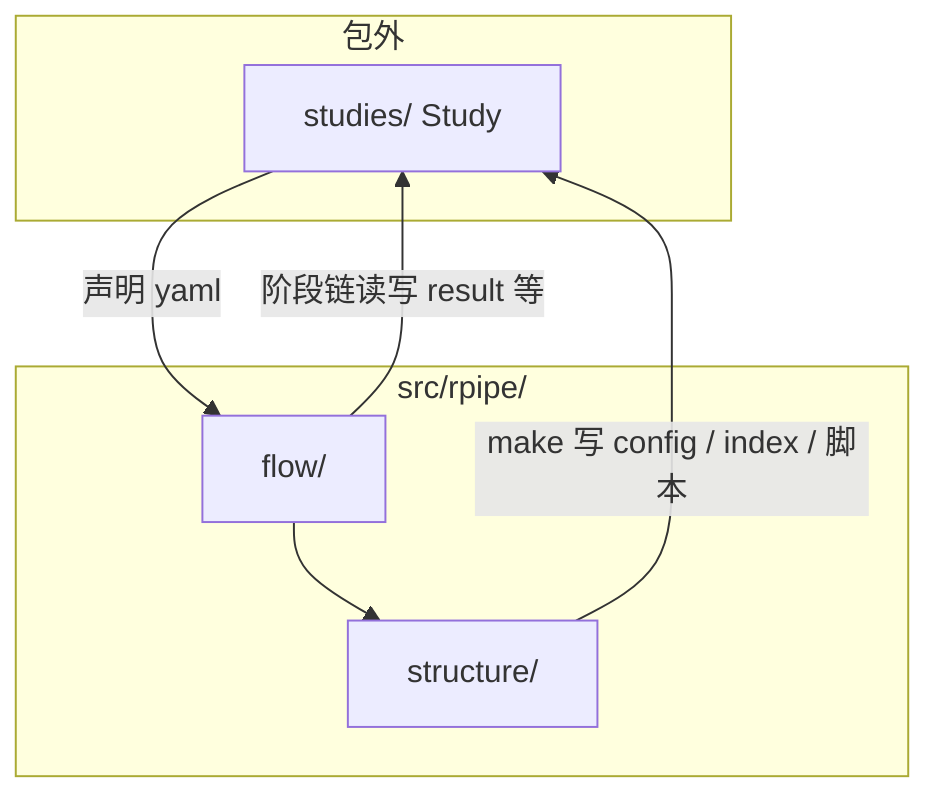

# Layout

本文定义 **RPipe** 仓库目录约定；Flow 展开到可执行入口文件，避免只见目录、不见实现。前置阅读 [concept.md](concept.md)。模块细则见 [code.md](code.md)。

参考包名 **`rpipe`**，源码根 `src/rpipe/`。下游以源码模板接入并保留该包，不以 pip 安装作为接入方式；本仓库的包构建用于验证分发合同。目录只映射 concept。

---

## 1. 导读

库内两柱：`structure/`、`flow/`。artifact 在 `structure/artifact/`，make 在 `structure/make/`。cli 在 `flow/cli.py`。Study 在包外 `studies/`。

| **仓库入口** | **用途与交付边界** |
| --- | --- |
| `src/rpipe/`、`pyproject.toml` | 基础源码模板、参考 CLI、依赖与包构建声明 |
| `docs/code/` | 设计：concept、layout、code，以及 structure / flow 分册 |
| `docs/development/` | 研究与反馈要求：research、feedback；开发与验证：brainstorm、bugs、testing、cicd、record、handover |
| `docs/releases/` | 各正式版本的完整差异、迁移、验证与未覆盖范围 |
| `studies/` | [Study 导航](../../studies/README.md)、声明、复跑入口与正式报告；通用操作在 [README 的 Study 指南](../../README.md#study-使用指南)，本地产物另按第四节管理 |
| `tests/` | 统一测试入口、源码镜像测试与安装后 CLI 验收，见 [测试入口](../../tests/README.md) |
| `.github/workflows/` | CPU 测试和 wheel / sdist 构建、安装验收 |
| `asset/` | README 保留的 2026-10-04 MNIST / CIFAR10 实例曲线；参考图与来源保存在 [历史图归档](../../studies/main_exp/docs/reference/README.md)，不作为新 Run 的资产根 |
| `.tmp/` | 本机运行环境、诊断与临时验证输出，不随 Git clone 提供 |

| **概念** | **目录落点** |
|------|----------|
| **Study** | `studies/<name>/` |
| **Experiment** | 逻辑分组（**index** + process 里跨 seed 摘要）；无顶层文件夹 |
| **Run** | `studies/<name>/runs/<id>/` |
| **structure** | `src/rpipe/structure/`：`api`、`control`、四层、**artifact**、**make** |
| **flow** | `src/rpipe/flow/`：阶段子包与 cli |

**Run 目录名：** config 的 `id` = 除 `id` / `description` 外内容的 hash（含 tags、seed、可选 `version`）。Run 是最底层的一次实测。需要避免相同实验参数与 seed 的不同实测发生 ID 冲突时，声明新的 `version`，生成新的 `runs/<id>/`；不再增加 version / attempt 子目录。

读写：

- **config**：**make** 写入 `runs/<id>/`；prepare 只读
- **result**：summarize / **write** 写入；process 可派生
- **asset**：文件通道。data / model 文件、checkpoint、AlgorithmTracker 曲线、Logger 文本，落在 `shared/` 或 `runs/<id>/assets/`

`version` 是 RunConfig 的可选内容字段，只用于区分实际 Run 并参与 `run_id` hash；它不是目录层级或序列化格式版本。timestamp 只是可采用的字段内容之一。

---

## 2. 概念与路径

### 跨 Study 共享资产（2026-10-14）

同一项目的 Study 默认共用项目根 `shared/data/` 和 `shared/model/`。原始数据、下载的预训练权重与 tokenizer 是可复用输入；训练中的模型对象、checkpoint、sampler / RNG、tracker 和报告仍属于各 Run。默认根：`<project>/studies/<study>` 使用 `<project>/shared`；其他布局使用 `<study-parent>/shared`，或显式指定根。

```yaml
shared:
  root: ../../shared     # 相对 Study；可省略，使用上述默认
  data: project          # 默认 project；不能共享的派生输入可选 study
  model: project         # 默认 project；不能共享的模型输入可选 study
```

`study` 选项只影响该类资产，落在 `<study>/shared/<kind>`；选择原因写入 PLAN。公共目录不能保存某个 Run 的可变状态。自定义 builder 接收同一个共享根，应按数据版本 / 格式或模型 revision 分目录，复用下载工具原有缓存，不将不同资源覆盖成同名文件。profile 的统计留在 Study 私有目录，显式传给当前 Data，防止一个 Study 的统计改变另一个 Study 的归一化。

Flow 通过 data_api / DataFactory 的可选 `profile_path` 传递自动解析的统计路径，不向实验 data.config 注入绝对目录，因而仅搬迁 profile 不改变 sampler 恢复身份。用户显式声明的 `config.stats_path` 优先于自动路径；改变实际输入 / 统计内容仍须按研究合同重新验证。

迁移是独立操作：`rpipe shared <study>` 默认只列路径；`--migrate` 校验已有私有资产与公共资产的全部重名文件，冲突时拒绝，成功后保留旧路径的链接。不得重写已完成 Run / provenance。历史探针原版 / 当前版 raw 使用同一文件的硬链接，processed / Stats 因归档格式及状态隔离仍可私有；禁止静默复制 raw。迁移前保全来源与失败，迁移后独立实测用新 version / make。

共享下载 / 发布受文件锁保护；进程退出释放锁，锁文件存在不代表下载成功。构造失败不写 ready。库不会自动下载未注册的 HF / ModelScope 模型；下游通过现有 ModelRegistry builder 使用共享根和相应 hub 的版本缓存。



| **概念** | **路径** | **说明** |
|------|------|------|
| Study | `studies/<study>/` | 编排壳 + artifact 根 |
| 基底配置 | Study 目录下的 experiment 基底文件 | Study 默认值 |
| Run | `…/runs/<id>/` | config / result / assets |
| 共享与文档 | `<project>/shared/`、`<study>/docs/` | 输入跨 Study 共用；文档仍为 Study 级。私有派生输入按显式配置存储 |
| structure | `src/rpipe/structure/` | api、control、data、model、algorithm、system、artifact（含 `readout/`）、**make** |
| flow | `src/rpipe/flow/` | cli；prepare / execute / collect / summarize / write / process。`status` / `logs` / `report` 由 cli 转给 artifact readout |

---

## 3. 库内目录树

`src/rpipe/` 与 `tests/rpipe/` 同构。`structure/` 只展到下一层。

```
RPipe/
  src/
    rpipe/
      structure/
        api/
        control/
        data/
        model/
        algorithm/
        system/
        artifact/
        make/
      flow/
        __init__.py           # 只做包导出，不承载阶段实现
        cli.py
        context.py
        runner.py
        study.py              # Study 扩展加载
        prepare/
          __init__.py         # from .run import run
          run.py
        execute/
          __init__.py
          run.py
        collect/
          __init__.py
          run.py
        summarize/
          __init__.py
          run.py
        write/
          __init__.py
          run.py
        process/
          __init__.py         # 只导出以下模块的入口
          individual.py       # 单条 Run 的 run(ctx)
          study.py            # 整轮 Study 聚合
          aggregate.py
          curves.py
  studies/
  docs/
  tests/
    rpipe/
```

| **flow 子包** | **阶段** |
|-----------|------|
| `prepare/` | 读 config，落地 structure |
| `execute/` | 计算 |
| `collect/` | 收观测 |
| `summarize/` | result 草稿 |
| `write/` | 把 result 写入 artifact |
| `process/` | 本 Run 派生与整轮 Study 聚合；Study 的额外 hook 可省略 |

库与 Study 的 Flow 包统一约定：`__init__.py` 只保留说明、导入与公开符号导出，不写阶段函数、业务逻辑或执行流程。普通阶段的实现放 `run.py`；复杂阶段按职责拆模块（库 process 见上树），包入口仅转出函数。

Study 在 `flow/<phase>/run.py` 定义 `run(ctx)`，通过同目录 `__init__.py` 导出，并由 `study.yaml` 的 `flow.study_phases: true` 显式启用。专用建构实现放 `structure/`，根 recipe 保留建构前注册，make 前准备使用显式手动入口。没有包入口的空目录或工具目录不作为 hook，但库默认阶段仍执行，不必复制默认实现或填入空函数。Run process 和整轮 Study process 使用不同 scope，迁移与来源规则见 [flow.md §14.0](flow.md#140-study-阶段目录)。

`rpipe status` / `logs` / `report` 的实现在 `structure/artifact/readout/`。cli 只调用它们。

---

## 4. Study 目录

```text
studies/<study>/
  study.yaml
  experiment_config.yaml
  recipe.py                  # 可选，注册 Study 专用 source
  flow/                      # 可选阶段扩展；无扩展时仍执行库默认链
    prepare/                 # 一个扩展示意，其他阶段按需添加
      __init__.py            # from .run import before, run（before 可选）
      run.py                 # 定义 before(ctx) / run(ctx)
      helper.py              # 按需拆分，不自动作为 hook
  structure/                 # 专用建构实现
  index.json                 # make 写入；不入库
  provenance.json            # make 写入的来源清单；不入库
  process.json               # launch / process 写入；不入库
  docs/
    PLAN.md
    STUDY_REPORT.md          # 人写的结论
    NUMBERS.md               # rpipe report 从 process.json 生成的数字表
    figures/
  shared/                      # 仅私有例外 / profile；默认输入在项目根 shared/
    data/
    model/
  scripts/
  runs/
    <run_id>/
      config.yaml
      result.json              # 摘要；曲线不在这里
      assets/
        tracker/               # AlgorithmTracker：state / scalars.jsonl
        logs/run.log           # Logger（system）：这一次 Run；index.log 指向这里
        checkpoints/           # 训练 checkpoint（有则写）
```

| **成员** | **说明** |
|------|------|
| `docs/` | 计划、人写的 `STUDY_REPORT.md`、图；可入库。`NUMBERS.md` 由 `rpipe report` 生成，也可以入库，它不是结论 |
| `<project>/shared/` | 跨 Study 的 data / model 输入；默认不入库。`<study>/shared/` 仅留私有派生输入、profile 或旧路径引用 |
| `runs/` | 每次 Run；默认不入库 |
| `scripts/` | make 生成的调度脚本与 `jobs.json`；默认不入库 |
| `index.json` | make 写入的编排清单（每条 Run 含 `config` 与 `log`）；不入库 |
| `process.json` | Study 级聚合信封；不入库 |
| `activity.json` | 只在 make 进行中出现，成功后删除；不入库。`rpipe status` 在它还在时把第一行打成当前阶段 |
| `provenance.json` | make 写入的来源清单：源码、声明、recipe，以及 index / Run config 的哈希；另记录环境和 git 提交，不是源码备份。不入库，规则见 [flow.md](flow.md) §14.2 |
| `recipe.py` | 可选；Study 自己注册的 data / model / algorithm `source`，由 `study.yaml` 的 `recipe` 指向，入库。见 [flow.md](flow.md) §14.1 |
| `flow/`、`structure/` | Study 两柱源码；入库并自动纳入 provenance。阶段 hook 仅在显式启用时执行 |
| `<project>/shared/data/`、`<project>/shared/model/` | structure data / model 可复用输入的默认落盘 |
| `runs/<id>/assets/` | 本 Run 的 asset：`tracker/`（数字曲线）、`logs/`（文本）、checkpoint、样本等 |

上表也是目标布局：Run 已是最底层。不同实测使用不同 `version` 导出不同 `run_id`，各自保存在独立的 `runs/<id>/`。

---

## 5. 调用关系

```
studies/<name>/study.yaml
        │
        ▼
  flow cli
        │
        ├─► structure.make → runs/<id>/config.yaml、index、scripts/jobs.json、shared/data
        └─► FlowRunner（launch 复用 jobs.json）
                    │
                    ▼
            runs/<id>/ 下的 result 与 assets
            shared/ 下的 data / model asset
```

---

## 6. 测试镜像

| **测试树** | **对应** |
|--------|------|
| `tests/rpipe/structure/` | `src/rpipe/structure/` |
| `tests/rpipe/flow/` | `src/rpipe/flow/` |

`unit` / `integration` / `e2e` 是标签，不是 `tests/` 下的一级目录。e2e 落在系统入口 `tests/rpipe/flow/`，使用 `tests/_data/` 或用例内声明，在临时 Study 中执行，不依赖正式 Study 的数据或运行成果。细则见 [testing.md](../development/testing.md) 与 [tests/README.md](../../tests/README.md)。
