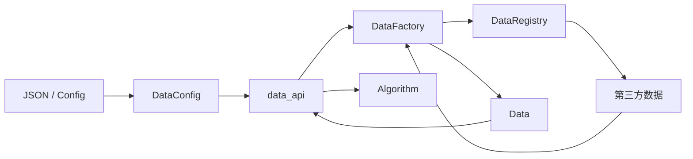
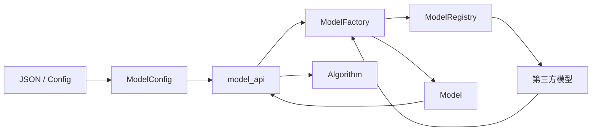
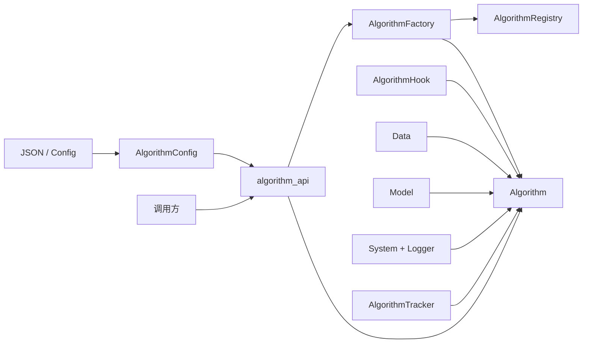
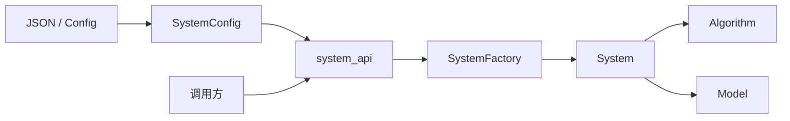
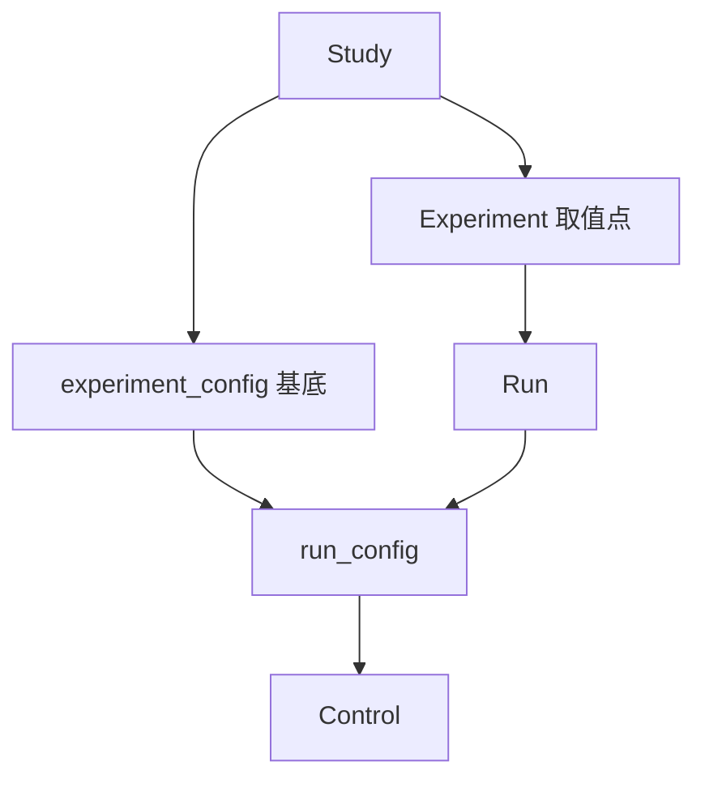
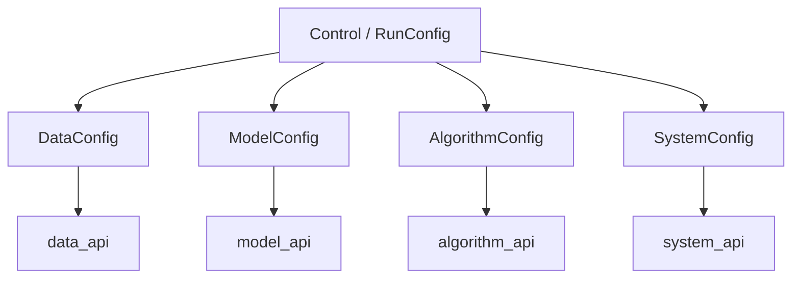

# Code structure · Structure

前置：[concept.md](concept.md) §6、[layout.md](layout.md)、[code.md](code.md)。
并列分册：[flow.md](flow.md)。

本文按层推进：**模块 → 类 → 叶文件**。data / model / algorithm / system / control 定到类（control 见 §8）。**artifact** IO 见 §9。**make** 见 §10。

**层间只经** `structure/api/` **交流。** 各层实现不互相直接 import；跨层与外部调用方只依赖对应 `*_api`。**不设** `control_api`：control 留在 `control/`。

运行时类（`Data`、`Model`、`Algorithm`、`System`）与配置 dataclass 分开：前者供 prepare/execute 消费；后者为 **`DataConfig` / `ModelConfig` / `AlgorithmConfig` / `SystemConfig`**，专责从 JSON / Artifact Config 加载声明字段。

**Config 字段约定：** 各 `*Config` 规定标准声明字段，其余键为可选扩展，由对应 `source` / 注册项解释。下方字段表描述对象和接口，不表示 YAML 必须显式填写每个字段；`path` / `config` 等允许省略，实际默认值与业务必需条件以当前 Config / Factory / contract 为准，不能为补齐表格虚构路径。

**实现与扩展边界：** 下方“下游来源”包含可复用生态和设计方向，不代表已注册或实测。当前实现见 [README](../../README.md#当前实现范围)和对应目录；不要仅设置 source 就推定未实现的后端已接通。

各层统一还有两类约定（字段名可微调，语义固定）：

| **约定** | **落在哪** | **说明** |
|------|--------|------|
| **内容配置** `config` | 每一层 `*Config` | 可装入从 `path` 读出的超参/子配置，也可由 Control / 实验侧**覆写**；各 source 明确支持的字段、合并规则与优先级，不由 Factory 推断未声明字段 |
| **向上兼容** | Model → Data；Algorithm → Model；System → Algorithm | **下一层声明对上一层的兼容**；Data 无更上一层，不设此项 |

`path` 仍是资源/超参文件根；读出来的内容应能进入本层 `config`，并允许被覆写。

---

## 1. 柱职责与原则

### 1.1 本柱做什么

- 承载 **control** 与 data / model / algorithm / system，以及 **artifact** IO 与 **make**
- 在 `api/` 暴露各层对外接口（`data_api`、`model_api`、…）
- 由 config mapping 构造 control，并由 control 导出 config mapping
- 在 prepare 经各层 api 落地可消费实例；在 execute 期经 api 使用它们
- 在 control 侧声明并执行 config / result **契约校验**
- 经 **asset** 路径读写缓存、权重、checkpoint、样本、日志（data / model 落盘都在 asset）
- 经 api 产出可序列化观测（loss、metric、路径等），供写入 result

### 1.2 能力 vs 取值（对齐 concept §6）

| **概念** | **谁声明** | **落在哪** |
|------|--------|--------|
| **能力** | Experiment + 各层 Registry（经 api 可查询） | 注册名解析到第三方实现 |
| **取值** | **make**（`axes` × `seeds`）写入 | Artifact Config → prepare → `Control` |
| **层间调用** | Structure 柱内 / 外部调用方 | 各层经 `structure.api.*`；Control 经 `control/` |

### 1.3 柱内依赖方向

```
api/                 → data_api / model_api / system_api / algorithm_api / artifact_api / make_api
control/             → Control 与编解码/契约；无 control_api
data/                → Data / DataRegistry / DataFactory / DataConfig
model/               → Model / ModelRegistry / ModelFactory / ModelConfig
system/              → System / Logger / SystemFactory / SystemConfig
algorithm/           → Algorithm / AlgorithmTracker / AlgorithmRegistry / AlgorithmFactory / AlgorithmConfig
artifact/            → layout / config / result / asset / index IO，以及 readout（status / logs / NUMBERS）；不 import 四层实现，不 import flow
make/                → 多实验：展开、写 config/index、调度脚本；调 control + artifact；不 import 四层、不 import flow
```

- 各层跨层只走对应 `*_api`；control 沿用既有例外
- 层实现目录之间不直连
- 第三方建构在各层实现内完成；经 Factory 得到运行时对象再经 api 交出
- algorithm 经 `data_api` / `model_api` / `system_api` 使用 `Data` / `Model` / `System`（含 System 上的 Logger）；数字观测走 **AlgorithmTracker**

### 1.4 分册推进状态

| **区域** | **状态** |
|------|------|
| **api** | 门面已定 |
| **data** | `Data` + `DataRegistry` + `DataFactory` + `DataConfig` |
| **model** | `Model` + `ModelRegistry` + `ModelFactory` + `ModelConfig` |
| **algorithm** | `Algorithm` + **AlgorithmTracker** + Registry / Factory / `AlgorithmConfig` |
| **system** | `System` + **Logger** + `SystemFactory` / `SystemConfig`；没有 `SystemRegistry` |
| **control** | `ExperimentConfig` + `RunConfig` + `Control` + 四层 `*Config` + 合并/编解码/契约（§8） |
| **artifact** | layout / config / result / asset / index（§9） |
| **make** | 多实验 config 网格 + 调度脚本（§10） |

---

## 2. 目录骨架（仅到层 / api）

```
structure/
  api/
  control/
  data/
  model/
  algorithm/
  system/
  artifact/     # §9
  make/         # §10
```

### 2.1 结构约束

本节约束 `src/rpipe/structure/` 的**形状**本身：允许有哪些包、文件放哪里、如何登记、如何互相依赖、如何演进。它与 §1.3 的依赖方向互为补充：§1.3 说“谁能调用谁”，本节说“结构怎样保持干净”。以下各条为硬约束，除第 4 条外都应能由测试或评审机械判定；若与下文各层小节冲突，以本节为准，并同步修正对应小节。

每条按 **规则 / 理由 / 检查** 给出。

#### 2.1.1 `__init__.py` 只做导出

- **规则：** 任何 `__init__.py` 只允许 `import` / `from … import …` 与 `__all__`。不得定义函数、类、常量表，不得执行有副作用的逻辑（注册、读文件、环境探测等）。
- **理由：** 包导入应当廉价、无副作用、可预测。实现写在 `__init__` 里会让模块边界失效：无法单独引用、难以测试、循环导入难以排查，读者也找不到实现在哪。
- **检查：** 测试以 AST 遍历 `structure/` 下所有 `__init__.py`，顶层语句只允许 `Import`、`ImportFrom` 和对 `__all__` 的赋值。
- **实现位置：** train/eval 的执行实现位于各自 `loop.py`，包入口只做既有名称导出。

#### 2.1.2 固定八个子包，顶层不放文件

- **规则：** `structure/` 下只允许 §2 骨架中的八个子包：`api`、`control`、`data`、`model`、`algorithm`、`system`、`artifact`、`make`。顶层除 `__init__.py` 外不放任何文件。新增子包或顶层文件须先经项目负责人批准，并在同一 PR 中更新 §2 与本节。
- **归属说明：** 国内源与下载解析（`system/origin.py`）属于运行环境能力，归入 `system/`，对外经 `system_api` 暴露。`artifact/readout/`（status / logs / compare 等读数展示）保留在 `artifact/` 内，不另立一层。
- **理由：** 层数固定，依赖方向（§1.3）才可推理。顶层散文件天然游离于层之外，最容易变成被各层直连的“公共杂物间”。
- **检查：** 测试列出 `structure/` 的直接子项，必须恰好等于上述八个目录加 `__init__.py`。
- **实现位置：** 来源与下载解析位于 `system/origin.py`，跨层与 flow 调用经 `system_api`。

#### 2.1.3 每个文件都登记

- **规则：** `structure/` 下每个 `.py`（`__init__.py` 除外）都须在本文对应层小节的文件表中登记，并附一句话职责。新增、删除、改名文件与修改本文在**同一个 PR** 中完成。
- **理由：** 本文是结构的唯一说明。未登记的文件等于没有归属，迟早重复造轮子或越层；文档里写了却不存在的文件同样误导读者。
- **检查：** 测试比对磁盘文件树与本文登记的文件集合，双向不一致（未登记 / 已登记但不存在）即失败。

#### 2.1.4 文件粒度保持规范

- **规则：** 不设硬性行数上限，但要求代码组织有素养：
  - 不写大而全的“万能文件”。一个文件承担多个可独立命名的职责时，按职责拆分。
  - 不碎片化。不为单个函数单独建文件；体量很小且只有一个调用方的文件，并回其调用方或同层相近文件。
- **理由：** 文件是阅读和评审的基本单位。过大难以理解和审查，过碎则跳转成本高、职责被稀释。
- **检查：** 评审判断，不做机械门禁。评审时对明显过长或过碎的文件应提出拆分 / 合并。

#### 2.1.5 跨层只经 `api/`

- **规则：** 重申并收紧 §1.3：任何层（包括 `flow/` 等 structure 外的调用方）使用另一层的能力，只能 import `structure.api.*`，不得直接 import 另一层的实现模块。层内模块之间可以直接引用。
- **理由：** api 是各层唯一的对外契约。绕过它直连实现，会把实现细节变成事实上的公共接口，层内重构随即牵动全局。
- **检查：** 测试扫描 import：凡跨越层目录的引用，目标必须位于 `structure/api/`（`control/` 按 §1.3 的既有约定处理）。

#### 2.1.6 修 bug 不扩张结构

- **规则：** 修复缺陷默认在现有函数 / 模块内完成，不为修 bug 新增模块，不叠加防御层（重复校验、兜底包装、并行的“安全版”实现）。确需新增公共 helper 时，须在 PR 中写明理由：为什么现有位置放不下、预期有哪些调用方。
- **理由：** 结构膨胀多数来自一次次局部修补。每个修补单看合理，叠加起来就是越来越厚的文件和越来越多的旁路。
- **检查：** 评审判断。PR 若以 `fix:` 为主却新增文件，须给出上述理由。

#### 2.1.7 本文只写结构

- **规则：** 本文每节只写职责、依赖方向与对外接口。带 Issue / Bug 编号的修复说明、边界情况“契约”与变更过程，记入 [record.md](../development/record.md)，本文至多保留一句链接。
- **理由：** 结构文档要能一口气读完并据此判断“东西该放哪”。修复日志会淹没结构信息，且随时间失效。
- **检查：** 评审判断。新增内容出现 Issue / Bug 编号或修复叙事即应移出。
- **说明：** 已定位的既有修复叙事原文见[开发记录归档](../development/record.md#2913-structure-history-archive)；新增修复过程同样记入开发记录。

#### 2.1.8 派生项目副本以 RPipe 为准

- **规则：** 派生项目（dayan、quantization、denoising-speculative-decoding 等）中的 `structure/` 副本以 RPipe 为唯一上游，不得在本地擅自改动整体架构（包划分、层边界、api 形状、本节各条）。需要改动时，先在 RPipe 中修改并评审，再同步到各副本。
- **理由：** 多份副本各自演化会迅速分叉，修复无法回流，同一问题要在多处重复修。
- **检查：** 同步时比对副本与 RPipe 的 `structure/` 文件树和内容差异；架构层面的差异须能追溯到 RPipe 的对应提交。
- **执行口径（Enmao 2026-10-17 19:25）：** 三个派生副本改为周期性同步，只有 RPipe 新的可用里程碑版本就绪后才同步；此前不做同步、不覆盖下游。本批只记录口径，不实施同步。实际同步时明确副本物理根、上游版本、允许范围和下游改动保全方式，不把每次本地提交或 PR 合并自动视为同步就绪。

---

## 3. `structure/api/`（门面）


### 3.0 文件登记

| **文件（相对 structure/）** | **职责** |
| --- | --- |
| `api/artifact_api.py` | 磁盘产物层的纯重导出门面。 |
| `api/make_api.py` | 脚本生成层的纯重导出门面。 |
| `api/algorithm_api.py` | algorithm_api: Algorithm, AlgorithmTracker, AlgorithmFactory.build, AlgorithmConfig. |
| `api/data_api.py` | data_api: Data, DataFactory.build, DataConfig. |
| `api/model_api.py` | model_api: Model, ModelFactory.build, ModelConfig. |
| `api/system_api.py` | system_api: System, Logger, SystemFactory.build, SystemConfig. |

| **单元** | **职责** |
|------|------|
| `data_api` | 暴露 `Data`、`DataFactory.build`、`DataConfig` |
| `model_api` | 暴露 `Model`、`ModelFactory.build`、`ModelConfig` |
| `system_api` | 暴露 `System`、`Logger`、`SystemFactory.build`、`SystemConfig` |
| `artifact_api` | 磁盘产物层入口；纯重导出 layout/config/result/index/shared/atomic/readout。 |
| `make_api` | 脚本生成层入口；纯重导出展开、recipe、调度与容量能力。 |
| `algorithm_api` | 暴露 `Algorithm`、`AlgorithmTracker`、`AlgorithmFactory.build`、`AlgorithmConfig` |

---

## 4. `structure/data/`（实现 + 类）


### 4.0 文件登记

| **文件（相对 structure/）** | **职责** |
| --- | --- |
| `data/config.py` | DataConfig dataclass. |
| `data/factory.py` | Dataset registry, factory and vision builders. |
| `data/runtime.py` | Runtime Data consumption, loader options and step-budget rebinding. |
| `data/prepare.py` | Materialize project-shared datasets once (not per Run). |
| `data/profile.py` | Dataset profile written next to shared data. |
| `data/resume.py` | Replay sampler indices, never consumed dataset transforms, on CPU-loader resume. |

把研究所需输入组织为可消费数据流（concept §6 **data**）。数据集本体由第三方提供；本层负责注册、建构与对外可消费的 **`Data`**。声明字段由 **`DataConfig`** 从 JSON / Config 加载。

### 4.1 本层自有类型

| **类型** | **职责** |
|------|------|
| **`Data`** | 对上提供统一的数据消费能力（划分、batch 迭代、元信息等）；持有并使用第三方已建构的数据对象 / loader |
| **`DataRegistry`** | name + source → 如何向第三方建构数据；`register` / `get` / `list` |
| **`DataFactory`** | 读 `DataConfig` + `assets_dir` → 经 registry 建构 → 得到 **`Data`** |
| **`DataConfig`** | dataclass；从 JSON / Artifact Config / Control.data 加载声明字段 |

对外：`DataFactory.build(data_config, assets_dir) → Data`。

Factory 按注册的 `name` / `source` 精确匹配，未注册组合抛 `ValueError`，不回退其他来源。省略数据 `source` 时使用 `torch`；占位数据必须显式声明 `source: stub`，且 name 已注册（`Toy` 或上述视觉数据集）。stub 只用于流程验证，不代表真实训练或评测。SVHN 的 `.mat` 读取依赖 `scipy`，列入基础安装依赖。

### 4.2 `Data` 职责要点

- 按 split 提供可迭代 batch（供 algorithm）
- 暴露来源、划分规模等只读元信息
- 需要时取出底层第三方对象（调试 / 进阶）
- **step 预算续训**：`rebind_train_steps(step, num_steps, step_period)` 按 main 的 `make_data_loader` 重建 train sampler（剩余 sample 数；generator 重新绑同一 seed）
- 不承载「配置字段表」本身（那是 `DataConfig`）

### 4.3 下游来源（至少）

| **来源** | **复用什么** |
|------|----------|
| PyTorch Dataset | `torch.utils.data.Dataset`、`DataLoader`；transform 可用 torchvision 等 |
| Hugging Face | `datasets.Dataset` / `DatasetDict` 及加载、格式化 API |
| ModelScope | ModelScope 数据集加载 API |

已注册 `source: torch`：`MNIST`、`FashionMNIST`、`CIFAR10`、`CIFAR100`、`SVHN`。数据侧只做 ToTensor，像素留在 0–1。`python -m rpipe data studies/<name>` 在 `<study>/shared/data/<数据集>/stats.yaml` 写下张数、形状、类别数量、像素最小/最大，以及 train 的 mean / std。Flow 只显式读取本 Study 的这份统计（config.stats_path 可指定），否则用代码里的常数，不借用其他 Study 的 profile。模型前面用 kornia：始终 Normalize；`augment` 为真时，训练态再加 CIFAR 的翻转+pad-4 crop，或 SVHN 的 pad-4 crop。`config.augment: false` 关掉随机增强。`config.pin_memory` / `config.num_workers` 传给 DataLoader（缺省 `false` / `0`）。

其它来源经 Registry 注册即可。

### 4.4 `DataConfig`

dataclass，从 JSON / Artifact Config 加载（经 Control 可覆写）。**标准字段：**

| **字段** | **说明** |
|------|------|
| `name` | Registry 查找用的数据集标识 |
| `source` | 下游来源（如 `torch` / `hf` / `modelscope`） |
| `path` | 数据相关路径（资源或该侧超参/清单所在位置） |
| `config` | **内容配置**：可装入 `path` 内读出的配置，或由上层覆写；合并规则下游再定 |

Data 是兼容链最上游，**不设**对更上层的兼容字段。`batch_size`、`test_batch_ratio`、`split`、`transforms` 等不进必须表；优先进 `path` / `config`。

### 4.5 Registry / Factory

| **类** | **能力** |
|----|------|
| `DataRegistry` | `register` / `get` / `list` |
| `DataFactory` | `build(data_config: DataConfig, assets_dir) → Data` |

### 4.6 协作



### 4.7 落盘与测试

本层会把可复用数据文件写到项目级 **asset**（默认项目根 `shared/data/`，跨 Study 共用），不把整份数据塞进 result。单测在 `tests/rpipe/structure/data/` 与 `tests/rpipe/structure/api/`（`data_api`）：Config 往返、Registry、Factory→`Data`。

---

## 5. `structure/model/`（实现 + 类）


### 5.0 文件登记

| **文件（相对 structure/）** | **职责** |
| --- | --- |
| `model/config.py` | ModelConfig dataclass. |
| `model/custom_torch.py` | custom_torch models from git main: linear, mlp, cnn, resnet10/18, wresnet. |
| `model/factory.py` | Runtime Model、registry 与模型构建，包含形状解析和参数初始化。 |
| `model/input_norm.py` | Input normalize and train augmentation in front of the network. |

构建可调用模型能力（concept §6 **model**）。网络本体由第三方提供；本层负责注册、建构与对外可消费的 **`Model`**。声明字段由 **`ModelConfig`** 从 JSON / Config 加载。

### 5.1 本层自有类型

| **类型** | **职责** |
|------|------|
| **`Model`** | 对上提供 forward、模式切换、参数与权重协作等；持有并使用第三方已建构的模型 / 推理句柄 |
| **`ModelRegistry`** | name + source → 如何向第三方建构模型 |
| **`ModelFactory`** | 读 `ModelConfig` + `assets_dir` → 建构/加载 → 得到 **`Model`** |
| **`ModelConfig`** | dataclass；从 JSON / Config / Control.model 加载声明字段 |

对外：`ModelFactory.build(model_config, assets_dir, data_meta=None) → Model`。`data_meta` 是 dict（通常 `Data.meta`），**不是** Data 对象；prepare 经 `model_api` 传入。`model.config.data_size` / `target_size` 优先于 meta。

省略模型 `source` 时使用 `custom_torch`；显式 source 必须与注册项匹配。未知模型名或来源抛 `ValueError`，不创建 `module=None` 的占位模型，也不改用 `custom_torch`。

已注册 `source: custom_torch`：`linear`、`mlp`、`cnn`、`resnet18`（别名 `resnet`）、`resnet10`、`wresnet28x2`（别名 `wresnet`）、`wresnet28x8`，结构对齐 git main `src/model/`（含 `init_param`）。linear/mlp 在模块内 flatten；cnn/resnet/wresnet 吃 NCHW。默认超参对齐 `hyper.py`（mlp 128×2 层；cnn/resnet hidden `[64,128,256,512]`；wresnet depth/widen/drop_rate）。

### 5.2 `Model` 职责要点

- 前向调用；train / eval 模式
- 可训练参数（供优化器）
- 权重加载 / 导出（与 asset、checkpoint 协作）
- 需要时取出底层第三方对象
- 设备等精细放置经 `system_api` 的 `System` 协作
- 不承载配置字段表本身（那是 `ModelConfig`）

### 5.3 下游来源（至少）

| **来源** | **复用什么** |
|------|----------|
| Custom PyTorch | 用户/实验侧 `torch.nn.Module`，经 Registry 注册 |
| `torchvision.models` | torchvision 预置结构与权重接口 |
| `timm` | timm 模型创建与权重接口 |
| **Diffusers** | Hugging Face `diffusers` 管线 / 模型 |
| **DiffSynth** | DiffSynth 等扩散合成相关加载与推理 API |
| llama.cpp | llama.cpp / Python 绑定 |
| Hugging Face Transformers | `transformers`；PEFT 用官方包装 |
| ModelScope | ModelScope 模型加载 API |

均可经同一 Registry 注册；Factory 产出统一的 `Model`。来源列表可随接入继续加，不改本层类型结构。

### 5.4 `ModelConfig`

dataclass，从 JSON / Artifact Config 加载（经 Control 可覆写）。**标准字段：**

| **字段** | **说明** |
|------|------|
| `name` | Registry 查找用的模型标识 |
| `source` | 下游来源（如 `custom_torch` / `torchvision` / `timm` / `hf` / …） |
| `path` | 模型资源根路径：其下可含权重、模型超参配置及其它 source 约定文件；**不**假定只有 weights |
| `config` | **内容配置**：可装入 `path` 内读出的配置，或由上层覆写；合并规则下游再定 |

结构变体、freeze、adapter 等不进必须表；优先进 `path` / `config`。

### 5.5 Registry / Factory

| **类** | **能力** |
|----|------|
| `ModelRegistry` | `register` / `get` / `list` |
| `ModelFactory` | `build(model_config: ModelConfig, assets_dir, data_meta=None) → Model` |

### 5.6 协作



### 5.7 落盘与测试

读权重 / 超参走 `ModelConfig.path` 及约定的 asset 位置；训练中的 checkpoint 由 algorithm 触发、**system** 协助写到本 Run `assets/checkpoints/`。result 只记路径。单测在 `tests/rpipe/structure/model/` 与 `model_api`。

---

## 6. `structure/algorithm/`（实现 + 类）


### 6.0 文件登记

| **文件（相对 structure/）** | **职责** |
| --- | --- |
| `algorithm/base.py` | Algorithm base class (no factory import). |
| `algorithm/batch.py` | Native batch prep: flatten only when the module is a linear-style head. |
| `algorithm/config.py` | AlgorithmConfig dataclass. |
| `algorithm/eval/loop.py` | Eval mode: independent algorithm; resume then score. |
| `algorithm/eval_hook.py` | Test-split body for train ``AlgorithmHook.on_eval_period`` (not a Flow mode). |
| `algorithm/factory.py` | Algorithm factory: mode + source → implementation. |
| `algorithm/hf_map.py` | Map algorithm extras onto Transformers TrainingArguments (same keys as native). |
| `algorithm/hook.py` | AlgorithmHook: named loop insertion points (not a Flow phase). |
| `algorithm/kwargs.py` | Pass config extras through a constructor, keeping only valid parameters. |
| `algorithm/metric.py` | Batch / full metrics compatible with git main names (Loss, Accuracy, MSE, RMSE, GLUE). |
| `algorithm/optim.py` | Native optimizer / scheduler (algorithm-layer interface). |
| `algorithm/progress.py` | Train budget and checkpoint cadence (epoch or step). |
| `algorithm/resume.py` | Resume target resolution (algorithm-layer; system only loads files). |
| `algorithm/tracker.py` | AlgorithmTracker: numeric ledger (curves in assets/tracker). |
| `algorithm/train/loop.py` | Train mode. |
| `algorithm/transformers_trainer.py` | algorithm.source: transformers_trainer — §6.11 keys, real HuggingFace Trainer loop. |

在任务范式下定义怎么算（concept §6 **algorithm**）。本层用 **`mode`** 区分 **train / eval / inference**（一次配置一个 mode；要组合多种 mode 由 Study / 多次运行或 Control 切换）。**当前 native 只注册 train / eval**；`mode: inference` 会在 Factory 报错。经 `data_api` / `model_api` / `system_api` 使用已落地的 `Data` / `Model` / `System`。声明字段由 **`AlgorithmConfig`** 加载。

更下层目录（若实现时按 mode 拆分）由本分册后续补，**不在 layout 展开**。

### 6.1 本层自有类型

| **类型** | **职责** |
|------|------|
| **`Algorithm`** | 按当前 `mode` 执行；**优化器 / 调度器 / resume** 接口（§6.11）；AlgorithmTracker；AlgorithmHook |
| **`AlgorithmTracker`** | 本层数字观测（勿与 **Logger** 混淆）：每 batch `append`，周期 `save`/`reset`，曲线 jsonl / state 落盘 |
| **`AlgorithmHook`** | 循环插入点合同：命名方法、共用签名；挂在 `Algorithm` 上，不是插件总线，也不是 Flow 阶段 |
| **`AlgorithmRegistry`** | `mode` + `source` → 具体执行能力；`register` / `get` / `list` |
| **`AlgorithmFactory`** | 读 `AlgorithmConfig` → 经 registry 装配 → 得到 **`Algorithm`** |
| **`AlgorithmConfig`** | dataclass；从 JSON / Config / Control 加载 |

对外：`AlgorithmFactory.build(algorithm_config, …) → Algorithm`。
execute 典型调用：`algorithm.run(data, model, system, tracker=…) → observations`。数字走 **AlgorithmTracker**；终端与 `run.log` 走 **`system.Logger.report(tracker, …)`**（§7.8）。

### 6.2 `Algorithm` 职责要点

- 按 `mode` 执行 train **或** eval **或** inference（三者行为不同；一次 Run 一个 mode）
- 从 `Data` 取 batch；调用 `Model`；经 `System` 做设备 / IO 协作。native 监督循环：有 `module` + `iter_batches` 即训，不按 `data.name` 特判 MNIST
- native 占位 train / eval 只接受显式 stub 数据（`source: stub` 且 `meta.stub: true`），结果标 `stub: true`；正式路径缺少模型 module 或数据迭代接口时抛 `ValueError`，不生成占位指标。HF 的回退路径复用此规则。
- **每个计算 batch** 更新 AlgorithmTracker（§6.9）；按间隔把 tracker 交给 `system.Logger` 打终端并写 `assets/logs/`
- train：更新参数；tracker 曲线进 `assets/tracker/`；checkpoint 经 system 写 asset；循环点上调 **AlgorithmHook**（§6.10），不另开 Flow 阶段
- **优化器 / 调度器 / resume**：本层接口（§6.11），各 `source` 自己落实；native 手写 loop 与 HF Trainer 走同一套名字
- eval：独立的 `mode=eval` 算法（§6.3、§6.11.4），通常经 resume 加载 `best` / `latest`；**不是** train 循环里的 `on_eval_period`
- inference：生成；可写样本到 asset
- 不承载配置字段表本身（那是 `AlgorithmConfig`）；超参主要进 `path` / `config`

### 6.3 `mode`

| **取值** | **含义** |
|------|------|
| `train` | 训练（可含循环内周期 test，仍是 train） |
| `eval` | **独立评测算法**：另一次 Run、另一个 `Algorithm`；默认 resume `best` |
| `inference` | 推理 / 生成 |

不设 `paradigm` 必须字段。train 与 eval 都实现 **resume** 接口（§6.11.3）：train 续训，eval 加载权重再评。不要把独立 eval 做成 Flow 里的第二个阶段。

### 6.4 下游来源（至少）

循环、优化器、调度器、resume、metric、生成管线等**复用生态能力**，经 Registry 按 **mode + source** 挂接。**算法层接口统一**（§6.11）：各 source 映射到同一套 `optimizer` / `scheduler` / `resume` 语义，不在 system / model 另造一套。历史对照 main `98648f3` 只有 native；当前模板还提供 Transformers Trainer，其他列表项属于扩展边界，不等于已实现。HF Trainer / Accelerate 等按对应 `source` 的职责组织，不把 Trainer 特有键抬成 Control 必须表。

| **来源** | **典型用于** | **复用什么** |
|------|----------|----------|
| Custom PyTorch（native） | train / eval / inference | 手写 loop；本层 `make_optimizer` / `make_scheduler` / `resume`；手写 metric |
| Transformers Trainer | train / eval | 真跑 `Trainer` + `TrainingArguments`：`optim` / `lr_scheduler_type` 映射到 §6.11；优化器 / cosine 仍可由算法接口给出（本实现如此，便于与 native 对齐 epoch 调度） |
| Accelerate | train（及需其封装的执行） | 在 PyTorch 之上的分布式 / 混合精度等编排；底层仍是 PyTorch；优化器仍由算法接口给出 |
| Diffusers | train / inference（扩散） | diffusers 训练与 pipeline 推理；optimizer / scheduler 仍走算法接口 |
| DiffSynth | train / inference（扩散合成） | DiffSynth 相关 API |
| TorchMetrics / HF Evaluate | eval | 现成 metric 与聚合 |
| lm-eval 等 harness | eval | 标准评测任务集 |
| Transformers generate | inference | `generate` 等解码 API |
| **vLLM** | inference | 高吞吐 LLM 推理 |
| **SGLang** | inference | 结构化生成 / LLM 推理运行时 |
| llama.cpp | inference | 本地 LLM 推理（亦可与 system 侧句柄协作） |

其它来源按同样方式注册；不在本层另造完整训练框架。Accelerate 属**算法层**编排，不放入 system 下游。

### 6.5 `AlgorithmConfig`

dataclass，从 JSON / Artifact Config 加载（经 Control 可覆写）。**标准字段：**

| **字段** | **说明** |
|------|------|
| `mode` | `train` / `eval` / `inference`（一次一个，须为当前 source 已支持的模式） |
| `source` | 执行实现来源（如 `custom_torch` / `transformers_trainer` / `accelerate` / `diffusers` / `vllm` / `sglang` / …） |
| `path` | 算法超参等资源路径 |
| `config` | **内容配置**：可装入 `path` 内读出的配置，或由上层覆写；合并规则下游再定 |

lr、步数、`optimizer` / `scheduler` / `resume`、**`metric`**、解码参数等不进必须表；优先进 `path` / `config`（§6.9、§6.11）。不同 `source` 解释同一套键，禁止每个 Trainer 再发明一套顶层字段。

### 6.6 Registry / Factory

| **类** | **能力** |
|----|------|
| `AlgorithmRegistry` | 按 `mode` + `source` `register` / `get` / `list` |
| `AlgorithmFactory` | `build(algorithm_config: AlgorithmConfig, …) → Algorithm` |

### 6.7 协作



### 6.8 落盘与测试

本层会往本 Run 的 **asset** 里写算法相关文件：AlgorithmTracker 的 `assets/tracker/`（state、jsonl）；inference 的样本。train 触发的 checkpoint 经 **system** 落到 `assets/checkpoints/`。这些都是文件，所以走 artifact 的 asset 路径，不进 `result.json` 正文。单测在 `tests/rpipe/structure/algorithm/`（Config / Registry / Factory、AlgorithmTracker、**AlgorithmHook**、与 `system.Logger` 联调打出行）。

### 6.9 `AlgorithmTracker`

算法层的数字账本。历史训练循环把「记数」和「print」写在同一个 Logger 里；这里拆开：**只记数**。终端与 `run.log` 是 **system.Logger**（§7.8）。必须把本对象交给 Logger 的 `report`，否则终端看不到 Loss。

内存里按 split（至少 `train` / `test`）维护：最近一次 batch 值、按样本数 `n` 加权的 running mean、累计 counter、`save()` 时追加的 history、以及给 jsonl 用的步数。

Metric 名与 git `main` 对齐，在 **algorithm** 算、不在 Flow 另起一套：`Loss`、`Accuracy`、`MSE`（batch）；`RMSE`、`GLUE`（full，在 `save()` 时收口）。配置键 `algorithm.metric`；缺省 train / test 都是 `Loss` + `Accuracy`。Accuracy 是 **0–100**。train 循环与独立 `mode=eval` 共用同一套名字。

`accuracy_value` 的既有 `topk` 参数按样本判断：标签出现在该样本的任一候选中即计为正确，分母为样本数，不是候选数；MetricBundle 仍使用默认 top1，本轮不新增配置键。

`evaluate(split, mode='batch', input, output)` 按该 split 登记的名字算 batch 指标。`mode='full'` 留给 RMSE / GLUE 这类要整段才有的量。默认 MNIST train 每个 batch 都 `append('train', n=batch_size)`；test 由 §6.10 的 `on_eval_period` 走同一套 `evaluate` / `append(..., split='test')`。

**进 `result.json` 的只有摘要**（如 `metrics.train_loss` = 最后一段 train mean，不是 last-batch CE）。曲线在 asset。

#### 6.9.1 每个 batch 与每个周期

每个 batch：`evaluate` → `append`（只更新内存 mean，不重写整份 state 文件）。
native step 模式在每次周期 test 前收口 train 段：`save()` 将本段 mean 推进 history，再 `reset('train')`，与 main 每次 train / test 段结束后 reset 的指标窗口对齐。epoch 收尾只保存仍有新 batch 的剩余段，不记录空段的零值；epoch 模式仍在 epoch 末收口。`eval_period<=0` 时训练结束后收口整段。batch / optimizer 计数与 history 不清零，采样和参数更新顺序不因指标分段改变。HF 仍按自己的 epoch 回调收口。test / checkpoint 节奏见 `eval_period` 与 `progress_unit`（§6.10）。

#### 6.9.2 画图与 flush

密曲线读 `assets/tracker/scalars.jsonl`（每次 **report 间隔** 每个 metric 一行：step、split、name、mean）；稀曲线读 `tracker_state.json` 的 `history`。`step` 仍是累计 batch 计数（含 test），不代表参数更新次数。真实 train / test 观测另记 `optimizer_step`（已完成更新次数）与 `epoch`；梯度累积多个 batch 只推进一次 optimizer_step。native 使用循环的更新计数，HF 使用 TrainerState.global_step 加恢复起点；HF epoch 保留实际浮点进度。即使预算按 epoch，优先用 optimizer_step 比较训练进度；仅有明确 epoch 的记录才使用 epoch。stub 不伪造进度。

train 开始时向原 JSONL 追加 `event: start`、`keep_until`（字节位置）。tracker state 保存 `jsonl_path`、`jsonl_offset` 和最近报告的 `progress`；checkpoint 中的 progress 使用该 checkpoint 的实际训练进度，即使此刻没有新报告。同一日志恢复时只继承该位置之前的有效观测；从头重跑、旧 checkpoint 无位置、来自另一日志或位置不可用时 keep_until=0，只比较本次新观测。日志不截断，回滚后的废弃分支仍可用于诊断。连续恢复按每次 start 的位置回溯选取轨迹，不仅依据 step 大小删除；复制/迁移日志不自动认定为同一来源。

HF 观测的连续坐标继承 checkpoint tracker.progress，再加本次 TrainerState.global_step / epoch；独立 eval 优先取 checkpoint 保存的观测坐标。该元数据只描述实际更新，不改变既有 HF 训练预算、回调节奏、checkpoint 调度或恢复策略，也不承诺采样 / 数值等价。

同一有效轨迹上 split / metric / 进度相同的重复观测取最后一条，保持原始日志；进度字段缺失或混合的新旧观测按 observation 处理，不猜单位。state history 回退也用 observation。jsonl 是 process 与绘图共用的主源。TensorBoard 已获授权作为可选展示：仅从 scalars.jsonl 有效轨迹导出 event 文件，不另起数值源；导出独立于正式 result，失败不改变结果。

flush **必须有**，与 print 同一套间隔，不能攒到 Run 结束：

修复过程与边界原文见[开发记录 §291.3](../development/record.md#2913-structure-history-archive)。

原生 supervised train 结束时区分成功与已有异常：已有训练异常（含终止）时尽力 flush state，二次编码/发布失败不能替换原异常，已有 Logger 可用时尽力记录二次 traceback；无 Logger 或日志也失败时原异常仍继续。训练体正常完成后，最终 state 写失败仍传播并阻止成功，不静默吞掉。只调整现有结束收尾的异常优先级，不改训练步骤、周期内 flush、checkpoint/RNG 或 tracker 格式。

native train 日志的 `lr` 记录刚完成的 optimizer step 实际使用的第一参数组学习率；周期 train / test 及该轮收尾保持同一口径。step 调度时不能复用 epoch 开始的缓存值。没有执行新 step 的恢复评测使用恢复后 optimizer 当前值。此日志修正不改变 optimizer / scheduler 的更新顺序。

不允许：log 只打终端不写文件；jsonl / state 只在 Run 结束写一次。不必每个 batch 都 rewrite 整份 state。

### 6.10 `AlgorithmHook`

本层第三类运行时对象（与 `Algorithm` / `AlgorithmTracker` 并列）：算法**循环里**要插入的动作。方法写在 **`Algorithm` 上**（`Algorithm` 继承 `AlgorithmHook`），由 `run()` 点名调用。**不是**新的 Flow 阶段，也**不是**第三柱，不要做成通用插件总线。

**为什么在这边：** Flow 只认 prepare → execute → collect → …；execute 一次一个 `mode`。train 中途评 test，仍是同一个 train 循环在说话。**独立评测**是另一次 `mode=eval` 的 Run（§6.11.4），不要用 Flow 阶段冒充。

**约定：**

- 基类方法默认 no-op / 返回「不停止」。具体 `mode`（如 `TrainAlgorithm`）覆盖自己需要的点。
- 签名共用：`(tracker, logger, data, model, system, extra=None)`。`extra` 带 epoch / lr / step 等，不另开对象图。
- train hook 返回 `True` 表示结束本轮 `run()`（early stop）；其它 hook 无返回值。
- hook **只**改 tracker / 触发 system 写 asset / 打 Logger；**不**改 config，**不**自己 write `result.json`。
- 新需求先加 **命名方法**，需要时再在循环里点名调用。不要做通用插件总线或把 hook 放到 data / system。

**已接线（train）：**

| **方法** | **何时** | **做什么** |
|------|------|--------|
| `on_eval_period(...)` | 每 `eval_period` 个 **进度单位**（默认 1；`0` = 只在训完评一次） | test：同一套 `evaluate` / `append(split='test')` / `Logger.report`；可选 `early_stop_patience` / `early_stop_min_delta`（看 test Accuracy）；记下 best |
| `on_checkpoint(...)` | 要落盘权重时（见下） | 经 **system** 写 `assets/checkpoints/`；不写 `result.json` |

**预留（有需要再接线，基类先留空）：**

| **方法** | **典型何时** |
|------|----------|
| `on_epoch_start` | 每个 epoch 训练 batch 之前 |
| `on_batch_end` | 每个 train batch 的 append 之后（慎用：太密） |
| `on_run_end` | `run()` 返回前（失败路径尽量也走） |

eval / inference 以后按同样方式加自己的点（例如 `on_generate_batch`），不新开 Flow。

#### 6.10.1 进度单位：epoch 或 step

训练预算以 **`num_steps`** 为基准（对齐 main 的 `step` / `num_steps`），`num_epochs` 仅在有 epoch 概念时用于**推导并覆盖**步数：

| **超参** | **默认** | **说明** |
|------|------|------|
| `num_steps` | `1` | optimizer step 预算（默认与主口径一致） |
| `num_epochs` | 无 | 若能推导 `steps_per_epoch`（train loader 长度，或 `train_size`/`batch_size`），则 `num_steps = num_epochs * steps_per_epoch`，并覆盖显式 `num_steps` |
| `progress_unit` | `step` | `eval_period` / `checkpoint_period` / 百分比按这个单位数；需要按 epoch 记周期时显式设 `epoch` |
| `eval_period` | `1` | 每 N 个单位评一次 test；`0` = 只在训完评一次 |
| `eval_num_steps` | 缺省 / `<0` | 正整数限定 test batch 数；缺省或负数 = 整个 split；`0` 报错，不能产生有效评测指标 |

`progress_unit=epoch` 仍可用，但要求 `num_epochs`。对不具备稳定 epoch 语义的数据（如流式数据），只配 `num_steps` 即可。cosine 的 `T_max` 跟单位走（epoch 训用 epoch 数，step 训用 step 数），可用 `T_max` 覆写。

单位是 `step` 时，`eval_period` 仍默认 `1`（每步一评，很贵）——LLM 请自己改大。MNIST 这类「每个 epoch 记一次 test」的 Study 应显式写 `progress_unit: epoch`。epoch 边界仍 `save`/`reset` train tracker，方便画按 epoch 的曲线。

显式 epoch 预算按声明轮数停止，不因每轮尾 batch 未形成完整梯度累积而增加 epoch；result.step 记录实际 optimizer 更新数，恢复已完成 epoch 不重复训练。维持当前尾 batch 不跨 epoch 累积的语义。若一整轮有输入但无法完成一次 optimizer 更新，明确拒绝 `step_period` 与迭代器长度不匹配，不能无限循环或报告零更新成功；从 checkpoint 恢复原轮剩余尾 batch 的收尾不误判成这种错误。

#### 6.10.2 Checkpoint（经 system，对齐 main 的 latest + best）

| **超参** | **默认** | **说明** |
|------|------|------|
| `checkpoint` | `latest` | 存法：`latest` = 只覆盖 `latest` 这一份；`percent` = 另按总预算百分比留命名快照 |
| `checkpoint_period` | `1` | 每 N 个进度单位更新 `latest`；`0` = 只在训完写一次 latest |
| `checkpoint_percents` | `[0.25, 0.5, 0.75, 1.0]` | `checkpoint: percent` 时生效；相对 **该单位的总预算**（epoch 训 = 总 epoch，step 训 = 总 step） |
| `save_best` | `false` | `true` 时 best 口径创新高则写 `best`（跟 eval 走，不跟 period 绑死；口径见下） |

文件都在 `assets/checkpoints/`：每个 stem 一份 **`<name>.pt` 整包**（恢复权威）外加 **`<name>/` 诊断镜像目录**（`model.pt` / `optimizer.pt` / `scheduler.pt` / `tracker.json` / `logger.json` / `meta.json`，含 RNG / tensor 的元信息用 `meta.pt`）。`save_best: true` 时另写 `best`。百分比时 `epoch_0005` / `step_000100`。result **不**塞权重。

**进度一致性：** native checkpoint 表示该 `step` / `epoch` 已完成。保存前必须完成对应的 scheduler 更新；model、optimizer、scheduler 的进度一致，恢复后 optimizer 中的 lr 用于下一次更新。日志中的 lr 仍是刚完成更新实际使用的值，不随保存顺序改成下一步 lr。周期 latest、best、百分比快照、early stop 和正常终态使用同一约定。

**指标语义：** best 的通用字段是 `best_metric` / `best_value`；仅当选择指标是 `Accuracy` 时才记录 `best_accuracy`。以 Loss 选 best 时不得把 Loss 填进准确率字段，恢复与 already-done 分支也不例外。

**完整发布：** `<name>.pt` 是恢复权威。先在同一 checkpoint 根目录写完整临时整包和分件，再更新诊断分件镜像，最后原子替换整包；替换前出错仍保留旧整包，不直接覆盖它。不通过删除旧分件目录再重命名新目录来发布。镜像更新期间保留 `.<name>.incomplete` 标记：存在标记时不能将裸分件当作已提交快照。`System.load_checkpoint` 即使收到目录路径，也优先读取同名整包；无整包且发布未完成时明确报错。无标记的历史纯分件目录仍兼容。提交后标记清理失败可以保留诊断标记，但不能把已提交的完整整包误报成未保存。这个约定只支持同一 Run / stem 单 writer，不承诺跨多个 stem 的事务或突然断电的持久化保证。

历史纯分件目录首次被覆盖前，先将旧快照原子迁成权威整包，再更新镜像，避免失败时损坏其唯一副本。

**Windows 短暂占用：** 原子文本写入与 checkpoint 的分件、旧快照迁移及最终整包提交共用 artifact 的有界文件替换。只对 Windows `winerror` 5 / 32 / 33 最多尝试 6 次，间隔 50 / 100 / 150 / 200 / 250 ms（总等待最多 750 ms）；每次仍用原子 replace，不先删除目标或修改 ACL。持续拒绝或其他 IO 错误向上传播，提交前失败仍保留旧权威整包。有限重试处理短暂文件占用，不承诺修复外部进程或永久权限配置。

`best_split` / `best_metric` / `best_mode`（`max`/`min`；Loss 默认 min）决定何时算 improved。缺省仍是 test Accuracy 越大越好。

**读回来**不是 system 的职责：system 只提供 `load_checkpoint(name)`（与 `save_checkpoint` 对称）。**何时读、读哪份、恢复哪些对象**由算法的 **resume 接口**决定（§6.11.3）。

### 6.11 算法层接口：优化器、调度器、resume、独立 eval

这些都挂在 **`Algorithm` 上**（与 `run` / hook 并列），**不是**新的 Flow 阶段，**不是** model / system 的必须字段。`source`（native / HF Trainer / Accelerate / Diffusers …）各自落实，对外名字一致。对照 main 只用来钉 native 行为；HF 等按同一接口映射，不要把 Trainer 特有键抬成 Control 必须表。

#### 6.11.1 优化器

`Algorithm.make_optimizer(model, …)`（名字可微调）：按 `algorithm.config` 构造可 step 的优化器句柄，交给本 `source` 的训练实现。

| **超参（进 `config` / extras，非必须表）** | **说明** |
|----------------------------------------|------|
| `optimizer` | 名字：`SGD` / `Adam` / `AdamW` / …；缺省由该 source 自定（native 可先 SGD） |
| `lr` | 学习率 |
| `momentum` / `betas` / `weight_decay` / `nesterov` 等 | **不枚举死**。yaml extras 整包 overlay；native 用 `inspect.signature` 只把该 `torch.optim` 构造函数认的键传进去（main 的 `filter_args`）。HF 对 `TrainingArguments` 同样过滤 |
| `step_period` | 梯度累积：每 N 个 batch 才 `optimizer.step()` 一次（计一步）。缺省 `1` |
| `max_grad_norm` | 梯度裁剪上限；缺省 / `0` = **不裁**（native 默认）。HF Trainer 自带默认 1.0，必须显式映射此键，否则会对不齐 |

映射（同一键，不同落实）：

| **source** | **落到哪** |
|--------|--------|
| `custom_torch` | `getattr(torch.optim, name)` + `filter_args`；`clip_grad_norm_` 在累积结束、`step` 之前 |
| Transformers Trainer | 优化器仍由算法接口给出；`TrainingArguments` 同样 `filter_args`（`lr`→`learning_rate`，`step_period`→`gradient_accumulation_steps`，`max_grad_norm`） |
| Accelerate | 仍由本接口给出 `torch.optim`，再交给 Accelerator 包装 |

不要把优化器建在 model 层。

#### 6.11.2 调度器

`Algorithm.make_scheduler(optimizer, …)`：按预算（§6.10.1 的 `num_steps` / 推导后的 `T_max`）构造 LR 调度。

| **超参** | **说明** |
|------|------|
| `scheduler` | 名字：`cosine` → `CosineAnnealingLR` 等别名；也可直接写 torch 类名。`constant` / 缺省 = 不建调度器。其余键 `filter_args` 进该类构造函数 |
| `warmup_ratio` / `warmup_steps` | `linear` 预热特例仍手写；与 `num_steps` / `T_max` 一起算 |
| `eta_min` / `T_max` | cosine 用；`T_max` 缺省则注入进度单位总预算 |

映射：

| **source** | **落到哪** |
|--------|--------|
| `custom_torch` | `torch.optim.lr_scheduler` 或等价（cosine / constant / linear+warmup） |
| Transformers Trainer | `lr_scheduler_type` + `warmup_ratio` / `warmup_steps` + `max_steps` |
| Accelerate | 调度器仍由本接口给出，再交给 Accelerator |

#### 6.11.3 resume（train 与 eval 的特殊接口）

`Algorithm.resume(…)`：在 `run()` **开头**调用。算法决定恢复什么；system 只负责从 `assets/checkpoints/` **读文件**。

| **超参** | **默认** | **说明** |
|------|------|------|
| `resume` | train：`latest`（没有文件则从头）；eval：`best` | `false` / `latest` / `best` / 命名快照（如 `step_000100`） |
| `resume_from` | 无 | 显式覆盖：本 Run 内 stem，其它 Run 的 `.pt` 路径，或 `sibling`（eval 按 index 找同 seed、同因素且 `mode=train` 的 checkpoint） |

**train 恢复（native 对齐 main）：** 有文件则恢复 `step` / epoch、model、optimizer、scheduler、**tracker**、**logger 文本不截断**。没有文件 = 从 step 0 开始，不算失败。

旧 checkpoint 或未支持的数据 / Trainer 路径只恢复已发布的部分状态，不承诺与不中断训练逐步等价；旧 step 路径可能重放同 seed 的采样前缀，缺少完整 RNG / 数据位置及 early-stop stall。恢复后的指标不能直接当作无中断对照，研究报告须注明中断及恢复位置。新原生 checkpoint 的支持条件与完整状态见本节下方恢复合同；旧档若已保存落后的 scheduler 状态，不自动猜测修正，应保留历史证据并用新 version 验证。

**eval 恢复：** 通常只要 **权重**（`best` 优先）；不建或不加载 optimizer。本 Run 没有目标文件时，eval 按 Study index 找 **sibling train** 的同名 checkpoint（默认 `best`）。两边都没有则失败（对齐 main `test_model.py`：先训出 best）。

映射：

| **source** | **落到哪** |
|--------|--------|
| `custom_torch` | `system.load_checkpoint(stem)` → `load_state_dict` |
| Transformers Trainer | `resume_from_checkpoint=` 指向对应目录或文件 |
| Accelerate | `Accelerator.load_state` / 其约定的 ckpt 目录 |

resume **不**改 config，**不**自己 write `result.json`。

**原生训练恢复合同（2026-10-12）：** 新 checkpoint 的 `training_state.version=1` 保存 Python / NumPy / Torch CPU 与已初始化 CUDA RNG、数据采样位置、预算、梯度累积周期、early-stop stall 和已命中的 percent 快照。原生 `custom_torch`、单进程、标准 RandomSampler / SequentialSampler、`num_workers=0` 支持 optimizer-step 边界的恢复；RandomSampler 必须有独立 generator。重建迭代器只重放采样索引，不执行已消费样本的 transform，恢复 RNG 在对象与优化器构造、数据绑定之后完成。epoch 内恢复不重复增加 epoch；epoch 边界从下一轮继续。

数据对象通过 `training_state()` / `restore_training_state(state)` 保存和恢复 batch cursor、采样器与 loader generator；后者返回是否仍在原 epoch 内。仅标准 map-style loader 的数据访问走此协议；transform / collate 若还维护私有 RNG 或其他可变状态，必须另实现协议并验证，不在内建保证内。tracker 同时保存原始 weighted_sum，避免恢复半个统计段时由 mean × n 重建产生舍入差；旧 tracker 没有该字段时仍按原方式读取。已停止的 early-stop checkpoint 不再执行额外训练步。

内建精确恢复只覆盖默认 MetricBundle 的 batch 指标（Loss / Accuracy / MSE）。RMSE / GLUE 的整段内部累积、以及自定义 metric 运行时未纳入恢复，不标记为完整数据恢复，续训明确警告；不能把默认分类指标的回归外推到这些指标。

修复过程与边界原文见[开发记录 §291.3](../development/record.md#2913-structure-history-archive)。

精确恢复要求预算、batch / sampler 和当前声明的训练算法设置一致；不允许把短预算 checkpoint 冒充原长预算前缀。改变环境、数据内容、精度或代码后是否仍等价需独立验证，本合同不跨设备保证数值一致。多 worker / 预取、自定义未实现恢复协议的数据、HF Trainer 不自动获得此能力。新 checkpoint 若缺少受支持的数据状态，续训明确警告仅为部分状态恢复；有完整状态但配置不匹配则拒绝，不能静默重放前缀。旧 checkpoint / 独立 eval 权重加载继续兼容；旧 checkpoint 训练恢复明确警告不保证连续等价。历史 Study 的拒绝续训门不会自动撤除。

#### 6.11.4 独立 `mode=eval` vs train 里的周期 test

| **比较项** | **train 的 `on_eval_period`** | **`mode=eval`** |
|--|---------------------------|-------------|
| 是什么 | 同一 train **Algorithm** 的 hook | **另一个** Algorithm（另一次 Run） |
| Flow | 仍是 `mode=train` 的 execute | 另一次 execute，`mode=eval` |
| 权重 | 内存里正在训的 module | resume 加载 `best` / `latest` / 指定快照 |
| 用途 | 学习曲线、early stop、写 `best` | 最终口径、与 train 解耦的评测（harness / HF evaluate 也走这里） |

两者应尽量共用 tracker 的 `evaluate` / metric 名字，避免两套数字。eval 的 `source` 可以是 `custom_torch`，也可以是 HF Evaluate / lm-eval；resume 接口仍然适用（先加载再评）。

---

## 7. `structure/system/`（实现 + 类）


### 7.0 文件登记

| **文件（相对 structure/）** | **职责** |
| --- | --- |
| `system/config.py` | SystemConfig dataclass. |
| `system/factory.py` | Runtime System object, factory, and Logger. |
| `system/logger.py` | System Logger: stdout + assets/logs/run.log (flush on every emit). |
| `system/runtime.py` | Apply Run seed and torch runtime flags. Call at the start of prepare. |
| `system/torchvision_load.py` | Load torchvision after its native ops are actually registered. |
| `system/origin.py` | 来源与端点选择、模型/数据下载入口及输入预检；公开名称经 system_api 对外提供。 |
| `system/transfers.py` | SDK 传输钩子、并发策略作用域及延迟 reader/media/generator 生命周期；私有状态由本模块独占。 |

管理计算在硬件上的执行（concept §6 **system**）：设备、精度、并行、内存与 IO。prepare 确认设备与输出位置；checkpoint **文件**读写在本层，**resume 语义**在 algorithm（§6.11.3）。声明字段由 **`SystemConfig`** 从 JSON / Config 加载。

### 7.1 本层自有类型

| **类型** | **职责** |
|------|------|
| **`System`** | 设备、精度、并行、输出路径、checkpoint **IO**；持有 **Logger** |
| **`Logger`** | 本 Run 的文本日志：stdout + `assets/logs/`（必写）；`report(algorithm_tracker, split, extra)` 才能打出带 Loss 的行 |
| **`SystemFactory`** | 读 `SystemConfig` + `assets_dir` → **`System`**（目前只有 native） |
| **`SystemConfig`** | dataclass；从 JSON / Config / Control.system 加载声明字段 |

对外：`SystemFactory.build(system_config, assets_dir) → System`（经 `system_api`）。

### 7.2 `System` 职责要点

- 解析并暴露当前 device；放置 module / batch
- **运行时随机与确定性**（§7.9）：prepare **最先**按 `Control.seed` + 本层开关落地，再建构 data / model
- 精度策略（fp32 / fp16 / bf16 / mixed）与 autocast 类上下文
- 并行策略（单卡 / DDP 等）钩子
- 输出路径：checkpoints、**logs**；**Logger** 挂在本层（§7.8），不是 algorithm
- **`save_checkpoint(payload, name)`** / **`load_checkpoint(name)`**：写 `assets/checkpoints/<name>.pt` 整包，并写 `<name>/` 分件；读时 `.pt` 或目录都行。algorithm 的 `on_checkpoint` / `resume` 调用；本层**不管**恢复哪些对象
- 可选 profile / 调试钩子
- 不承载配置字段表本身（那是 `SystemConfig`）
- **不**实现优化器、调度器、resume 策略（那是 algorithm §6.11）

### 7.3 下游来源（至少）

执行环境与推理运行时；与 PyTorch 生态共轭、按需接入。**Accelerate 不在本层**（见 algorithm §6.4）。

| **来源** | **复用什么** |
|------|----------|
| Native PyTorch | `torch.device`、`.to(device)`、autocast / GradScaler、单进程 IO；分布式原语若直用也归在此，不单列 `torch.distributed` |
| CUDA / MPS / CPU | 设备枚举与可用性探测 |
| **llama.cpp** | 本地推理引擎句柄与设备/内存相关设定 |
| **vLLM** | 推理服务 / 引擎侧的设备与批处理运行时 |
| **SGLang** | 推理运行时与设备相关能力 |

当前没有 SystemRegistry，SystemFactory 只构造 native System；改变 `system.source` 不会切换引擎。其他运行时先由项目专用 Algorithm / 薄适配组合使用，确需改 System 时先明确对应职责、兼容与验证，不调用不存在的注册接口。

### 7.4 `SystemConfig`

dataclass，从 JSON / Artifact Config 加载（经 Control 可覆写）。**标准字段：**

| **字段** | **说明** |
|------|------|
| `source` | 执行环境来源（如 `native` / `llama_cpp` / `vllm` / `sglang`） |
| `path` | system 超参等资源路径 |
| `config` | **内容配置**：可装入 `path` 内读出的配置，或由上层覆写；合并规则下游再定 |

`device` **不是**必须字段；需要时进 `path` / `config` 或作扩展键。运行时开关同样进 `path` / `config`（见 §7.9），不进必须表。

### 7.5 Factory

| **类** | **能力** |
|----|------|
| `SystemFactory` | `build(system_config: SystemConfig, assets_dir) → System` |

### 7.6 协作



prepare 顺序建议：先 `SystemFactory.build`，再 data / model（设备与输出根就绪后再放置模型）。

### 7.7 落盘与测试

本层管执行环境，因此也管**往本 Run asset 写环境侧文件**：checkpoint 读写 `assets/checkpoints/`（`save_checkpoint` / `load_checkpoint`）；Logger 必写 `assets/logs/`。**resume 策略**在 algorithm。algorithm 算出的数字曲线仍由 AlgorithmTracker 写到 `assets/tracker/`。单测在 `tests/rpipe/structure/system/` 与 `system_api`（含 Logger 根据 AlgorithmTracker 打出行）。多设备 / 外网推理标 `external` 或 `slow`。

Logger 与 AlgorithmTracker 的追加文件初始化只能创建/追加，不能截断存在性检查之后到达的旧字节。已有文件不在构造器重开，目录错误继续拒绝；日志追加和曲线 offset 恢复沿用各自协议，这不承诺任意同 Run 多写者或多文件事务。

### 7.8 `Logger`

Logger 是 **system** 的运行时对象：打到 **terminal**，并且 **同一行写入** `assets/logs/run.log` 后立刻 flush。每一行是一条记录：`<RFC3339 毫秒+时区> <INFO|WARN|ERROR> <Run id 或 -> [<事件>] <内容>`。级别补齐到 5 个字符。没有 Run id 时身份格写 `-`。`--console shared` 时用 Run id 这一格把多条 Run 拆开。这是执行环境的 IO，不是算法语义。没有 Study 级总 log；index 的 `log` 指向这份文件。

事件是闭集：`[flow]` `[error]` `[warn]` `[epoch]` `[split]` `[metric]` `[time]` `[ckpt]` `[resume]`。骨架：`[flow] start` → `[flow] prepared` → `[epoch] … [split] … [metric] … [time] …` → `[ckpt]` / `[resume]` → `[flow] execute finished` → `[flow] succeeded`。失败时同一份文件写 `[error]` 摘要，traceback 的每一行都重复时间、级别、Run id 和 `[error]`。prepare 还没建 System 时，Runner 先用同一路径打开 Logger，避免 traceback 只留在控制台窗口。

`report(tracker, split, extra=None)` **必须能接收 AlgorithmTracker**：读其 mean（及最近 batch 值），写成 `[epoch]` / `[split]` / `[metric] Name=0.0000` / `[time] elapsed= eta=`。`elapsed` / `eta` 是 algorithm 进度时钟，不是行首墙钟，也不是 make 的 pack 估计。否则终端看不到 Loss/Accuracy。`info` / `warning` / `error` / `exception` 不依赖 tracker，同样进终端和文件。

并行时 Windows 上 `rpipe launch` 默认每条 Run 一个新控制台（`--console new`）；`--console shared` 才混打。这只影响 printout，不改变组间 `wait`。train 第一次没有 `latest` checkpoint 时 **不**打 `resume skip`（默认路径）；真正 load 到权重仍打 `resume …`。

Logger 的两路输出在已知 I/O/编码/关闭流错误下分别尝试；多行消息及 exception 的原 traceback 继续逐行尝试，完成后仍抛首个原 I/O 错误。未知程序错误和取消直接传播，原文件句柄关闭规则保持；不可写出口不保证持久化，健康出口不会因另一出口的已知拒绝而跳过。

Logger **不**改 AlgorithmTracker 的 mean/history；Logger 实现不变。TensorBoard 由独立导出命令从 scalars.jsonl 生成，仅用于展示，不接管日志或恢复。

### 7.9 运行时 seed 与确定性

`Control.seed` 是 Run 的随机源（`study.yaml` 的 `seeds`，不写进 system）。确定性 / cudnn 写在 **Study 的 `experiment_config.yaml` → `system`**（`study.yaml` 的 `fixed.system` 可覆写），进 Run `id` hash。**prepare 在建构 Data / Model 之前**调用 `system.apply_runtime(seed, system_config)`，一次落地：

| **做的事** | **默认** | **配置（`system.config` / 扩展键）** |
|--------|------|----------------------------------|
| `random` / `numpy` / `torch.manual_seed` / `torch.cuda.manual_seed(_all)` | 有 seed 就设 | `Control.seed`（不在 system 必须表） |
| `torch.use_deterministic_algorithms` | 关（`warn_only=True`，避免个别算子直接炸） | `deterministic` |
| `cudnn.deterministic` | 跟 `deterministic` | `cudnn_deterministic`（可单开） |
| `cudnn.benchmark` | `not cudnn.deterministic`（对齐 main：默认 benchmark 开） | `cudnn_benchmark` |
| cuDNN / CUDA matmul 的 TF32 | 未配置时保留 Torch 当前值 | 可选布尔值 `cudnn_allow_tf32` / `matmul_allow_tf32`；配置 `false` 关闭对应低精度内部计算，实际值写入 runtime / System 结果 |
| DataLoader shuffle | train：`Generator().manual_seed(seed)` + `worker_init_fn`（对齐 main `make_data_loader`）。step 新训练按完整预算建 RandomSampler；有完整恢复状态时重建原预算，再恢复 batch cursor / generator，只读取未见后缀；旧 checkpoint / 部分恢复才沿用剩余预算前缀并警告。epoch 训练恢复当前轮后缀或下一轮 shuffle | 经 `data_api.build(..., seed=)`；算法先绑定 loader，再恢复数据位置和 RNG，精确恢复范围见 §6.11.3 |

不要把 seed 再抄一份进 algorithm / data 必须字段。DataLoader 的 generator **单独绑 seed**，不能只靠全局 `manual_seed`（shuffle 另有 RNG）。`num_workers>0` 时 worker 用 `torch.initial_seed()` 再种 numpy / python。

确定性开关与 TF32 精度开关分别配置。改变精度可能改变训练轨迹，应记录设备、Torch 版本和实际精度值；严格数值 Study 要在原代码与当前链两侧统一，并以新 version 复验。TF32 配置非布尔值时拒绝，不能把字符串 `"false"` 当成开启。未配置不会强制改变已有 Torch 设置。

---

## 8. `structure/control/`（实验侧控制器）


### 8.0 文件登记

| **文件（相对 structure/）** | **职责** |
| --- | --- |
| `control/contract.py` | Light contract checks for RunConfig / Control. |
| `control/control.py` | Control object: holds RunConfig for one Run. |
| `control/mapping.py` | Config mapping and shared layer conversion, deep merge, and stable content identifiers. |
| `control/run_config.py` | ExperimentConfig / RunConfig and merge + id hashing. |

编排层级与 concept §2 / §5 一致：

| **层级** | **含义** |
|------|------|
| **Study** | 一轮研究：编排壳 + artifact 根（`studies/<name>/`） |
| **Experiment** | 研究因素的一个取值点（不含 seed；无顶层目录）。产物是该点下各 Run 的 **mean / std / min / max**（写在 Study `process.json` 的 `experiments[]`） |
| **Run** | 该点 × 一个 seed 的最底层实测；**`id`** 是内容 hash（见 §8.3）；目录 `runs/<id>/` |

配置分两级：**Study 根上的 `experiment_config`** 是基底默认（类型 `ExperimentConfig`，名字沿用历史，不是「某一个 Experiment 实例」）；**`run_config`** 套在其上，作为本 Run 写入 artifact 的完整 Config。

**Control** 是 Structure 内对象：持有本 Run 的 **`RunConfig`**（四层 + `seed` + `id` 等）。**不设 `control_api`**。
库内不设顶层 `defaults/`；`experiment_config.yaml` 放在 **Study 根**（与 `study.yaml` 同级）。

### 8.1 本层类型

| **类型 / 单元** | **职责** |
|-------------|------|
| **`DataConfig` / `ModelConfig` / `AlgorithmConfig` / `SystemConfig`** | 各层 dataclass（§4–§7） |
| **`ExperimentConfig`** | dataclass；Study 基底（`experiment_config.yaml` 的类型化） |
| **`RunConfig`** | dataclass；Run 级配置：四层 + `seed` + 可选 `version` + **`id`** 等；由 `experiment_config` 与 Run 侧补丁合并得到 |
| **`Control`** | 持有本 Run 的 `RunConfig`（或与之同构）；prepare / 契约 / 导出四层的入口 |
| **编解码 / 合并** | JSON/YAML ↔ `ExperimentConfig` / `RunConfig`；deep-merge |
| **契约** | 必须字段、`mode`、兼容链 |

### 8.2 Study / Experiment / Run 与两级 Config



| **形态** | **落盘 / 位置** | **说明** |
|------|-------------|------|
| **`experiment_config`** | Study 根 `experiment_config.yaml` | 该 Study 的基底默认；类型 → `ExperimentConfig` |
| **`run_config`** | `runs/<id>/config.yaml` | **套在**基底之上的本 Run 完整配置；类型 → `RunConfig`；含四层 + `seed` + tags + 可选 `version` 等；**`id` 由除 `id` / `description` 外的内容 hash 得出** |
| **`Control`** | 内存对象 | 由本 Run 的 `run_config` 构造；供 prepare 落地四层 |

**合并原则：**

1. 读 Study 根 `experiment_config` → `ExperimentConfig`。
2. **make** 为每次 Run 提供补丁（`axes` 取值、`seed`、tags、可选 `version` 等；**不必手写 `id`**）。
3. `merge(experiment_config, patch) →` 完整内容 → **对除 `id` / `description` 外做稳定序列化并 hash → 写入 `id`** → `RunConfig`。
4. 落盘完整 `run_config`（不写 diff）。同配置内容 → 同一 `id`；需要保留新的实测时修改 `version`，由完整内容导出新的 `id`，不再增加 attempt 层。
5. prepare：只读该次落盘的 `run_config` → `Control`（一般不再回读 `experiment_config`）。

### 8.3 `RunConfig` 字段与 `id`（hash）

| **字段** | **说明** |
|------|------|
| `id` | **由除 `id` / `description` 以外的配置内容 hash 得到**；标识「这份配置内容」 |
| `seed` | 本 Run 的 seed（参与 hash） |
| `version` | 可选的 Run 区分字段；参与 hash。可使用序号、名称、timestamp、代码 revision 或目的说明，但不是第二个 ID，也不是 artifact 格式版本 |
| `experiment` | 所属 Experiment 标识（如 `mnist_linear`；参与 hash） |
| `tags` | 如 `baseline`（参与 hash） |
| `description` | 给人看的说明；**不参与** hash |
| `data` / `model` / `algorithm` / `system` | 四层 `*Config`（参与 hash） |

**`id` 怎么来：**

1. 合并得到完整 `run_config` 内容后，取出**除 `id` / `description` 外**的全部字段。
2. 做**稳定序列化**（键排序、约定好的 JSON 规范；实现为 sha256 截断）。
3. hash → 得到 `id`，再写回 `RunConfig` / 落盘 Config。

因此：配置内容相同 → `id` 相同；内容一变 → `id` 变。编排侧 **不**人工指定 `id`。

**落盘路径：** `studies/<name>/runs/<id>/`（见 layout）。Run 是最底层；相同内容复用该目录，新的 `version` 产生新的 Run 目录。

**`ExperimentConfig`** 与 `RunConfig` 在四层上同构，便于合并；基底里不带 `id`；`id` 只在合并成 `run_config` 后计算。

`version` 沿用两级 Config 的 `extras` 保存，序列化时写回顶层并参与 hash，不额外添加默认值。入口为基底的 `version` 或 Study 的 `fixed.version`，后者覆盖前者；省略时不改变旧配置的 ID。Study 顶层同名字段不参与展开。

示例（落盘 Config；`id` 为示意 hash）：

```yaml
id: a1b2c3d4e5f6...
seed: 0
experiment: mnist_linear
description: train_size=500 seed=0
tags: [baseline]
data:
  name: ...
  source: ...
  path: ...
  config: { ... }
model:
  name: ...
  source: ...
  path: ...
  config: { ... }
algorithm:
  mode: train
  source: ...
  path: ...
  config: { ... }
system:
  source: ...
  path: ...
  config: { ... }
```

| **API（名可微调）** | **行为** |
|----------------|------|
| `experiment_config_from_json(path) → ExperimentConfig` | 读 Experiment 基底 |
| `run_config_from_merge(exp, patch) → RunConfig` | 基底 ⊕ 补丁，并 **hash 生成 `id`** |
| `control_from_run_config(run) → Control` | 供 prepare |
| `run_config_to_mapping` / `control_to_config` | 落盘完整 run_config（含 `id`） |
| `control_from_config(mapping) → Control` | prepare 读回 |

- Flow 不修改已落盘的 `run_config`。
- 各层 `path` 不在编解码时自动展开；装入层内 `config` 由 Factory / prepare 下游再定。

### 8.4 契约校验

对本 Run 的 `RunConfig` / `Control`：必须字段、`algorithm.mode`、兼容链（`compat_*` 空则跳过）。不校验第三方能否加载。

### 8.5 与四层关系



prepare：`control_from_config` →（可选契约）→ 各 `*_api` Factory.build（建议先 system，再 data / model，再 algorithm）。

### 8.6 测试意图

`tests/rpipe/structure/control/`：`ExperimentConfig` / `RunConfig` / `Control` 往返；合并后 **`id` = 除 id / description 外内容的 hash**（含 tags、seed、可选 version）；契约校验。version 回归验证省略时旧 ID 稳定、同值同 ID、新值新 ID、基底/补丁合并及往返。Study 展开与 index 切换见 `tests/rpipe/flow/` 的集成用例，独立 eval 只从当前 index 找 sibling train，不因磁盘残留旧 Run 而回退。

---

## 9. `structure/artifact/`


### 9.0 文件登记

| **文件（相对 structure/）** | **职责** |
| --- | --- |
| `artifact/_atomic.py` | Atomic text write (unique temp file then replace). |
| `artifact/activity.py` | Current Study task, so a long make can be seen without waiting for the final print. |
| `artifact/asset/kinds.py` | Run asset names, directory creation and recursive file listing. |
| `artifact/config/io.py` | Config YAML mapping codec and atomic entity IO. |
| `artifact/index.py` | Study ``index.json`` — orchestration plan written before Flow. |
| `artifact/layout.py` | Study/Run layout, canonical leaf names and artifact IO errors. |
| `artifact/provenance.py` | Study provenance: source / plan hashes, environment, and the freeze gate. |
| `artifact/readout/compare.py` | Compare two Run directories: result metrics, tracker history, checkpoint state. |
| `artifact/readout/logs.py` | Print Study run.log event lines in timestamp order. Does not write a file. |
| `artifact/readout/report.py` | Write Experiment and Run number tables from process.json. Does not write a conclusion. |
| `artifact/readout/status.py` | Read-only Study listing: index plan joined with each Run result. |
| `artifact/result/io.py` | Result JSON mapping codec, validation and atomic entity IO. |
| `artifact/shared.py` | Project input roots, interprocess preparation lock, and explicit cache migration. |

持久化 IO 与路径。**不**解析 control 业务语义；**不** import `flow` 或四层实现。形状可做最小检查；字段契约在 `structure.control.contract`。

### 9.1 目录与磁盘

```
structure/artifact/
  layout.py
  index.py
  provenance.py
  config/
    io.py
  result/
    io.py
  asset/
    kinds.py
  readout/
    status.py
    logs.py
    report.py
```

Config 与 Study YAML 的严格 mapping 读取仅对解析结果 `None` 保留历史空文档/null→`{}` 兼容；`false`、`0`、空字符串、空列表均为非法非 mapping，沿用既有异常类型拒绝，不能先按 truthiness 转成空配置。返回合法 mapping 原内容，不新建格式、路径或全局 YAML 适配层。可选 stats 的缺字段返回 None 合同不变。

`readout/` 只读 index、result、`run.log`、`process.json`，或把数字表写到 `docs/NUMBERS.md`。不跑阶段链，不 import `flow`。命令仍从 `flow/cli.py` 进来。

readout 在既有 status.py 内用私有三态读取区分可用、缺失和不可读，logs 复用相同边界；实际解析器因输入嵌套抛出的 `RecursionError` 也归不可读，不提高递归上限；普通 `RuntimeError` 仍传播，严格配置加载器不变。activity 继续原可选读取合同。process 可选 tracker state 的 stat/is_file、打开和解码同处原 I/O try；权限/EIO 等明确 OSError 按原空回退处理，不让 state 遮蔽有效 JSONL；缺失与普通 RuntimeError 原合同保持。activity、process旧tracker state与JSONL三处现有可选JSON解析边界统一接住具体的 `ValueError`（含语法/整数转换限制）和 `RecursionError`：不可用提示忽略、不可用state不拖垮有效JSONL、坏JSONL记录跳过后保留后续合法记录；不调高系统限制、不改变严格加载器/轨迹恢复指针或科学聚合，普通 `RuntimeError` 仍传播。计划 config 可用时先核对 mode / id / seed，冲突按原 error 字段显示，坏格不遮蔽 peer；仅缺 config 时回退历史 axes / result 信息，见 [record §71](../development/record.md)。

status / logs 的逐文件 I/O 容错同时覆盖存在性查询和内容读取：不可读结果沿用已有计划配置回退，不可用日志不提供 note/event，其他 Run 继续展示；不改写任何输入。共享 load_index 在进入调用方前验证 experiments/runs 为 list、各条目为 object、factors 为 object；缺省/null 的可选容器保留历史空值语义，非法非空或空类型均明确拒绝，不将列表对强转为因素。当前 index 缺失/不可用仍拒绝，意外编程错误仍向上抛出，不把它们当作缺失文件。 status 的 metric 单元格仅展示 object 中支持的数值字段；非 object 指标直接使用已有不可用占位，不把列表对转换为 mapping，也不因此隐藏 Run 状态或其他有效结果。

读数的数字格式只在既有 report._fmt 内统一：有限 int/float 显示四位小数，bool、其他类型、溢出和非有限值显示 `-`，status 复用并保留后续可用指标 fallback。report 的计数格由既有report.py内私有_count统一：仅非负int按原十进制显示，bool/负数/其他类型为单格“-”；stat.n、空metrics的Experiment.n及缺stat.n时的回退共用，缺失字段原回退/默认0不变，不重算或回写process计数。report 的 Experiment / Run metrics 非 object 时仅该格不可用，不隐藏其他 Run；严格 loader、计划一致性、compare 与 process 科学聚合不由此放宽。

通用 compare 的标量与张量树统一非有限值身份：无穷值只在相同值/符号/位置时相同，不让相对界的 inf 或 0×inf 的 NaN 产生错误通过；非有限不匹配报告差异，保持既有 paired-NaN 判断。有限值绝对/相对容差、整数精度、匹配字段及缺失语义不变；这是已有证据的只读比较，不改变训练计算、输出schema或checkpoint恢复。JSON输出继续原有非有限差值归null，CLI合法比较不同exit1、文件/参数错误exit2。

整数 checkpoint 张量在非零容差下也须保留全部整数位：先保持既有形状/空张量与零容差判断，再将两边均为非 bool 整数的张量值交给现有标量树和 Fraction 容差判断，不经过 float64。绝对/相对界及最大差值按整数精确值；标量/向量/多维一致。零容差的既有诊断、bool/混合类型、浮点/复数/非有限值路径保持，不修改 checkpoint、输出格式、恢复合同或布局。

有限 compare 输入的差值或容差中间量溢出时，不能按 inf≤inf 或 inf>inf 的浮点结果决定通过。普通有限运算保留；仅溢出回退到现有_close中的精确Fraction判断。复数有限张量回退用实/虚部分的范数平方：D²、B²和A=atol、R=rtol，若M=D²−A²−R²B²≤0则通过，否则判M²≤4A²R²B²，等价原绝对+相对界且无需浮点平方根。张量仅对输入均有限但diff/bound非有限的单元复用该标量判断；原NaN/inf身份mask、普通单元、整数路径、shape/empty和输出schema不变。超出float可表达范围的最大差值仍用原inf→JSON null合同，不将它误写成零或成功依据。

report 导出前以当前 index 核对 process 的 Study 名、完整计划 Run ID / seed / 因素归属；无新格式字段，合法部分聚合兼容。当前索引不可用、重复 / 缺失 Run 或身份不匹配时拒绝导出，保留旧聚合与数字表；仅校验成功后用已有 atomic writer 替换 NUMBERS。完整边界见 [flow.md §13](flow.md#13-climake--launch-与-wait)。

`provenance.py` 记录来源 / 执行计划的哈希、环境与 Git 信息，并提供 freeze 检查。make 写入，Flow 在执行前核对；Study `flow/` 与 `structure/` 的 Python 源码自动发现，额外输入显式 include。完整范围、覆盖与迁移边界见 [flow.md §14.2](flow.md#142-来源清单)。

```
studies/<study>/
  docs/
  shared/{data,model}/
  runs/<id>/
    config
    result
    assets/
  index
```

叶名与路径错误由 `layout.py` 集中定义。Run `id` 规则见 §8。

RunConfig 可选字段 `version` 参与 `id` hash，用于让相同实验配置、同 seed 的不同实测得到不同 Run identity。artifact 文件本身不另设本轮所讨论的格式版本。

### 9.2 `layout.py`

| **符号** | **职责** |
|------|------|
| `ArtifactLayout` | 一次 Run 的路径句柄（含 `study_dir`） |
| `artifact_layout(study_dir, run_dir)` | 根为 `study_dir/runs/<run_dir>/` |
| `ensure_study_layout(study_dir)` | 确保 Study 的 `docs/`、`runs/` 及配置指定的共享输入根 |

| **成员** | **含义** |
|------|------|
| `root` | `…/runs/<run_dir>/` |
| `config_path` / `result_path` / `assets_dir` | 本 Run |
| `shared_dir` / `shared_data_dir` / `shared_model_dir` | 项目级共享输入根；data / model 可分别显式选 Study 私有例外，见 layout |
| `docs_dir` | 人文文档 |
| `ensure()` | 创建上述目录 |

index 在 **Study 根**，不在 `runs/<id>/`。Run 目录直接使用 `id`，不提供 timestamp 后缀接口；新的实测由 RunConfig 的 `version` 进入 hash 后生成新 `id`，历史目录保持不变。

错误：`ArtifactError`、`MissingConfigError`、`CorruptArtifactError`。

原子文本使用短随机 UUID 临时名，不使用墙钟充当唯一标识；必须排他创建成功才取得 staging 所有权，碰撞时拒绝，stat/创建失败不能清理 peer。共享引用同样只清创建成功的临时链接，不能以递归晋升推断所有权。 link_input及migrate_shared的自有临时链接清理遇OSError时保留诊断，不覆盖原发布异常或把已经提交的发布误报失败；RuntimeError等意外程序错误照常传播。共享硬链接的权限与源共享，禁止为清理而chmod；不可恢复OS拒绝允许留下诊断链接，不承诺任意失败无残留。

原子文本写入的初始临时文件写入与替换处于同一 finally 清理范围；部分写入失败保留旧目标、原异常并清理本次临时文件，不删除其他写者的临时文件。 对本次排他创建的独立文本staging，unlink遇PermissionError时仅恢复该临时文件为0o600并重试删除一次；不可恢复的chmod/删除IO仍best-effort，不遮蔽原发布异常。不修改旧target/peer权限，不将权限恢复用于共享硬链接或checkpoint诊断staging，atomic_replace既有有界重试不变。

### 9.3 `config/`

编排写入；Flow 不改。正文含 **`id`**（hash）及四层等字段。

`load_config` / `write_config`；原子写为宜。读入纯 mapping，由 `control_from_config` 解释。业务校验在 `structure.control.contract`。

写入方：`structure.make`。读取方：`flow.prepare`；status 优先只读查询 Run config 的模式与身份；仅 config 缺失时兼容历史轴值 / 已记录结果。

### 9.4 `result/`

collect → summarize → Flow **write** 定稿。失败时 Runner 可直接 `write_result`。

定稿宜含 `status`（`succeeded` \| `failed`）；失败时宜有 `error`。成功路径宜有 control / structure 快照 / metrics / paths。

Run的write_result沿用既有必需状态枚举VALID_STATUS；validator先检查status为字符串，再做枚举成员判断，任何非法类型均返回原有错误列表，由writer拒绝为ValueError，不让容器型字段逃逸为unhashable TypeError。通用decode_result/load_result仍只要求根mapping，不能对process等通用映射全套Run写校验。status读Run时仅核对该状态字段：缺失/null/空字符串/pending保留已有显示兼容，其余必须满足既有合法状态；非法类型或未知标签沿unreadable→pending+诊断回退，不丢peer、计划mode/seed或旧输入字节。合法部分结果仍可显示，不新增状态、格式、路径或读时修复。

**metrics（摘要）：** 键用稳定名，如 `train_loss`、`accuracy`。`train_loss` 来自 AlgorithmTracker 最后一段 train mean，**不是** last-batch CE。完整曲线在 `assets/tracker/`（§6.9），不在 result。

**Runtime vs 快照（必守）：** `state` 里可有 Loader / Module / AlgorithmTracker / Logger 句柄；result 只接受可序列化投影。summarize 丢弃这些 runtime 对象。大对象走 **asset**，result 只记路径。

`data.source`（`stub` / `torch`）须显式，避免 unit 误下真数据（见 Study 指南）。

### 9.5 `index.py`

Study 编排清单。`rpipe.structure.artifact.index`，**不是** Flow 的 write 阶段。

| **符号** | **职责** |
|------|------|
| `build_index(...)` | 组装 Study + Experiment 分组 + 计划中的 Run |
| `write_index` / `load_index` | 读写 Study 根下的 index |
| `compute_index_id` | 内容 hash（排除 `id`） |

**make** 写入；按 Experiment 分组列 Run；每条 Run 含 `config` 与 `log`（`runs/<id>/assets/logs/run.log`）。可回填 status / metrics；不以扫描 result 建清单。

### 9.6 `asset/`

库默认 prepare / execute 读写；默认 collect / summarize 不改 asset 文件内容，默认 write 只登记路径。Study write 扩展可以写研究证据、投影与对比，并在库成功定稿前完成验收；时机与失败边界见 [flow.md §14](flow.md#14-study-扩展recipe来源清单run-对比)。

数据集、权重 / checkpoint、AlgorithmTracker 曲线、Logger 文本都是**文件**，所以走 asset，不进 result 正文。

| **位置** | **内容** |
|------|------|
| `shared/data/`、`shared/model/` | 默认项目根，跨 Study 共享；可变 Run 状态不得写入 |
| `runs/<id>/assets/` | 本 Run |
| `runs/<id>/assets/tracker/` | AlgorithmTracker 数字（`tracker_state.json` / `scalars.jsonl`；TB 默认关） |
| `runs/<id>/assets/logs/` | `system.Logger` 文本，**必写**，与终端同一套；`时间 级别 Run id [事件]` |

`kinds.py` 集中相对路径（cache、weights、checkpoints、tracker、logs、samples）。

### 9.7 阶段权限

| **Phase** | **config** | **asset** | **result** |
|-------|--------|-------|--------|
| prepare | 读 | 读写 | — |
| execute | — | 读写 | — |
| collect | — | — | 内存 |
| summarize | — | — | 内存 |
| write | — | Study 扩展写证据，库登记路径列表 | 写定稿 |
| Runner（失败） | — | — | 尽量写 `failed` |

### 9.8 与 control 契约

| **层次** | **位置** | **做什么** |
|------|------|--------|
| 字节 / 格式 | `artifact/config/io.py` / `artifact/result/io.py`、`io.py` | 解析 mapping、原子写 |
| 业务契约 | `structure/control/contract.py` | 字段、result 必选键（含 `status`） |
| 消费方 | Study / autoresearch | 读 result / index；需要时再读 config |

不在 artifact 下建 `schema/` 包。测试落在 `tests/rpipe/structure/artifact/`。

---

## 10. `make/`


### 10.0 文件登记

| **文件（相对 structure/）** | **职责** |
| --- | --- |
| `make/capacity.py` | Batch packing, capacity calculation and reporting; existing hardware exports remain direct imports. |
| `make/estimate.py` | Config-only job memory/time estimates and annotation; no hardware probing. |
| `make/expand.py` | Expand a Study declaration into Run patches. |
| `make/hardware.py` | GpuInfo and GPU discovery through nvidia-smi or optional torch; no packing or reporting. |
| `make/recipe.py` | Load a Study recipe and call its ``register(ctx)`` before Data / Model are built. |
| `make/schedule.py` | Run readiness, launch-plan reuse and subprocess lifecycle. |
| `make/scripts.py` | Wait-group validation, shell generation and atomic script publication. |
| `make/write.py` | Expand a Study declaration and write Run configs, index, and provenance. |

多实验管理与调度脚本化。与 **control** 并列：control 做**一次**合并；make **循环**调用 control 与 artifact。不直接 import 四层或 flow；调度时经 `algorithm_api` 复用 resume 的 sibling 依赖解析，避免另写一套匹配规则。

| **职责** | **说明** |
|------|------|
| 展开 | 读 Study 声明（`axes` × `seeds`）→ patch 列表 |
| 写格子 | 每个 patch → `run_config_from_merge` → `runs/<id>/config.yaml`；写 **index**（`log` 指向该 Run 的 `run.log`） |
| 共享数据 | 写格子之后、spawn 之前：经 `data_api` 按 `data.name`+`source` 各 materialize 一次到 `shared/data/`（忽略 `train_size`）。只有 `.ready` 与当前 origin 一致才跳过。下载把 tqdm 静音。`run --skip-launch` 只写格子，不下载；`flow.prepare_shared: false` 的 Study 由显式手动入口或 Study prepare / Data builder 准备专用数据，recipe 负责注册 |
| 来源清单 | 配置与 index 写入后生成 `provenance.json`；自动记录库源码和 Study 两柱源码，额外输入由 `provenance.include` 指定，不执行阶段 hook 或手动实验工具 |
| 写脚本 | 默认 `--round auto`：先按 `system.device` 分流；CPU Run 不绑 GPU，CUDA Run 再把同类、相近耗时任务按显存装箱，组末 **`wait`**。手写 `--round N` 则按资源类型均匀切块。仅 CUDA Run 设置 `CUDA_VISIBLE_DEVICES`；可选 `--split-round`。清单在 `scripts/jobs.json`（含 device 与 wait 组） |
| `wait` | 一组并发的内存闸门：本组进程全部退出、显存释放完，才启动下一组。不 `wait` 则下一组会挤进还在跑的进程，显存叠加，容易 OOM。eval 波次同样：全部 train `wait` 完再开 |
| 墙钟估计 | 一组取组内最慢那条；整轮 conservative 墙钟 = 各组 max **再加总**。只供排班参考，不是实测。训练 Logger 的 `elapsed` 才是该进程实测 |

**容量与配置解释（2026-10-12）：** 原始 mapping 的 system / algorithm setting 与运行时一致：`config` 内设置优先于同名顶层扩展。调度读取实际 device，不能把 `system.config.device: cuda` 当 CPU。epoch 的训练样本基数与 test 基数分别记录；梯度累积按实际 batch 次数估算，不把一次 optimizer step 当一次前向。显存启发式取训练与周期 / 最终 test 的较大估计，独立 eval 使用实际 test batch，进程固定开销不乘 no-grad 折扣。保持原 safety=0.5 与模型系数；启发式不是显存实测，历史 allocated 峰值不自动成为新的装箱预算，也不证明并发吞吐。

校准后可在 `system.config.vram_bytes`（或同名顶层扩展）显式声明单个 Run 进程的显存预算，单位 byte，必须为不小于固定开销的整数；嵌套配置优先。该值替代经验估算，仍由同一个装箱器分配，不改变数值计算或强制并发数。当前参考实现默认 safety=0.5，这是实现默认值，不是下游必须遵守的固定比例；容量函数允许调整 safety，项目须按实测接入，当前 CLI 没有独立 safety 开关。预算应覆盖同设备、模型 / source、batch、精度下的训练、完整 test、checkpoint 峰值，包含 reserved、CUDA context / 驱动等进程开销，并保留余量；不能只填 allocated，也不能把其他数据 / 设备的测量直接套用。未配置保持启发式，不自动读取旧报告或学习历史结果；采用新预算须重新 make，正式实测换新 version。

复用可选jobs缓存时，存在性查询、文件读取/解码及已存init_gpu/num_gpus/round数值转换处于同一文件错误边界；明确 IO、编码、类型、值、溢出或解析 RecursionError 返回既有 None 重建请求，loader不写回或修文件。合法缺省/整数文本/round空值兼容保留；当前调用参数的int转换在该边界外，意外RuntimeError等继续传播，不把程序错误当坏缓存。

调度的 `run_succeeded` 是保守成功查询：旧结果缺失、坏 JSON、非 object 根（CorruptArtifactError）或无法解析的嵌套（RecursionError）沿现有空 mapping 返回 False，不让单个不可用记录中断其余计划过滤。严格 `load_result / decode_result` 仍报原错，合法成功与 sibling 新鲜度、include_done、调用方路径校验及普通 RuntimeError 传播保持；sibling匹配及调度内存依赖key/lookup/失效比较均用当前平台Path组件身份，metadata与父ID保持index原字符串，POSIX不同大小写组件独立；不扩大旧成功保留或改变重试策略。

复用已有 jobs.json 时，存在的 config 所声明的 mode / 实际 device 必须与保存计划一致；不一致返回重建请求，不继续沿用错误 CPU / CUDA 分配。旧计划的显存与估时不会自动升级，使用新估算需重新 make；正式实测仍用新的 version，不能重写旧验收基线。

CPU job 的旧计划若仍有 gpu 绑定须重新 make；直接调度 CPU job 也不应用残留 gpu 标签，不覆盖父环境的 GPU 可见性，启动文案使用 CPU。CUDA job 的显式 GPU 分配保持原行为。

显式 batches 必须是所声明 jobs 的同一完整多重集（含每条job字段），允许组内/组间重新排序，不允许漏项、额外Run或同ID字段漂移。在既有wait_groups统一拒绝不一致；写jobs.json前与复用缓存过滤成功Run前调用同一校验。坏缓存返回原有重建请求None，原生launch/脚本生成直接拒绝，均先于旧结果失效、子进程启动或脚本覆盖。

启动计划在既有 wait_groups 统一校验：声明 job 必须是 object，run_id 必须通过既有安全字符串目录组件校验；缓存读取在 include_done/就绪过滤前无条件进入，坏条目返回 None 重建，不静默丢弃。jobs.json 发布、原生启动及脚本渲染也经过该边界。重复 Run 按当前平台 Path 组件比较（Windows 大小写别名相同，POSIX 不同大小写组件独立），在脚本覆盖、子进程启动或旧结果失效前拒绝，维持 Run 单写者合同。合法空队列和缺可选字段的 legacy job 保持；不新增文件系统探测或跨调用全局锁。计划内的失败重试是后续独立轮次，不算同一清单的重复任务；需要重复实测时使用新 version。 同一wait组启动或等待/结果纠正/退出诊断出现异常时，保留首个异常并继续原等待和非零退出纠正循环，尝试本次已启动的其余句柄后传播原错，不开启后续组或重试。正常codes/顺序不变，首次wait异常对同一已知句柄追加一次恢复wait，恢复成功仍执行原非零退出纠正；完成后诊断失败不重wait。不kill/suspend；OS wait持续拒绝仅保证尝试，不能推断句柄已退出或扩大跨调用互斥。

Study 展开也在写入 Run config / index 前拒绝重复内容 ID，包括重复 seed / 轴值，防止顺序执行及聚合重复计入同一产物。Accuracy 按目标形状区分每个样本的标签与类别分数，样本数不一致时报错，不允许广播得到虚假准确率。正预算训练没有 batch 时失败，不定稿零步成功；合法的已恢复 epoch 尾段保持原语义。完整 RNG 恢复仅声明 CPU / CUDA，其他后端属于部分恢复。

Run 目录名必须为非空单一目录组件，拒绝点 / 父目录、分隔符、盘符、控制字符和 Windows 保留 / 尾部别名。校验发生在任何目录写入之前，index读入也核对有效目录名；不影响明确提供的外部checkpoint路径。

产物：N 份 config + index，以及 `studies/<name>/scripts/`（默认 gitignore）。`launch.sh` 用 Python heredoc 调同一 `launch_jobs`，保留分组并行 / wait / GPU 分配，并复用依赖检查和波内重试。`--split-round` 按 wait 组切片，最后一片执行 Study process；旧版裸 `run-one` 脚本须重新 make 后才有这些保护。

`algorithm.mode: eval` 在**默认整轮 launch**里是第二波：train 全部 `wait` 完再启动。`rpipe launch --mode eval` 只发 eval，不改 `jobs.json`。已成功的加 `--include-done`。`rpipe make` 打印 `pack N waits`。`rpipe launch` **复用** `scripts/jobs.json`（GPU / `round` 一致），不重做 make、不重印 pack；缺清单、参数变了或 `--remake` 才再 make。Windows 默认 `--console new`，组间仍 `wait`。默认 `--round auto` 按 [Study 指南 §3](../../README.md#3-高效率实验设计) 排班；脚本形状见 [§4](../../README.md#4-一条命令怎么跑)。

测试：`tests/rpipe/structure/make/`。

---

## 11. 演进

1. 编排：Study → Experiment → Run；公共输入在项目级 `shared/`，Run artifact 挂在 Study 下（`runs/<id>/`）。
2. 配置：基底 ⊕ **make** → run config → control；`study.yaml` 声明 `axes` / `seeds`（见 Study 指南）。
3. result 快照契约（§9.4）先文档后单测固化。
4. Flow：summarize 之后是 **write**（写 result），再 **process**。


修复过程与边界原文见[开发记录 §291.3](../development/record.md#2913-structure-history-archive)。


文本写入、日志、Tracker 与共享锁复用 artifact 的句柄退出规则；写流以标准库 closing 保留原始句柄，锁仍先解锁后关闭。

修复过程与边界原文见[开发记录 §291.3](../development/record.md#2913-structure-history-archive)。


配方定义的自定义 checkpoint 对象：原生 System 和 compare checkpoint 读取经 system_api 的私有桥，在标准Run assets且该Study配方包已加载时选用局部兼容Unpickler；既有裸helper引用与其它物理根的私有引用解析到当前Study代码，非本地全局引用仍用标准pickle。没有已加载配方时保持原torch.load参数。此处只处理类定义的导入身份，不改变权重/optimizer/RNG恢复范围、指纹拒绝、数值门、weights_only=False或checkpoint文件协议/布局，不写回原checkpoint。绕过RPipe直接加载自定义Python类仍须使其定义代码可导入；使用原生System读取可保留旧helper与换根兼容。


修复过程与边界原文见[开发记录 §291.3](../development/record.md#2913-structure-history-archive)。


### 国内源扩展入口（2026-10-17）

origin=domestic在Data/Model注册builder前设置HF_ENDPOINT。模型builder可复用model_api.download_model(repo_id,cache_dir,revision=None)：现有本地路径不下载，远端先ModelScope snapshot_download，同ID/revision/cache_dir失败仅显式hf-mirror兜底，双失败保留异常链报错，取消不换源。HF数据builder复用data_api.load_hf_dataset，导入前/后核对已缓存HF端点，海外旧常量明确拒绝，要求新worker导入前选domestic。不reload第三方全局模块，不声称能管住任意builder/第三方脚本的自定义HTTP，接入作者须逐项审查外部URL并改国内源。ID不自动猜映射。可选hf包含modelscope/datasets，纯torch不强加依赖；没有国内镜像的torchvision类型仍拒绝。共享目录/历史配置/结果不变，新Study模板domestic。


修复过程与边界原文见[开发记录 §291.3](../development/record.md#2913-structure-history-archive)。