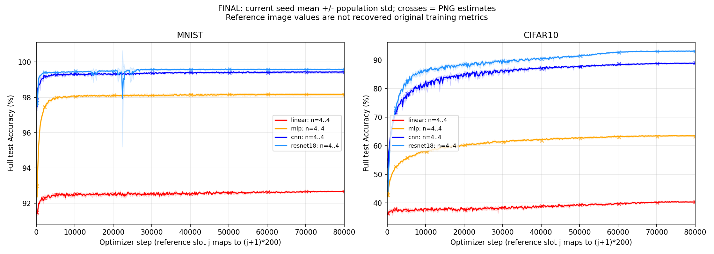

# main_exp 实测报告

## 一、摘要

### 2026-10-15 文本产物发布正确性修复（未重跑研究）

本Study的替换类报告/清单发布统一复用库 atomic_write_text；main_probe 的共享 save_json 另消除固定 `.writing` 竞争。最终文件位置、JSON/YAML格式和研究配置/预算不变；旧Run和provenance不改写。合成文件/并发合同、计算AST范围核对及CI状态见 [开发记录 §79](../../../docs/development/record.md#79-全仓替换文本发布合同接续53--b-072)。本次仅代码正确性验证，不执行数据准备、性能入口、GPU或原研究；既有科学结论仍对应其原来源，未来实测使用新version/make并重新验证。

### 2026-10-14 共享输入迁移验证

原始数据默认迁至项目shared/data，并保留旧路径引用。完整MNIST60000/10000、CIFAR1050000/10000各由两个消费者读取，16项固定raw hash不变；归档格式与torchvision路径指向同一文件。本机main_exp的23个共享文件及旧probe的848个匹配raw路径完成引用适配，278份历史result/index/process/provenance字节不变。逻辑重复字节汇总不是实测磁盘释放量；不删除无法识别的输入或失败证据。见 [迁移证据](shared_inputs_migration.json)。

本轮没有新80000-step长矩阵或当前源码八格600-step前置门，原v0.3.0正式结论保持原来源。

固定归档processed改为来源分版共享后，MNIST / CIFAR10各linear的CPU200-step前缀诊断通过、参数最大差0，采样和scheduler总预算仍80000，完整test与原数值门保持；[正式精选证据](shared_inputs_prefix.json)保留实际源码与限制。两格200-step不能替代八格600-step。4ccb28d新缓存的六个processed文件与旧缓存字节相同，已保持旧路径同文件引用；与98648f3的不同格式分别存储。

### 2026-10-13 v0.3.0 本机完整复验

- 完成：main_probe新正式八格60-step及Study终验通过；main_exp八格600-step前置门、32条各自连续80000-step训练、32条各自best独立评测、64条完整性及八组固定四seed曲线门 / 两组模型次序门均通过。每条训练有400个完整test10000点，未缩短预算或评测。
- 来源：软件为核对过的最新main / 发布v0.3.0 / `804b3823ab6d2af46cbda1a65688ca8b76c60b22`，独立venv与16项raw hash已验证，FP32、benchmark / 两项TF32=false、CUBLAS=:4096:8、CPU2 / workers0保持不变。每条训练的实际浮点权重为torch.float32，committed scheduler进度与保存step一致。
- 并发：两Study分别实测资源，main_exp采用4.5 GiB、main_probe采用5 GiB、原生auto两并发与safety=0.5。main_exp短校准round2总体吞吐约为串行1.35–1.54倍；main_probe auto约1.33倍。本轮长执行没有同条件完整串行对照，不把短校准比值当长矩阵加速比。
- 执行与中断：原调度04:26开始，20:59左右在30条训练完成后中断；未完成两条旧轨迹保留。接续21:14–23:11重新从step0训练两个受影响seed并完成全部评测，接续观察墙钟1.956小时；从首次启动至接续结束的包络约18.756小时，含中断和接续准备。32条成功训练分别连续，不称一次连续launch。原30条结果与原provenance未改，四个受影响身份槽位使用recovery01，源码与科学配置一致。
- 科学结果：八组终点均值最大原图估读差0.254999个百分点，所有预置曲线门通过；八格seed0最初600步的96个指标值精确一致，两条中断 / 重跑的已保留指标前缀精确一致。这些前缀证据不替代全预算验收，也不证明原图对应的全部历史权重逐位相同。
- 资源与剩余问题：两段观察整卡峰值10.66 GiB、最少空闲12.82 GiB、主存最少可用4.81 GiB，含背景与驱动/context；精确allocator峰值限校准记录。B-030报告来源缺陷仍open，本次通过ID集合 / 真实provenance核对防止旧数字混入。历史原始seed / 指标 / 权重未恢复，历史自定义sampler的精确resume仍未验收；并发进一步改进只记brainstorm。
- 证据：[64条审计](v030_long_audit.json)、[固定曲线终验](COMPARISON.json)、[数字](NUMBERS.md)、[接续身份与原来源](v030_recovery_plan.json)、[原中断](v030_interruption.json)、[完整重跑前缀](v030_interrupted_prefix_audit.json)、[执行记录](v030_execution.md)。原日志 / checkpoint / 逐次资源JSONL仅本机，随Git提供的正式JSON保留状态、数字、hash和验证边界。

### 2026-10-13 容量与精度复验

以下记录发布准备阶段的候选源码与当时状态；发布后的本机完整复验以本节最上方摘要为准，历史“未执行”不代表当前状态。

- 目标：验证修复后的实际容量和严格数值边界，不重跑长矩阵。完整raw缓存已按16项历史hash校验。
- 容量：27个800-step原生Flow Run通过；CNN、ResNet18、混合任务的round1/2/3严格checkpoint / test history一致，无OOM。代表性并发总体更快，main_exp后续fresh make使用显式4.5GiB预算和既有50%安全池。
- 精度：同一新CNN best的16次FP32串行 / 并发全test逐样本一致；TF32对照取得不同kernel及两张图预测差异。旧B-023 checkpoint未找回，新权重不替代旧76800-step反例。
- 状态与边界：最终候选源码[八格600-step前置复验](speed_measurements/main-ready-preflight-20261013-014911.json)全部通过，参数最大差0、Loss最大差4.44e-16，输入 / RNG / scheduler / 正确计数门一致，实测期间来源未变；此前[标签变更前一轮](speed_measurements/main-ready-preflight-20261013-013509.json)另行保留。未执行当前源码完整80000-step矩阵。旧失败、freeze中止、固定快照和原始JSON见[速度报告](speed_calibration.md#九2026-10-13-cifar10-容量与总体吞吐)；version03[历史长结果快照](versions/main-exp-flow-20261011-03/README.md)不替代本版本长曲线验收，旧PREFLIGHT保留，异机须fresh gate。

### 2026-10-12 B-022 单组速度 / 显存接续

- 通过现有校准入口完成 MNIST / ResNet18、seed0、两侧各800-step / 完整 test10000 的固定源码复验；初始与最终参数精确一致，四段正确样本数一致，Loss 差为0。
- 当前链 peak reserved 为2472 MiB，未包含全部进程开销，不直接作为正式装箱预算。源码、实际精度、raw hash、阶段时间和三轮失败保留在 [速度报告第八节](speed_calibration.md#八2026-10-12-本机-mnist-短校准)。
- 该结果不证明 CIFAR10 并发安全或速度排名，不替代八格前置门与完整矩阵。B-022 的整体容量 / 吞吐校准和 B-023 的默认精度根因仍开放，正式声明与旧结果未覆盖。

### 2026-10-12 重构后单组 200-step 前缀复验

- 目标：通过现有 `recipe.preflight` 对照原 main `4ccb28d` 与重构后的当前链；只做 MNIST / linear、seed0、CUDA、200 steps、完整 test10000，sampler 与 cosine horizon 仍为 80000。
- 结果：参数与 Loss 最大差均为 0，输入、RNG、scheduler 和正确样本数门通过；两侧 test Accuracy 均为 91.3100%，成对计算 7.005 s。源码在计算期间未变化，详细条件和原始数字见 [短实验证据](flow_smoke_20261012.json)。
- 当前状态：验证 ID 为 `main-exp-flow-smoke-20261012-01`，源码为 `7eb16438` 加未提交重构；产物在本机 `shared/validation/`，不随 clone 提供。正式 version03 声明、PREFLIGHT 和长实验结果未改写。
- 边界：这是手动前置对照，不是正式 Flow Run，也不是八格 600-step 门；不能据此解锁长矩阵。实验后的 collect 入口重复实现清理已通过函数 AST 一致性及 57 passed / 2 skipped 针对性回归；本次实测来源仍是清理前快照，后续完整复验必须重新建立基线。

### 2026-10-11 version03 历史完整验收

以下摘要及第二节起记录重构前的完整验收，不作为本轮重构后完整矩阵通过的依据。

main-exp-flow-20261011-03 的新源码八格 600-step 原代码 / 当前链前置对照全部通过，参数最大差均为 0。完整矩阵于 2026-10-11 05:03 启动，按 round=3 调度 32 条连续 80000-step train 与 32 条自身 best 独立 eval。已有 32 条训练正式成功，均完成 80000-step 连续训练及 400 个完整评测点，单体 checkpoint / tracker 核查通过；32 条自身 best 独立评估也全部成功，64 个 Run 的 checkpoint / tracker 合同核查通过。2026-10-11 19:48 原生 Flow 正常退出（exit 0），Study process 应用固定四 seed 曲线门后通过终验。

实际源码提交 09e495b2d006caa197bb41e2773d47b817a4bd46；Torch 2.11.0+cu130、RTX 5090 D v2、CPU 2 线程。新基线显式关闭 cuDNN / matmul TF32，并在 prepare 完成后检查实际 deterministic、cuDNN 和精度开关；数据、seed、预算和固定估读门沿用 [PLAN.md](<../../../docs/research/研究计划 RPipe.md#study-main-exp>)。旧版训练及评估全部执行成功但终验 invalid，完整证据见 [version02 报告](versions/main-exp-flow-20261010-02/STUDY_REPORT.md)，不能混入当前精度基线。

## 二、改前与改后

本节至第四节保留2026-10-11 version03历史结果与当时变更，证据指向对应快照；本轮完整结果在摘要和第五节。

| **范围** | **改前** | **当前状态** |
| --- | --- | --- |
| 设备条件 | 归档导入把声明的 benchmark=false 覆盖为 true；TF32 未显式固定 | 导入前开关保存并恢复，TF32 显式关闭，实际值写入 runtime_validation.json；全部 64 个 Run 均通过实际值检查 |
| 前置来源 | 新 make 后可能沿用旧源码的成功前置报告 | register 核对前置源码 hash；旧源码报告拒绝回归通过，新源码八格对照通过 |
| 调度 | 重型四 seed 被逐条串行安排 | 新完整矩阵显式 round=3，首批三条训练同时推进；B-022 容量估算器仍开放 |
| 验收 | 旧版 best 独立评估存在一个样本差异 | 新版本全部 32 组自身 best 独立评估一致，八组固定曲线门与两组模型次序门通过；B-023 的本次 FP32 基线复验通过，具体 kernel 根因仍未完全确定 |

## 三、证据与未完成项

1. 前置证据：[PREFLIGHT.json](versions/main-exp-flow-20261011-03/PREFLIGHT.json)。导入副作用与失败边界回归：[ARCHIVE_RUNTIME_REGRESSION.json](versions/v030-before-local-20261013/docs/ARCHIVE_RUNTIME_REGRESSION.json)。正式 Flow 前缀辅助核查：[FLOW_PREFIX_AUDIT.json](versions/v030-before-local-20261013/docs/FLOW_PREFIX_AUDIT.json)，当前已核对 8/8 组 seed0，step200 / 400 / 600 共 96 个 train/test Loss / Accuracy 值与通过的前置链完全一致；只覆盖这些前缀的指标，不代替参数或长预算终验。精度和恢复条件：[eval_recovery.md](versions/v030-before-local-20261013/docs/eval_recovery.md)。
2. 当前曲线证据：[COMPARISON.json](versions/v030-before-local-20261013/docs/COMPARISON.json)，状态 passed，complete=true、final_gates_applied=true。八组均包含四个 seed；参考叉号为原图估读，不是恢复的原始指标。正式更新日期和执行细节见 [RERUN.md](versions/v030-before-local-20261013/docs/RERUN.md)。
3. 32 条训练、32 条各自 best 独立评估、完整性核查和固定曲线门均已完成；正式数字见 [NUMBERS.md](versions/main-exp-flow-20261011-03/NUMBERS.md)。同设备 CNN / ResNet18 各三次串行历史速度校准已完成，见 [速度报告](speed_calibration.md)；B-022 的容量与并发吞吐调查仍未完成。B-021 已按通用原生单进程合同本机修复，本 Study 的自定义 sampler / 数据适配尚未验收精确恢复，继续拒绝中断续训。原图的实际 seed、环境及原始指标没有恢复，终验结论限于预先固定的估读门。
4. 原始 Run 日志、数据和 checkpoint 保留在本机 runs / shared 下，不随 Git clone 提供。临时 launch 日志 .tmp/main-exp-flow-20261011-03-launch.log 和会话 13127 也仅为本机执行证据。

## 四、已完成训练

截至 2026-10-11 19:48，以下 32 条训练正式成功，完整性证据见 [CHECKPOINT_AUDIT.json](versions/v030-before-local-20261013/docs/CHECKPOINT_AUDIT.json)。数字为各 seed 的训练末点与全程 best，全部矩阵与独立 best 评估已完成；各 seed 数字与完整四 seed 终验分开呈现。

| **数据** | **模型** | **seed** | **Run ID** | **末点 Accuracy** | **全程 best Accuracy** | **训练耗时** |
| --- | --- | --- | --- | --- | --- | --- |
| MNIST | linear | 0 | 7cd22ce8f92311e3 | 92.6500% | 92.8000% | 0:31:13 |
| MNIST | linear | 1 | cbd61fd5c36c10ad | 92.6900% | 92.7700% | 0:31:31 |
| MNIST | linear | 2 | ccc82976e799fc4b | 92.6800% | 92.7700% | 0:31:05 |
| MNIST | linear | 3 | c9715d794ad3049b | 92.6800% | 92.8000% | 0:31:24 |
| MNIST | mlp | 0 | 614c69d396e317b9 | 98.0800% | 98.1300% | 0:32:28 |
| MNIST | mlp | 1 | 3fa6abbc9027faad | 98.2600% | 98.3100% | 0:32:33 |
| MNIST | mlp | 2 | 9d53348ea5c1165c | 98.1700% | 98.2400% | 0:32:50 |
| MNIST | mlp | 3 | 787e4985f98a2e63 | 98.0900% | 98.1500% | 0:32:59 |
| MNIST | cnn | 0 | f4133f0d7a248646 | 99.4100% | 99.4900% | 0:37:20 |
| MNIST | cnn | 1 | 2921357483f031cd | 99.4600% | 99.5000% | 0:39:05 |
| MNIST | cnn | 2 | 96c74c6b1e44e9cf | 99.4800% | 99.5400% | 0:39:07 |
| MNIST | cnn | 3 | fd2727682e116c02 | 99.3500% | 99.4300% | 0:38:59 |
| MNIST | resnet18 | 0 | cf087b07765f4be4 | 99.6000% | 99.6700% | 2:09:19 |
| MNIST | resnet18 | 1 | 977b2e85d87dcc31 | 99.5500% | 99.5900% | 2:08:46 |
| MNIST | resnet18 | 2 | 9d380eea53541fa8 | 99.5700% | 99.6200% | 2:09:25 |
| MNIST | resnet18 | 3 | 069305e87da05b12 | 99.6000% | 99.6300% | 1:13:49 |
| CIFAR10 | linear | 0 | fc085db588d295b4 | 40.3900% | 40.6700% | 1:26:00 |
| CIFAR10 | linear | 1 | 385bf2b1307b622f | 40.5300% | 40.6600% | 1:25:48 |
| CIFAR10 | linear | 2 | dae98504b3fa274d | 40.3200% | 40.6200% | 1:25:48 |
| CIFAR10 | linear | 3 | a9148272760d5180 | 40.2400% | 40.4400% | 1:26:02 |
| CIFAR10 | mlp | 0 | d2b0e7f33699ecd4 | 63.6500% | 63.8500% | 1:26:11 |
| CIFAR10 | mlp | 1 | 6c2cda2cf02c2a9b | 63.2400% | 63.4200% | 1:26:31 |
| CIFAR10 | mlp | 2 | 28f2368d1634417c | 63.6900% | 63.8800% | 1:26:30 |
| CIFAR10 | mlp | 3 | 8e5f67f6b365822f | 63.2900% | 63.5000% | 1:26:19 |
| CIFAR10 | cnn | 0 | b99775641e1800c7 | 88.8500% | 89.0700% | 1:32:19 |
| CIFAR10 | cnn | 1 | 48ee1a36f59ac74d | 88.9000% | 89.1300% | 1:32:13 |
| CIFAR10 | cnn | 2 | 30cc6a335b81cf34 | 88.4200% | 88.6600% | 1:32:13 |
| CIFAR10 | cnn | 3 | 6ce695c58b4b1f98 | 88.8500% | 89.0700% | 1:36:43 |
| CIFAR10 | resnet18 | 0 | 5bd65c61c30c12d2 | 92.8100% | 93.0000% | 2:17:35 |
| CIFAR10 | resnet18 | 1 | caf78c8d80ad9f10 | 93.0200% | 93.2300% | 2:17:34 |
| CIFAR10 | resnet18 | 2 | 8c413f14e3d8f742 | 93.1000% | 93.2600% | 2:03:14 |
| CIFAR10 | resnet18 | 3 | 6b9fced9385ffbad | 93.2100% | 93.3200% | 2:03:14 |

## 五、本轮 v0.3.0 完整长结果与来源

### （一）接续前后对照

| **范围** | **接续前 / 既有状态** | **本轮完成后的实际状态** |
| --- | --- | --- |
| 本机环境与数据 | 历史环境和成功报告不能作为本轮证明 | 隔离venv、真实CUDA、完整16项hash、最终core / CPU门及两Study数值门实测通过 |
| 调度资源 | 统一预算的设备适用性需验证，原生同模型静态wait分组存在优化空间 | 独立校准各Study，保留保护池；两并发通过数值及资源门，未修改调度实现或科学配方 |
| 中断训练 | 最后两条在24400步附近中断，自定义sampler未验收精确恢复 | 两条新Run各自从step0连续80000步，原30条来源保留；未将旧checkpoint当续训入口 |
| 结果身份 | 原root process可能仍为旧轮次，B-030可导出旧数字 | 本次index / process / COMPARISON全部对应当前64个Run，逐Run来源与实际配置核对；B-030软件缺陷仍open |
| 长曲线证据 | 发布前version03的通过属于历史源码 | 最新已核对main的实际32条训练、32条评测、400点评测及全部固定门通过 |

### （二）固定四 seed 曲线门

下表均值±标准差为四seed末点的population描述，差值单位为百分点；参照列来自原图估读。终点 / 末50点均值 / 七锚点MAE与最大差 / 末段时间波动的预置门全部应用，两个数据集的末段模型次序也通过。逐门观察、门限与四条原始曲线在COMPARISON.json，没有按结果放宽门限。

| **组合** | **末点均值 % ± population std pp** | **原图末点估读 %** | **末点差 pp** | **末50均值差 pp** | **锚点 MAE pp** | **整组门** |
| --- | ---: | ---: | ---: | ---: | ---: | --- |
| MNIST / linear | 92.6750 ± 0.0150 | 92.6700 | 0.005001 | 0.001349 | 0.009644 | 通过 |
| MNIST / mlp | 98.1500 ± 0.0725 | 98.1600 | 0.009999 | 0.007649 | 0.014999 | 通过 |
| MNIST / cnn | 99.4250 ± 0.0502 | 99.4100 | 0.015001 | 0.010701 | 0.018215 | 通过 |
| MNIST / resnet18 | 99.5800 ± 0.0212 | 99.5900 | 0.009999 | 0.008399 | 0.016071 | 通过 |
| CIFAR10 / linear | 40.3700 ± 0.1065 | 40.3500 | 0.020001 | 0.009401 | 0.037143 | 通过 |
| CIFAR10 / mlp | 63.4675 ± 0.2038 | 63.2600 | 0.207501 | 0.233301 | 0.253573 | 通过 |
| CIFAR10 / cnn | 88.7550 ± 0.1945 | 89.0100 | 0.254999 | 0.183298 | 0.244285 | 通过 |
| CIFAR10 / resnet18 | 93.0350 ± 0.1464 | 92.9700 | 0.065002 | 0.097802 | 0.195715 | 通过 |

### （三）32 条成功训练

每条有400个完整test点，latest为80000步、best等于全程test Accuracy最大值；32条独立eval全部加载对应seed / 实际version的自身best并匹配正确样本数和保存step。final表示原调度完成的30条，recovery01表示从头连续重跑的两条；每条完整Run的实际version / provenance和eval来源均在v030_long_audit.json。日志链接依赖本机保留的Run资产，Git clone不包含它们。

| **数据** | **模型** | **seed** | **训练 Run ID** | **执行身份** | **末点 Accuracy** | **best Accuracy** | **训练耗时** | **本机证据** |
| --- | --- | ---: | --- | --- | ---: | ---: | --- | --- |
| CIFAR10 | cnn | 0 | 8d9daf7916520731 | final | 88.8500% | 89.0700% | 1:26:41 | [日志](../runs/8d9daf7916520731/assets/logs/run.log) |
| CIFAR10 | cnn | 1 | ababcab8f6d65c72 | final | 88.9000% | 89.1300% | 1:26:40 | [日志](../runs/ababcab8f6d65c72/assets/logs/run.log) |
| CIFAR10 | cnn | 2 | c0c5d1936ad0da6c | final | 88.4200% | 88.6600% | 1:21:16 | [日志](../runs/c0c5d1936ad0da6c/assets/logs/run.log) |
| CIFAR10 | cnn | 3 | f4a19e8da0eb7d90 | final | 88.8500% | 89.0700% | 1:21:13 | [日志](../runs/f4a19e8da0eb7d90/assets/logs/run.log) |
| CIFAR10 | linear | 0 | e0810e7b3f071367 | final | 40.3900% | 40.6700% | 1:09:08 | [日志](../runs/e0810e7b3f071367/assets/logs/run.log) |
| CIFAR10 | linear | 1 | eff5c8acf0c7dc88 | final | 40.5300% | 40.6600% | 1:08:59 | [日志](../runs/eff5c8acf0c7dc88/assets/logs/run.log) |
| CIFAR10 | linear | 2 | 48e6cc671a2cd192 | final | 40.3200% | 40.6200% | 1:20:38 | [日志](../runs/48e6cc671a2cd192/assets/logs/run.log) |
| CIFAR10 | linear | 3 | 54feef6b7d47e1bf | final | 40.2400% | 40.4400% | 1:20:50 | [日志](../runs/54feef6b7d47e1bf/assets/logs/run.log) |
| CIFAR10 | mlp | 0 | 46c16a43bc5a7f58 | final | 63.6500% | 63.8500% | 1:21:42 | [日志](../runs/46c16a43bc5a7f58/assets/logs/run.log) |
| CIFAR10 | mlp | 1 | 31e904af62d676e1 | final | 63.2400% | 63.4200% | 1:21:43 | [日志](../runs/31e904af62d676e1/assets/logs/run.log) |
| CIFAR10 | mlp | 2 | 913ae66fe6c7ddd9 | final | 63.6900% | 63.8800% | 1:21:38 | [日志](../runs/913ae66fe6c7ddd9/assets/logs/run.log) |
| CIFAR10 | mlp | 3 | 180355784b991302 | final | 63.2900% | 63.5000% | 1:21:33 | [日志](../runs/180355784b991302/assets/logs/run.log) |
| CIFAR10 | resnet18 | 0 | 64bbf81249f98718 | final | 92.8100% | 93.0000% | 2:07:03 | [日志](../runs/64bbf81249f98718/assets/logs/run.log) |
| CIFAR10 | resnet18 | 1 | 27a5b73a9ff05450 | final | 93.0200% | 93.2300% | 2:07:03 | [日志](../runs/27a5b73a9ff05450/assets/logs/run.log) |
| CIFAR10 | resnet18 | 2 | 0572738bf48d6536 | recovery01 | 93.1000% | 93.2600% | 1:55:40 | [日志](../runs/0572738bf48d6536/assets/logs/run.log) |
| CIFAR10 | resnet18 | 3 | 895601f2fbde8418 | recovery01 | 93.2100% | 93.3200% | 1:55:40 | [日志](../runs/895601f2fbde8418/assets/logs/run.log) |
| MNIST | cnn | 0 | 8aeb38536c213eea | final | 99.4100% | 99.4900% | 0:35:40 | [日志](../runs/8aeb38536c213eea/assets/logs/run.log) |
| MNIST | cnn | 1 | d0c852d1824dfbdc | final | 99.4600% | 99.5000% | 0:35:30 | [日志](../runs/d0c852d1824dfbdc/assets/logs/run.log) |
| MNIST | cnn | 2 | 2fbd37f4280ca44e | final | 99.4800% | 99.5400% | 0:35:29 | [日志](../runs/2fbd37f4280ca44e/assets/logs/run.log) |
| MNIST | cnn | 3 | 4720df1be1e1f821 | final | 99.3500% | 99.4300% | 0:35:40 | [日志](../runs/4720df1be1e1f821/assets/logs/run.log) |
| MNIST | linear | 0 | 9eb2aa9c1ba6698d | final | 92.6500% | 92.8000% | 0:20:28 | [日志](../runs/9eb2aa9c1ba6698d/assets/logs/run.log) |
| MNIST | linear | 1 | 9f8ba1e313f320d0 | final | 92.6900% | 92.7700% | 0:20:29 | [日志](../runs/9f8ba1e313f320d0/assets/logs/run.log) |
| MNIST | linear | 2 | c0e6228390220324 | final | 92.6800% | 92.7700% | 0:20:28 | [日志](../runs/c0e6228390220324/assets/logs/run.log) |
| MNIST | linear | 3 | b856c36b845f39a3 | final | 92.6800% | 92.8000% | 0:20:23 | [日志](../runs/b856c36b845f39a3/assets/logs/run.log) |
| MNIST | mlp | 0 | 98b2d68f940214b6 | final | 98.0800% | 98.1300% | 0:30:28 | [日志](../runs/98b2d68f940214b6/assets/logs/run.log) |
| MNIST | mlp | 1 | 566c5ffb78b2a815 | final | 98.2600% | 98.3100% | 0:30:20 | [日志](../runs/566c5ffb78b2a815/assets/logs/run.log) |
| MNIST | mlp | 2 | 07f033dd0adf88f6 | final | 98.1700% | 98.2400% | 0:30:33 | [日志](../runs/07f033dd0adf88f6/assets/logs/run.log) |
| MNIST | mlp | 3 | 51071324cba33354 | final | 98.0900% | 98.1500% | 0:30:27 | [日志](../runs/51071324cba33354/assets/logs/run.log) |
| MNIST | resnet18 | 0 | 149a2c46c53d310a | final | 99.6000% | 99.6700% | 1:26:17 | [日志](../runs/149a2c46c53d310a/assets/logs/run.log) |
| MNIST | resnet18 | 1 | d9a305205598356e | final | 99.5500% | 99.5900% | 1:26:16 | [日志](../runs/d9a305205598356e/assets/logs/run.log) |
| MNIST | resnet18 | 2 | 2b8945d844b1658b | final | 99.5700% | 99.6200% | 1:26:30 | [日志](../runs/2b8945d844b1658b/assets/logs/run.log) |
| MNIST | resnet18 | 3 | 9bcf24dee1442929 | final | 99.6000% | 99.6300% | 1:26:32 | [日志](../runs/9bcf24dee1442929/assets/logs/run.log) |
