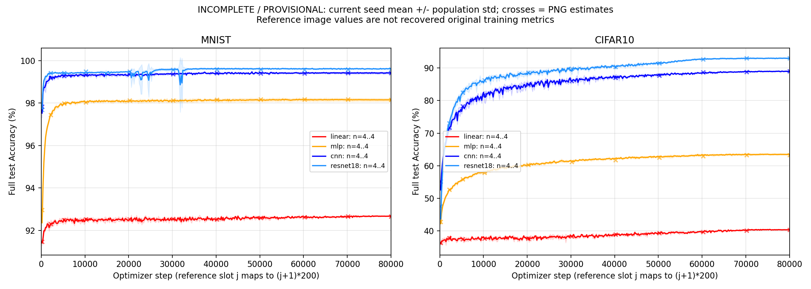

# main_exp version02 实测报告

## 一、摘要

main-exp-flow-20261010-02 的 32 条连续 80000-step train 与 32 条自身 best eval 已执行成功，64 个单体 checkpoint / tracker 契约通过；Study 终验 invalid。CIFAR10 CNN seed0 的 best 独立评测差一个正确样本，固定四 seed 曲线门未正式应用。五次新进程串行复查仍有一次不一致，因此停止原配方串行恢复，未替换任何正式结果。

主源码提交 e682f25e510436b51430510c4a8057cadc09c582；Torch 2.11.0+cu130、RTX 5090 D v2、CPU 2 线程，数据 / seed / 预算和图像估读门未改。600-step 原代码 / 当前链八格前置门通过，只证明受控前缀，不替代长实验终验。

## 二、改前与改后

| **范围** | **改前** | **本次结果** |
| --- | --- | --- |
| Flow 接续 | 已有旧基线结果，重构版本未实测 | 32 train / 32 eval 通过真实六阶段链执行，来源冻结与完整测试集审计通过 |
| 剩余调度 | CIFAR10 ResNet18 seed 逐条串行 | seed1 原进程保留，seed2 / 3 通过原生 run-one 并发，均完成连续 80000-step 预算；容量估算器仍未修复 |
| 数值终验 | 前置门通过 | 长实验独立 best 门揭示 1 张样本差异；执行成功与质量通过分别记录，未放宽门限 |

## 三、原图与当前训练末点

以下为描述性数字，不是当前版本的正式曲线门结论。原图仅是 PNG 估读，原始 seed 集合、逐 seed 记录与环境未找回。当前值为四 seed 训练末点均值 ± population std（ddof=0），不以 best 代替末点。

| **数据** | **模型** | **原图末点估读（%）** | **当前末点（%）** | **差值（百分点）** |
| --- | --- | --- | --- | --- |
| MNIST | linear | 92.6700 | 92.6750 ± 0.0150 | +0.0050 |
| MNIST | mlp | 98.1600 | 98.1500 ± 0.0725 | -0.0100 |
| MNIST | cnn | 99.4100 | 99.4075 ± 0.0402 | -0.0025 |
| MNIST | resnet18 | 99.5900 | 99.6225 ± 0.0130 | +0.0325 |
| CIFAR10 | linear | 40.3500 | 40.3700 ± 0.1065 | +0.0200 |
| CIFAR10 | mlp | 63.2600 | 63.4675 ± 0.2038 | +0.2075 |
| CIFAR10 | cnn | 89.0100 | 88.9000 ± 0.1562 | -0.1100 |
| CIFAR10 | resnet18 | 92.9700 | 92.9250 ± 0.1297 | -0.0450 |

## 四、失败证据与限制

CIFAR10 CNN seed0 train 16ae89c5c90f7eca 在 step76800 保存 best=8915/10000；eval 00597cc7bfc1fb1d 加载匹配的实际路径和步数，结果为 8914/10000。其余 31 个 best 对照一致。默认 cuDNN TF32 并发诊断两批各 8 次存在 8914 / 8915 两种结果，串行五次也有一次 8914；FP32 八次均为 8915，输入与模型 hash 一致。具体 kernel 尚未跟踪，不能把这份诊断当作 FP32 训练验收。

完整数字见 [NUMBERS.md](NUMBERS.md)，原始曲线与失败门见 [COMPARISON.json](COMPARISON.json)，前置门见 [PREFLIGHT.json](PREFLIGHT.json)，设备对照见 [EVAL_DIAGNOSTIC.json](EVAL_DIAGNOSTIC.json)。所有旧 Run / checkpoint 继续留在本机原目录；正式 JSON 保存可随 Git clone 获得的数字、hash 与失败结论，临时原始日志及 logits 不随 clone 提供。

## 五、下一基线

新 version03 显式固定 cudnn_allow_tf32=false / matmul_allow_tf32=false。浮点训练轨迹可能变化，须重新通过前置门并执行完整矩阵；不把本版本训练混入新精度基线。旧结果和失败保留，恢复停止条件与新方案见当前 Study 的 eval_recovery.md。
