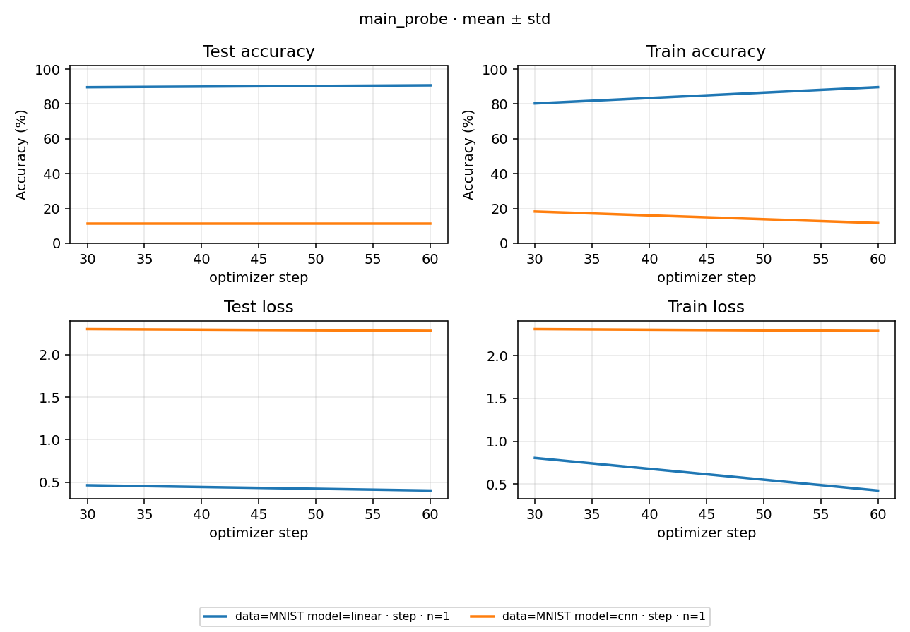
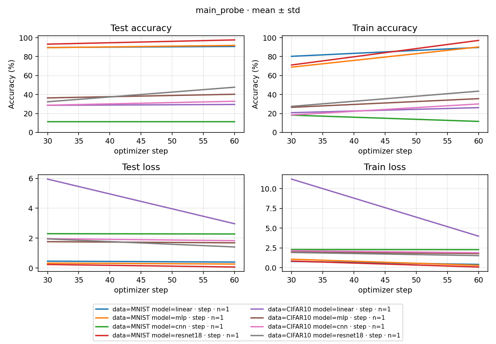

# main_probe 实测报告

## 一、摘要

### 2026-10-14 共享 raw 的单格流程验证

共享改动后使用两个新身份完成 MNIST/linear 的60-step、完整test10000成对验证，实际CUDA与CPU各一次，均通过输入 / RNG / 参数 / 整数样本计数 / best独立eval和库compare；仅单格，未执行新完整八格Study。原版 / 当前版raw引用项目共享文件，Stats和processed仍隔离。实际来源、版本、数值门及首轮失败见 [共享验证证据](shared_inputs_validation.json)。

CUDA Run `1dd708dab35a7aaa` 的原声明曾被误标为CPU：基底device被fixed.system.device覆盖，生成配置和实测均为CUDA；保留实际事实。同步两个层级后CPU新Run `318c693057e54f70` 通过，execution_device=cpu、gpu_execution_started=false。原复制Study的prepare导出失败和临时脚本目录复用错误也保留，未覆盖旧Run。

自动统计目录改为IO参数、保持sampler配置身份后，再以新version `shared-inputs-20261014-cpu04` / Run `25ae12161dec991a` 做CPU同一单格60-step完整test复验并通过。首轮CPU单格的Study process实际拒绝不完整矩阵，成功Run仍保全；不把单格结果写成完整八格Study通过。

### 2026-10-13 v0.3.0 正式八格本机复验

- 软件基线：发布 `v0.3.0` / `804b3823ab6d2af46cbda1a65688ca8b76c60b22`；旧版固定 `98648f3`。独立 venv、完整 raw 16 项 hash、FP32、benchmark / 两项 TF32=false，数据、seed0、60-step / 完整 test 与门限不变。
- 正式 version：`main-probe-v030-20261013-final`。资源配置确定后 fresh make，8 succeeded / 0 failed / 0 pending，成对门、8 次库 compare、Study complete / passed 与来源不变均通过。16 段参数最大差 0、train/test Loss 最大差 4.44e-16。
- 并发：独立串行 / round2 同八任务为 246.60 / 141.75 秒，1.74×；round3 因保护未执行。最终采用原生 safety=0.5、5 GiB 预算的自动同模型两并发；校准 185.0 秒、1.33×，正式复验约171.20秒。不同分组与重复观测分开，不挑最快一次冒充稳定速度排名。
- 证据：[正式逐 Run 数值及来源](v030_final_gate.json)、[校准](v030_capacity.json)、[自动分组](v030_capacity_auto.json)、[执行记录](v030_execution.md)、[数字](NUMBERS.md)。运行资产和临时日志留在本机，不随 clone 提供。
- 边界：本次八格通过不替代 main_exp 的 80000-step 四 seed 长曲线；旧报告保留实际源码，不回填为本次运行。

| **组合** | **正式 Run ID** | **原版自身 best eval** | **当前链自身 best eval** |
| --- | --- | ---: | ---: |
| MNIST / linear | e7d86f0d69b4c7bd | 90.7300% | 90.7300% |
| MNIST / mlp | 74728c9fe0644092 | 91.8200% | 91.8200% |
| MNIST / cnn | b465aebb373aba20 | 11.3500% | 11.3500% |
| MNIST / resnet18 | cc778f4da5862223 | 97.6300% | 97.6300% |
| CIFAR10 / linear | 402cc418c88df2ca | 29.5200% | 29.5200% |
| CIFAR10 / mlp | c94251a081b0b074 | 40.3000% | 40.3000% |
| CIFAR10 / cnn | ef9e845bd80b849f | 32.8900% | 32.8900% |
| CIFAR10 / resnet18 | 09684e7b06ef2e19 | 47.7300% | 47.7300% |

### 2026-10-13 version06 完整短探针

- 目标：验收缺陷修复后的真实六阶段成对流程，非长曲线。version为main-probe-flow-20261013-06，基于dev ce8b3e6加当时未提交修复，实际源码哈希随报告保存。
- 结果：8 succeeded / 0 failed / 0 pending；Study complete=true / passed=true。16段参数最大差0，输入、RNG、optimizer、scheduler、计数、best选择与两侧独立评测均通过；8次库compare通过，原门不变。
- 保全：旧version05两条Run和六条pending子集清单 / 报告已[逐字节保存](versions/main-probe-flow-20261012-05/README.md)，不是将旧子集改写为完整通过。本轮完整机器证据见[flow_validation_20261013.json](flow_validation_20261013.json)，最新数字表对应本次8组。
- 边界：60-step短探针不替代main_exp80000-step验收；Run / 权重 / 日志仍在本机，不随clone提供。

| **组合** | **Run ID** | **两侧独立 eval Accuracy** |
| --- | --- | ---: |
| MNIST / linear | c3daa91bd822de97 | 90.7300% |
| MNIST / mlp | 926f3fea763bbb50 | 91.8200% |
| MNIST / cnn | aeb45fd0052480a1 | 11.3500% |
| MNIST / resnet18 | 2ce06ae7c0f1542c | 97.6300% |
| CIFAR10 / linear | 5207b4b350d9e8bf | 29.5200% |
| CIFAR10 / mlp | 94541f193540c92a | 40.3000% |
| CIFAR10 / cnn | 039bb9486ec47aee | 32.8900% |
| CIFAR10 / resnet18 | 94795d9bc81f9304 | 47.7300% |

### 2026-10-12 两柱与阶段入口短复验

- 目标：确认 `structure/` 建构、`flow/<phase>/run.py` 编排在真实短训练中仍遵守原数值门。基线为 `7eb16438` 加未提交重构，version 为 `main-probe-flow-20261012-05`。
- 结果：MNIST / linear、MNIST / cnn 各完成两侧 60 steps、完整 test 和自身 best 独立 eval；两个 Run 的六阶段链、逐段参数、Loss、输入、RNG、optimizer、scheduler、归档核验与库 compare 均通过。
- 当前状态：2 succeeded / 0 failed / 6 pending；Study process 按预期 exit 1，报告 complete=false / passed=false，没有把子集当作八组合终验。正式数字见 [短实验证据](flow_smoke_20261012.json) 与 [当前数字](NUMBERS.md)。
- 失败与边界：version04 因缺少 `evaluate` 在 prepare 失败，原失败 Run 保留；隔离目录补齐 evaluate 0.4.6 / datasets 5.1.0 后使用 version05 重跑。MNIST raw 8/8 hash 匹配；CIFAR 下载未完成，未验证另外六组。

| **组合** | **Run ID** | **参数 / Loss 最大差** | **两侧独立 eval Accuracy** | **成对计算耗时** |
| --- | --- | --- | --- | --- |
| MNIST / linear | 075534e416d6cc8d | 0 / 0 | 90.7300% | 5.001 s |
| MNIST / cnn | aa502aa512c16e4b | 0 / 0 | 11.3500% | 5.903 s |

耗时不含完整 Flow 准备，不用于性能排名；低预算 CNN Accuracy 不是长预算结论。实验完成后发现库 collect 包入口尚有重复实现，已清除，只保留导出；`run.py` 函数 AST 与旧实现一致，最终针对性回归 57 passed / 2 skipped。实测 provenance 保留清理前的真实 hash，未重写成清理后的来源；再次实测必须使用新 version 和 make。

### 2026-10-11 历史完整验收

以下摘要及第二至第七节记录重构前 version03 的完整验收，不是本轮 version05 的结果。[可取得的历史快照](versions/main-probe-flow-20261011-03/README.md) 保留旧报告、数字、图与终验；旧 index / provenance / process 未在当前检出中取得，未补造。

目标是确认固定 main `98648f3` 与当前 RPipe 在受控同设备 60-step 配方下的数值一致性。2026-10-11 的 FP32 version03 八组合完整通过；实际源码提交 `c9c782b5d5bb62da4e5e2292e96e842740c24f53`。Flow 阶段职责拆分后，真实 prepare → execute → collect → summarize → write → process 已完成，数值与库 artifact compare 同时通过。

- 主要结果：16 个 step30 / 60 点参数最大差 0，train / test Loss 最大差 4.44e-16，独立 eval Loss 差 0；正确样本数、RNG、输入、optimizer、scheduler、best 选择及原归档完整性全部通过
- 当前状态：8 succeeded / 0 failed / 0 pending，Study 终验 complete / passed；同一设备、Torch、提交与来源清单
- 失败保留：version01 的首个 Run 在准备阶段失败，模块导入与来源清单缺陷修复后使用新 version 从头运行
- 未完成：本探针不能替代 main_exp 的四 seed 80000-step 长曲线验收；本报告不宣称原 main 默认非确定性条件或其他设备通过

## 二、改前与改后

| **范围** | **改前** | **本次改后与证据** |
| --- | --- | --- |
| 阶段职责 | recipe 准备，execute 集中计算、比较、投影；write 后检查 | prepare.before 准备，execute 捕获，collect 比较，summarize 数值门，write 投影及库 compare 后定稿；八个真实 Run 全链成功 |
| GPU 精度 | 两侧没有显式声明 TF32 控制 | version03 两侧显式 FP32，全部输入 / RNG / 参数 / 正确样本数门通过 |
| 首轮准备 | version01 / f6db09ee2f38fec9 因缺 os 导入失败；归档被误计为源码变化 | version02 新 Run 完成环境落盘，复用库来源清单；真实源码变更仍受 freeze 保护，归档单独逐字节核验 |

## 三、条件与固定门

version 为 main-probe-flow-20261011-03，seed0；NVIDIA GeForce RTX 5090 D v2，Torch 2.11.0+cu130 / torchvision 0.26.0+cu130，Python 3.13.9，CPU 2 线程。完整 raw 文件匹配 [固定清单](../../main_exp/docs/DATA_MANIFEST.json)。运行使用仓库 src 与 .tmp/runtime 的 PYTHONPATH、MKL_THREADING_LAYER=SEQUENTIAL、MPLBACKEND=Agg，并固定 CUBLAS_WORKSPACE_CONFIG=:4096:8、cudnn_allow_tf32=false、matmul_allow_tf32=false。

两侧连续 60 optimizer steps，train batch250 / test1000，step30 / 60 完整 test10000，各自 Loss-best 独立 eval。准备使用完整 train 的原 Stats(dim1)。配方与固定门见 [PLAN.md](PLAN.md)，未因结果调整：参数及 momentum atol1e-6 / rtol1e-5，Loss 差≤1e-6，整数和正确样本数严格一致。

## 四、原代码与当前侧对比

下表是历史 version03 两侧自身 best 的独立 eval Accuracy（%）；曲线终点与 best 分别保留在 [逐对原始数字](versions/main-probe-flow-20261011-03/PAIR_RESULTS.json)，不以 best 替代训练终点。

| **数据** | **模型** | **固定 main 原代码** | **当前 RPipe** | **差值（百分点）** |
| --- | --- | --- | --- | --- |
| MNIST | linear | 90.7300 | 90.7300 | 0.0000 |
| MNIST | mlp | 91.8200 | 91.8200 | 0.0000 |
| MNIST | cnn | 11.3500 | 11.3500 | 0.0000 |
| MNIST | resnet18 | 97.6300 | 97.6300 | 0.0000 |
| CIFAR10 | linear | 29.5200 | 29.5200 | 0.0000 |
| CIFAR10 | mlp | 40.3000 | 40.3000 | 0.0000 |
| CIFAR10 | cnn | 32.8900 | 32.8900 | 0.0000 |
| CIFAR10 | resnet18 | 47.7300 | 47.7300 | 0.0000 |

图由库 process 从当前 Run 的实际 tracker history 生成；只有 step30 / 60 两个完整 test 点，不能外推长预算收敛或作为八模型性能排名。

## 五、验证与失败依据

历史 version03 每个 Run 的初始化参数与 RNG、完整 train / test 数据、实际索引与输入、step30 / 60 参数和 optimizer / scheduler / RNG、正确样本数、best 选择与权重、两侧各自 best 独立 eval 均通过。[历史 Study 终验](versions/main-probe-flow-20261011-03/PROBE_COMPARISON.json) 只读取当时 index，核验八组齐全、无重复、seed0、同设备与同来源。[历史逐对结果](versions/main-probe-flow-20261011-03/PAIR_RESULTS.json) 保存正式数值摘要及逐段判定。

首轮失败为 [f6db09ee2f38fec9 日志](../runs/f6db09ee2f38fec9/assets/logs/run.log)。CPU 数据/模型数值检查通过，但总体 prepare 未通过；原始 SOURCE_MANIFEST.json 显示105→137文件，增加项均为自身生成的32个归档 Python 文件。修复补充 os 导入，并用库 provenance.source_files 排除生成产物；归档独立校验与全部数值门保留。修复后 CPU 集成37项通过，version02八组真实复验通过。

## 六、Run 与原始证据

下列日志、比较报告、checkpoint 和 OBSERVATIONS.pt 是本机运行产物，不随 Git clone 提供；正式逐段数字、Study 终验、图片与本报告随 Git 提供。

- MNIST / linear：[Run 5326973d800e910b 日志](../runs/5326973d800e910b/assets/logs/run.log)，[比较证据](../runs/5326973d800e910b/assets/probe/COMPARISON.json)
- MNIST / mlp：[Run 4bfd7cac9435d290 日志](../runs/4bfd7cac9435d290/assets/logs/run.log)，[比较证据](../runs/4bfd7cac9435d290/assets/probe/COMPARISON.json)
- MNIST / cnn：[Run 0e50147d81a620df 日志](../runs/0e50147d81a620df/assets/logs/run.log)，[比较证据](../runs/0e50147d81a620df/assets/probe/COMPARISON.json)
- MNIST / resnet18：[Run 50601537445bede2 日志](../runs/50601537445bede2/assets/logs/run.log)，[比较证据](../runs/50601537445bede2/assets/probe/COMPARISON.json)
- CIFAR10 / linear：[Run cd476205ee101527 日志](../runs/cd476205ee101527/assets/logs/run.log)，[比较证据](../runs/cd476205ee101527/assets/probe/COMPARISON.json)
- CIFAR10 / mlp：[Run b9739155f583f75f 日志](../runs/b9739155f583f75f/assets/logs/run.log)，[比较证据](../runs/b9739155f583f75f/assets/probe/COMPARISON.json)
- CIFAR10 / cnn：[Run 5393e60e0c588ca5 日志](../runs/5393e60e0c588ca5/assets/logs/run.log)，[比较证据](../runs/5393e60e0c588ca5/assets/probe/COMPARISON.json)
- CIFAR10 / resnet18：[Run 03474cc7d60f809b 日志](../runs/03474cc7d60f809b/assets/logs/run.log)，[比较证据](../runs/03474cc7d60f809b/assets/probe/COMPARISON.json)

## 七、执行记录

2026-10-11：在精度修复提交 c9c782b 上通过统一 CLI 以 round3 完成 version03 的八格真实六阶段链，Study process 终验通过，rpipe report 生成 [历史数字](versions/main-probe-flow-20261011-03/NUMBERS.md)。旧 version02 完整通过的证据保留在 [版本报告](versions/main-probe-flow-20261010-02/STUDY_REPORT.md)。详细过程见 [RERUN.md](RERUN.md)。main_exp version03 的完整长曲线验收另已通过，见 [长实验报告](../../main_exp/docs/STUDY_REPORT.md)；本短探针本身不替代长预算验收。
