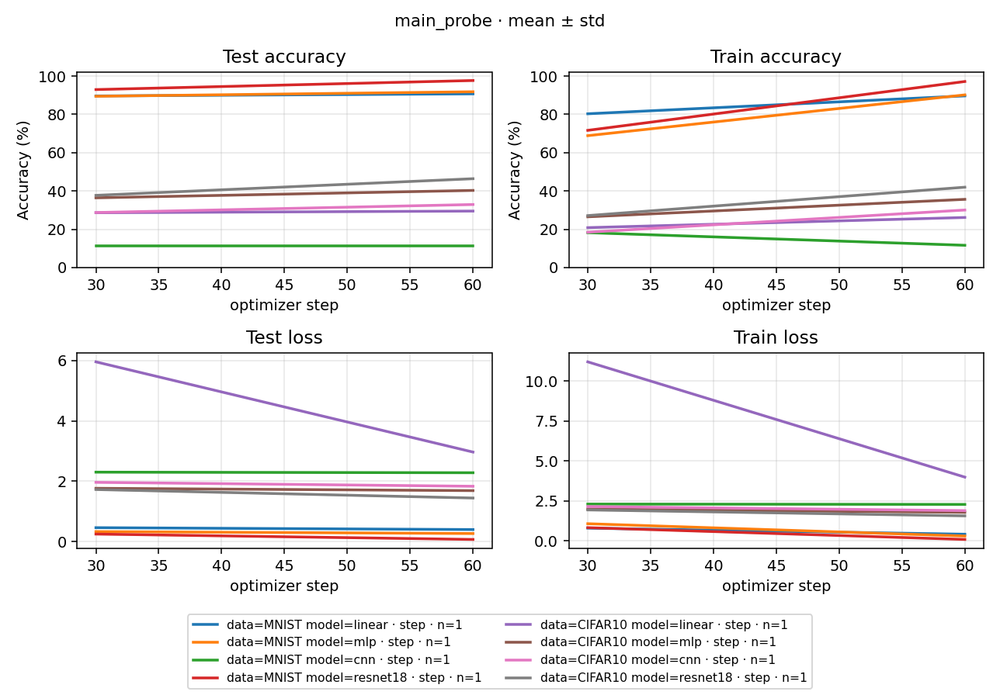

# main_probe 实测报告

## 一、摘要

目标是确认固定 main `98648f3` 与当前 RPipe 在受控同设备 60-step 配方下的数值一致性。2026-10-10 的 version02 八组合完整通过；实际源码提交 `e682f25e510436b51430510c4a8057cadc09c582`。Flow 阶段职责拆分后，真实 prepare → execute → collect → summarize → write → process 已完成，数值与库 artifact compare 同时通过。

- 主要结果：16 个 step30 / 60 点参数最大差 0，train / test Loss 最大差 6.66e-16，独立 eval Loss 差 0；正确样本数、RNG、输入、optimizer、scheduler、best 选择及原归档完整性全部通过
- 当前状态：8 succeeded / 0 failed / 0 pending，Study 终验 complete / passed；同一设备、Torch、提交与来源清单
- 失败保留：version01 的首个 Run 在准备阶段失败，模块导入与来源清单缺陷修复后使用新 version 从头运行
- 未完成：本探针不能替代 main_exp 的四 seed 80000-step 长曲线验收；本报告不宣称原 main 默认非确定性条件或其他设备通过

## 二、改前与改后

| **范围** | **改前** | **本次改后与证据** |
| --- | --- | --- |
| 阶段职责 | recipe 准备，execute 集中计算、比较、投影；write 后检查 | prepare.before 准备，execute 捕获，collect 比较，summarize 数值门，write 投影及库 compare 后定稿；八个真实 Run 全链成功 |
| 首轮准备 | version01 / f6db09ee2f38fec9 因缺 os 导入失败；归档被误计为源码变化 | version02 新 Run 完成环境落盘，复用库来源清单；真实源码变更仍受 freeze 保护，归档单独逐字节核验 |

## 三、条件与固定门

version 为 main-probe-flow-20261010-02，seed0；NVIDIA GeForce RTX 5090 D v2，Torch 2.11.0+cu130 / torchvision 0.26.0+cu130，Python 3.13.9，CPU 2 线程。完整 raw 文件匹配 [固定清单](../../../../main_exp/docs/DATA_MANIFEST.json)。运行使用仓库 src 与 .tmp/runtime 的 PYTHONPATH、MKL_THREADING_LAYER=SEQUENTIAL、MPLBACKEND=Agg，并固定 CUBLAS_WORKSPACE_CONFIG=:4096:8。

两侧连续 60 optimizer steps，train batch250 / test1000，step30 / 60 完整 test10000，各自 Loss-best 独立 eval。准备使用完整 train 的原 Stats(dim1)。配方与固定门见 [PLAN.md](<../../../../../docs/research/研究计划 RPipe.md#study-main-probe>)，未因结果调整：参数及 momentum atol1e-6 / rtol1e-5，Loss 差≤1e-6，整数和正确样本数严格一致。

## 四、原代码与当前侧对比

下表是两侧自身 best 的独立 eval Accuracy（%）；曲线终点与 best 分别保留在 [逐对原始数字](PAIR_RESULTS.json)，不以 best 替代训练终点。

| **数据** | **模型** | **固定 main 原代码** | **当前 RPipe** | **差值（百分点）** |
| --- | --- | --- | --- | --- |
| MNIST | linear | 90.7300 | 90.7300 | 0.0000 |
| MNIST | mlp | 91.8200 | 91.8200 | 0.0000 |
| MNIST | cnn | 11.3500 | 11.3500 | 0.0000 |
| MNIST | resnet18 | 97.6900 | 97.6900 | 0.0000 |
| CIFAR10 | linear | 29.5200 | 29.5200 | 0.0000 |
| CIFAR10 | mlp | 40.3000 | 40.3000 | 0.0000 |
| CIFAR10 | cnn | 32.9400 | 32.9400 | 0.0000 |
| CIFAR10 | resnet18 | 46.4200 | 46.4200 | 0.0000 |

图由库 process 从当前 Run 的实际 tracker history 生成；只有 step30 / 60 两个完整 test 点，不能外推长预算收敛或作为八模型性能排名。

## 五、验证与失败依据

每个 Run 的初始化参数与 RNG、完整 train / test 数据、实际索引与输入、step30 / 60 参数和 optimizer / scheduler / RNG、正确样本数、best 选择与权重、两侧各自 best 独立 eval 均通过。[Study 终验](../../../PROBE_COMPARISON.json) 只读取当前 index，核验八组齐全、无重复、seed0、同设备与同来源。[PAIR_RESULTS.json](PAIR_RESULTS.json) 保存正式数值摘要及逐段判定。

首轮失败为 [f6db09ee2f38fec9 日志](../../../runs/f6db09ee2f38fec9/assets/logs/run.log)。CPU 数据/模型数值检查通过，但总体 prepare 未通过；原始 SOURCE_MANIFEST.json 显示105→137文件，增加项均为自身生成的32个归档 Python 文件。修复补充 os 导入，并用库 provenance.source_files 排除生成产物；归档独立校验与全部数值门保留。修复后 CPU 集成37项通过，version02八组真实复验通过。

## 六、Run 与原始证据

下列日志、比较报告、checkpoint 和 OBSERVATIONS.pt 是本机运行产物，不随 Git clone 提供；正式逐段数字、Study 终验、图片与本报告随 Git 提供。

- MNIST / linear：[Run 785f86e74f36f408 日志](../../../runs/785f86e74f36f408/assets/logs/run.log)，[比较证据](../../../runs/785f86e74f36f408/assets/probe/COMPARISON.json)
- MNIST / mlp：[Run 0de842c1fdaf3d2f 日志](../../../runs/0de842c1fdaf3d2f/assets/logs/run.log)，[比较证据](../../../runs/0de842c1fdaf3d2f/assets/probe/COMPARISON.json)
- MNIST / cnn：[Run faf974f2bbc87c3b 日志](../../../runs/faf974f2bbc87c3b/assets/logs/run.log)，[比较证据](../../../runs/faf974f2bbc87c3b/assets/probe/COMPARISON.json)
- MNIST / resnet18：[Run ccc2dd91f7d4f925 日志](../../../runs/ccc2dd91f7d4f925/assets/logs/run.log)，[比较证据](../../../runs/ccc2dd91f7d4f925/assets/probe/COMPARISON.json)
- CIFAR10 / linear：[Run b4cd50450d5e4b7c 日志](../../../runs/b4cd50450d5e4b7c/assets/logs/run.log)，[比较证据](../../../runs/b4cd50450d5e4b7c/assets/probe/COMPARISON.json)
- CIFAR10 / mlp：[Run 377477abe1b435b6 日志](../../../runs/377477abe1b435b6/assets/logs/run.log)，[比较证据](../../../runs/377477abe1b435b6/assets/probe/COMPARISON.json)
- CIFAR10 / cnn：[Run 439d0f1bb5020d55 日志](../../../runs/439d0f1bb5020d55/assets/logs/run.log)，[比较证据](../../../runs/439d0f1bb5020d55/assets/probe/COMPARISON.json)
- CIFAR10 / resnet18：[Run 785ce102fae3c97d 日志](../../../runs/785ce102fae3c97d/assets/logs/run.log)，[比较证据](../../../runs/785ce102fae3c97d/assets/probe/COMPARISON.json)

## 七、执行记录

2026-10-10：先执行 version01 / MNIST-linear 并保留失败；修复后在 version02 先验收单组合，再由统一 CLI 顺序完成其余七组，Study process 终验通过，rpipe report 生成 [NUMBERS.md](NUMBERS.md)。详细过程见 [RERUN.md](RERUN.md)。main_exp 的前置门已开始，长曲线结果另行验收。
